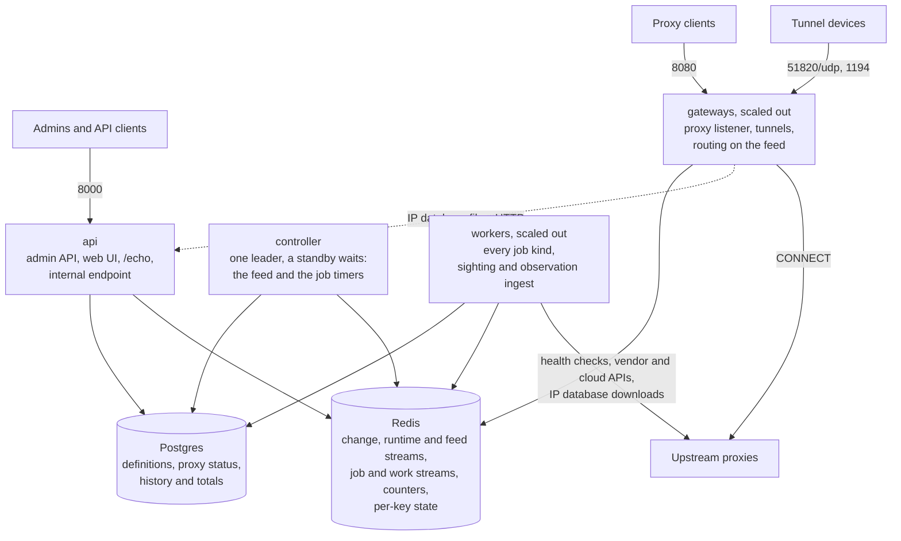
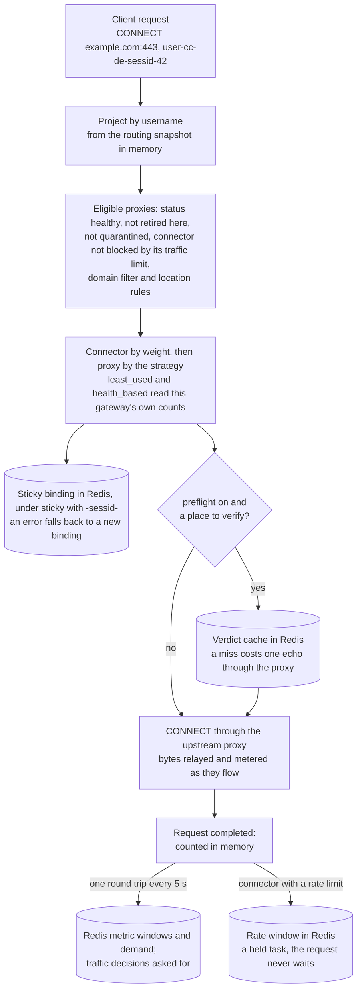
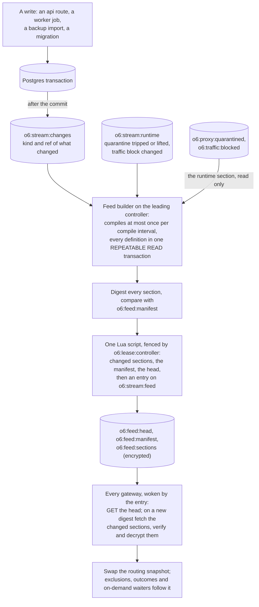
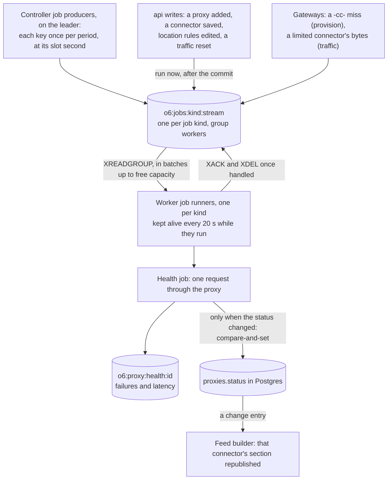
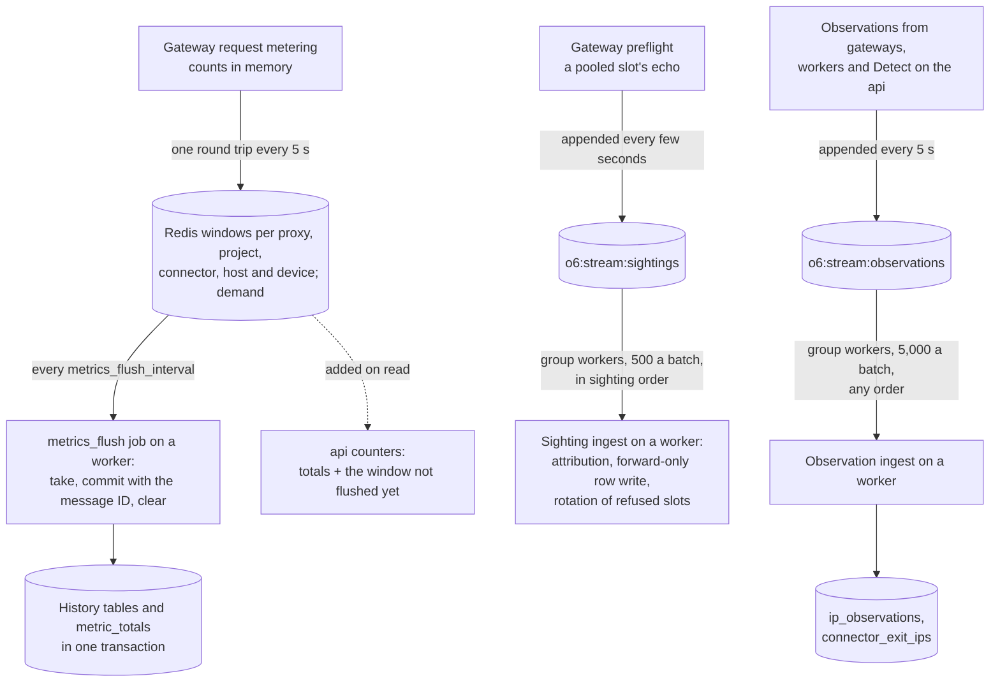
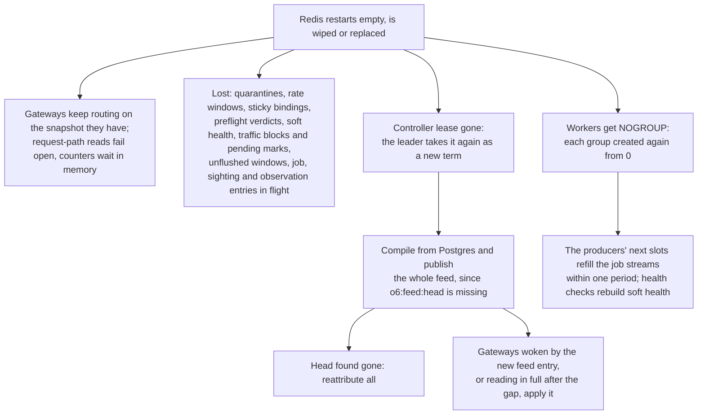

# Architecture

<p class="subtitle">One image, five roles and two shared stores. Processes hand each other news and work on Redis streams: producers append, consumers read, and every handler is safe to run twice. No process ever calls another, so the cost of a replica never depends on how many replicas there are.</p>

Octoprox runs as a set of **roles**. Every role is the same image and the same command (`uvicorn api.main:app` on port 8000); `OCTOPROX_ROLE` decides what a process runs. A single instance runs every role in one process (`all`, the default), and a cluster runs each role in processes of its own, scaled on its own. In both shapes the roles talk only through Postgres and Redis, the same way: a single instance is a cluster of one.

## The roles

| Role | What it runs | Ports | Postgres | Scale it for |
|------|--------------|-------|----------|--------------|
| `api` | The admin API under `/api/v1`, the web UI, the public `/echo`, and the internal endpoint gateways fetch IP database files from. Writes go through one service per entity; each announces what it changed on the change stream and asks for the jobs that follow. Reads come from Postgres plus the runtime state in Redis. Connect previews, the traffic split, Detect and a manual IP database download run here. | 8000 | yes | Admin and API traffic, `/echo` when no echo role serves it |
| `gateway` | The proxy listener, and the tunnel endpoints when enabled. Routes every request on the routing feed it follows in memory; preflight, TLS interception, request metering and the failure log run here. It publishes request counts, rate-limit trips, preflight sightings and IP observations to Redis. Holds no database credentials. | 8080, 51820/udp, 1194, plus 8000 for probes | no | Proxied connections and bandwidth |
| `controller` | Builds the routing feed from Postgres and publishes it, and runs the timers that publish the periodic jobs. Nothing else. One process leads by a lease; the other only waits. | 8000 for probes | yes | Nothing: two small replicas, for failover |
| `worker` | Every job kind: health checks, provider syncs, cloud scaling, on-demand country groups, re-attribution, exit lookups, traffic decisions, metrics flushes and compaction, system snapshots, IP database downloads, tunnel last sightings and index hygiene. It also ingests the gateways' preflight sightings and every process's IP observations. | 8000 for probes | yes | Proxies to check, connectors to sync and scale, traffic to flush |
| `echo` | `/echo` alone, for IP attribution, on a public host. No Postgres, no Redis, no secret. | 8000 | no | Echo requests |
| `all` | Every runtime above but echo, in one process. The default. | all of the above | yes | One host |

A process of role `all` runs the api, gateway, controller and worker runtimes side by side, and they still pass everything through Redis and Postgres as separate processes would, so a single instance exercises the same paths as a cluster.



The one HTTP call between roles is a gateway fetching an IP database file from the api's internal endpoint, and it happens only when the routing feed lists a file the gateway does not have yet (with a shared `geo_data` volume, never). It is a download of a file named by its checksum, not coordination.

## Five ways processes interact

Everything that crosses a process boundary takes one of five shapes. Each writer pays only for its own writes, and each reader for its own reads.

| Shape | Who writes | Who reads | Examples |
|-------|------------|-----------|----------|
| **Follow the change stream** | Every write that commits a definition appends one entry to `o6:stream:changes` naming what changed | The leading controller compiles the feed on it; every api and worker process reads again the few definitions it keeps | Projects, connectors, proxies, descriptors, attribution settings, IP databases, tunnel devices |
| **Follow the feed** | The leading controller publishes the routing feed: sections in Redis, a head that names them, and an entry on `o6:stream:feed` | Gateways read the head when the entry wakes them and fetch the sections that changed | Projects, connectors, proxies with their status, quarantines, traffic blocks, descriptors, attribution settings, tunnel devices |
| **Publish work** | Producers append entries to a work stream: the controller's timers, any role asking for a run now, gateways' sightings, every process's observations | Workers take each entry once through the consumer group `workers`, and delete it when handled | Health checks, syncs, scaling, traffic decisions, metrics flushes, sightings, observations |
| **Add to shared counters** | Gateways add what they counted to hashes in Redis every 5 seconds | The metrics flush job takes them into Postgres; the api, the traffic job and the scale job read them live | Request counters per proxy, project, connector, host and tunnel device; demand; failure counts |
| **Per-key request state** | The gateway serving a request | Every gateway, by key | Sticky bindings, rate-limit windows, the quarantine set, preflight verdicts, tunnel fake-IP mappings |

Postgres is the source of truth for definitions and for proxy status: health, draining and terminating are a column of the proxy row. Redis holds copies made for distribution, the work in hand and soft state. Any Redis key may vanish, and the system recovers with no manual step (see [Redis loss and recovery](#redis-loss-and-recovery)).

## Streams: producers and consumers

The model is plain:

- **Streams are producers and consumers.** Periodic work is a producer on a timer: the controller publishes each periodic job's keys once per period, and a worker takes each entry once.
- **Duplicates are expected.** A key published twice runs twice, and every handler is idempotent, so no process keeps track of what it asked for.
- **No coordination state.** Nothing is kept per key: no due times, no locks in the job layer, no record of what is queued. A work stream holds the work in hand, and nothing else.

### Every stream

| Stream | Entry fields | Producers | Consumers | Cap |
|--------|--------------|-----------|-----------|-----|
| `o6:stream:changes` | `kind`, `ref` | api and workers, after a commit | the leading controller's feed builder (compiles, at most once per `feed_compile_interval`, entries coalesced); every api and worker process's definitions refresher (descriptors, attribution settings, the IP database list) | about 10,000 entries |
| `o6:stream:runtime` | `kind` (`quarantine` or `traffic`), `ref` | gateways (rate-limit trips), the api (quarantine lifts), workers (the traffic job, when a block changes) | the feed builder (the runtime section) | about 10,000 |
| `o6:stream:feed` | `digest` | the leading controller's fenced publish | gateways (fetch the changed sections) | about 100 |
| `o6:jobs:<kind>:stream`, group `workers` | `key`: a proxy ID, a connector ID, `<connector>:<country>`, a re-attribution scope, or `all` for the install-wide kinds | the controller's job producers (the periodic kinds); a run asked for now by any role; gateways' metering and index hygiene (`traffic`) | workers, one job runner per kind | about 100,000 |
| `o6:stream:sightings`, group `workers` | `item`: a preflight sighting, JSON | gateways | workers (the sighting ingest; forward-only writes) | about 50,000 |
| `o6:stream:observations`, group `workers` | `item`: an IP observation or an exit judgement, JSON | api, gateway and worker processes | workers (the observation ingest; forward-only, order-tolerant writes) | about 100,000 |

The fifteen work streams (thirteen job kinds, the sightings and the observations) are listed once, as `WORK_STREAMS` in `api/db/redis.py`, under the names the System page shows them by (`jobs.<kind>`, `sightings`, `observations`); the System page and index hygiene both read that list, and the log lines about a work stream's consumer group name the stream by it: after a wipe, `Stream consumer group was missing; created again` says `jobs.sync`, not the runner's loop.

There are two kinds of stream:

- **Event streams** (changes, runtime, feed). An entry says what to read again. Readers follow it from positions of their own, kept in memory, and a reader that may have missed entries reads in full, so a lost or repeated entry costs a read at most.
- **Work streams** (each job kind's, sightings, observations). An entry is the work itself. It is taken through the one consumer group, `workers`, in which each worker process is one consumer named after its Redis client's `writer_id` (fresh for each process life), and it is deleted once handled. A work stream therefore holds only the work in hand: queued, running, or waiting to be reclaimed from a worker that died. Its cap only bounds a stream no worker takes, by dropping its oldest entries.

### Following an event stream

Broadcast followers (the controller's feed builder, every gateway's feed follower, every api and worker process's definitions refresher) read with `XREAD COUNT 1000 BLOCK <ms> STREAMS ...`, with `XINFO STREAM` in the same pipeline. They read in full:

- at the start, and, for the leased feed builder, at each new lead;
- after a gap: the stream was trimmed past the position, wiped or recreated, which the stream's first entry and `last-generated-id` show;
- after a failed read, since Redis may have restarted empty;
- every `reconcile_interval` (an hour by default): the net for a write that announced nothing.

Their positions are taken before each full read, so an entry published while it runs is read again rather than missed, and a full read for any reason puts the next reconcile off an interval.

### Taking work from a work stream

Every work stream is taken the same way, by the job runners, the sighting ingest and the observation ingest, one consumer per worker process:

| Step | Command | When, and limits |
|------|---------|------------------|
| Join | `XGROUP CREATE <stream> workers 0 MKSTREAM`, `BUSYGROUP` ignored | at start, and after any `NOGROUP` reply (a wipe): from `0`, so what producers appended meanwhile is delivered |
| Read | `XREADGROUP GROUP workers <writer_id> COUNT <batch size> BLOCK <ms> STREAMS <stream> >` | while there is room (free batches times the batch size) and no reclaim check is due; the block is capped at 20 s, never 0, and only a stop cuts it |
| Complete | `MULTI`, `XACK <stream> workers <ids>`, `XDEL <stream> <ids>`, `EXEC` | once, after the handler or the give-up returns. A completion Redis refuses is logged (`Stream entries not acknowledged; they run again after the claim timeout`) and not sent again: its entries stay pending and run again after the claim timeout |
| Keep alive | a script: `XPENDING <stream> workers <id> <id> 1` to check the owner of each ID, then `XCLAIM <stream> workers <writer_id> 0 <ids> JUSTID` | every 20 s for every entry the consumer holds, those it is running or giving up. An entry another worker reclaimed is never taken back, and is logged once |
| Reclaim | `XAUTOCLAIM <stream> workers <writer_id> 60000 <cursor> COUNT <room>` | every 20 s while there is room, before any read, on its own timer whatever happened before; repeated at once while a reply comes back full. Its own entries reclaimed while it runs them count as kept alive |
| Give up | one pipelined `XPENDING <stream> workers <id> <id> 1 <writer_id>` per reclaimed ID | an entry delivered more than 5 times is logged and run as a give-up batch (the job's `give_up`), held like any batch, then completed; a give-up that raises leaves its entries pending for the next reclaim, and the rest of that reclaim runs |
| Stop | cut the read; batches get 30 s; cancel the rest; `XGROUP DELCONSUMER` only when nothing is pending for it | a clean stop: what was cut is reclaimed by another worker after 60 s, and a consumer left with entries pending is removed later by index hygiene |
| Prune | `XINFO CONSUMERS <stream> workers`, then `XGROUP DELCONSUMER` for a consumer with nothing pending, idle for an hour | the `index_hygiene` job |

The claim timeout is 60 seconds, the reclaim check and the keep-alive come every 20 seconds, an entry gets 5 deliveries, and a stop gives running batches 30 seconds. A turn that fails backs off like every other loop, 1 second doubling to 30; a refresh or reclaim check that fails is tried at its next tick.

- **A handler only does the work.** The base acknowledges and deletes a batch in one transaction once its handler returns, so the stream keeps nothing handled. A handler that raises leaves its batch pending; it is delivered again after the claim timeout, and reads back off meanwhile, so a lasting cause does not pull the whole stream into pending.
- **Giving up is a batch like any other.** The reclaim that would deliver an entry a sixth time gives it up instead: held and kept alive until it returns, then completed and counted as dropped. A job that kills its worker therefore does not go round the fleet, and a batch Postgres keeps refusing is not retried forever. A give-up that raises is given up again by the next reclaim, so a metrics flush that cannot tell whether it committed, because Postgres is away, tries again later rather than losing counts.
- **Why reclaim in pages.** One `XAUTOCLAIM` looks at only ten pending entries for each one it may take, so the check follows the group's cursor and repeats while replies come back full: a crashed worker's whole holding is taken in a check or two, and a dead worker's entries behind busy ones are still reached.
- **No hand-back.** A stopping consumer hands nothing back and reads none of its own pending entries: what it leaves pending is reclaimed by another worker after the claim timeout.
- **No acknowledgement safeguards.** A completion is sent once. One Redis refuses, and an outage longer than the claim timeout, can make an entry run again; handlers are idempotent, and an observation batch can then write its log rows twice, which is accepted.
- **Never Redis's group lag.** `XINFO GROUPS` reports a group's `lag` as null whenever an entry deleted out of order lies past the group's position, which is exactly when a backlog builds. The backlog is the stream's length less its pending count instead.

### Publishing

- **Jobs.** `XADD o6:jobs:<kind>:stream MAXLEN ~ 100000 * key <key>`, 500 keys to a pipeline. The controller's producers raise when Redis refuses a pipeline, so the same second is sent again; a run asked for after a commit goes through the request deadline and never fails the write (see [After the commit](#after-the-commit)).
- **Traffic decisions from metering.** The gateways' metering script appends a `traffic` entry for each limited connector a window carried bytes of, inside the script that adds those bytes, so a part sent again after a lost reply asks for nothing more.
- **Sightings and observations.** Gateways and every process append them in batches with an identity of their own (`o6:applied:<writer>` remembers the highest batch Redis applied), so a batch sent again after a lost reply lands once. One part of 5,000 items of about 1 KB takes 20 to 25 ms of Redis time.

## A proxied request

A gateway answers a request from memory and from per-key state in Redis. It never waits on Postgres.



Every Redis call on the request path runs under the request deadline (`redis_request_timeout`, 2 seconds) and fails open: a sticky lookup that fails binds the session afresh, a verdict cache that fails costs one echo, a rate window that fails lets the request through, and counters wait in memory, bounded, until Redis answers again.

The proxy and tunnel listeners hold the gateway's router and request metering themselves, each a class with one implementation: of the router they ask the project, the upstream for one request and why none was found (rate-limit quarantines answer 429, connectors over their traffic limit their own status), and of metering a meter per transfer, finished when the transfer is over.

## The routing feed

Everything a gateway routes on reaches it through one feed. A write anywhere announces itself on the change stream after its commit; the leading controller compiles the definitions and publishes the sections that changed; every gateway follows.



- **Change entries.** After its commit a write appends one entry naming what changed. An entry only says what to read again, so a duplicate costs a read; a write that changed no row announces nothing. The entry is kept and sent again until Redis takes it. What announces nothing (a crash between a commit and its entry, manual SQL) is caught by the reconcile: every follower reads in full once per `reconcile_interval`.
- **Coalesced compiles.** A change after a quiet spell is compiled at once; changes that arrive within `feed_compile_interval` of the last compile wait and are compiled together, however many. Runtime entries are acted on meanwhile, on the compile in hand. A new lead compiles at once, and publishes nothing before a compile of its own: a process that leads again while Postgres is away would otherwise roll the feed back to what it compiled before.
- **One snapshot.** A compile reads every table the feed carries in one read-only REPEATABLE READ transaction, so the sections come from one snapshot however many writers commit meanwhile. The builder takes its change stream position before that snapshot, so a write the snapshot misses was announced after the position and is compiled next.
- **Sections.** One global section (projects, custom provider descriptors, attribution settings, the IP database list, tunnel settings and devices), one section per connector (the connector, the countries it declares, its proxies with their status, and the credential its requests are rendered from, less any secret no template reads, such as a vendor account's API token), and one small runtime section (the quarantines and traffic blocks of the moment). A change travels only in the sections it touched: editing one connector republishes that connector's section, a health flip republishes the section of the proxy's connector, and a rate-limit trip or a traffic block republishes only the runtime section, however large the pool. Carried in their connector's section, quarantines would send every gateway the whole pool again on each trip: 51 ms to decode 5,000 rows, against 0.5 ms for a runtime section of 2,000 quarantines.
- **The runtime section is a read.** It holds the quarantines (ended ones skipped) and the traffic blocks as Redis holds them, filtered to what the compile holds; the builder writes neither. Every runtime entry asks for the section again, whatever its kind: the stream carries only quarantine and traffic entries, so the builder tells entries apart by stream, not by kind.
- **Fenced and atomic.** The publish is one Lua script that checks the controller lease is still held by the process publishing, writes the changed sections, drops the removed ones, and writes the manifest and the head; when the head changed it appends the head's digest to `o6:stream:feed`, which wakes the gateways. A stalled former leader can never roll the feed back, and the manifest and the sections never disagree. A publish that finds another holder marks the lease lost at once.
- **Sealed.** Each section is stored compressed and encrypted with AES-256-GCM, and listed in the manifest under an HMAC-SHA256 of its JSON; the head carries an HMAC of the whole manifest. The cipher key and the digest key are drawn from `OCTOPROX_INTERNAL_SECRET` by HKDF under labels of their own, as is the token gateways present to the api's internal endpoint, so no two of them coincide. Reading Redis without the secret reveals nothing the sections carry (upstream and project credentials, descriptor account keys, tunnel server keys), and writing Redis without it makes no section a follower accepts. The secret is not the JWT secret, so a gateway that holds it can sign no user session. The digest is of the plaintext, so a section compiled again unchanged keeps its digest though every encode picks a fresh nonce, and is neither rewritten nor fetched again. A gateway applies nothing it cannot verify: a missing or altered section, or one sealed with another secret, leaves it on the snapshot it has. It never applies a partial or empty feed.
- **Nothing that changes by itself.** No latency, failure count or usage travels in the feed, so sections change only when definitions, statuses, quarantines or traffic blocks do. An idle install publishes nothing. The stored feed is trusted only when the head, the manifest and the sections agree and were written with this process's secret; otherwise it is written again in full, which is how a wiped Redis, a lost key or a rotated secret is repaired with no special case.

**What a compile holds.**

- Every list in one order (by ID; proxies by creation time, then ID), so unchanged definitions compile to the same JSON and the publisher has nothing to write.
- Proxies with their credential placeholders filled, their status as the column holds it, and the metadata no gateway reads left out; connectors without their error bookkeeping, disabled and pending-deletion ones included, which the router skips.
- A row built from a provider template keeps its secrets out of the proxies table: its username or password holds `{key}` placeholders, filled from the credential's and the connector's configuration wherever the row is used. One function fills them for every user, so none can disagree: the compiler for the stored rows, the gateway router for a row rendered per request (rendering puts the placeholders back), and the attribution store for the rows its lookups go through. The connector's value wins when both have the key, only a non-empty string fills a placeholder, and a placeholder nothing fills stays as it is.
- A connector whose provider is gone is left out, logged once (`Connector left out of the feed: its provider is gone`): its rows cannot be served as their provider meant them. A provider that cannot be built (a stored config its descriptor rejects, a broken plugin) serves its rows as stored, and a project whose stored strategy no router has is served with the install's `default_strategy` (`OCTOPROX_DEFAULT_STRATEGY`), logged once (`Unknown routing strategy served as the default`). The compiler is the one place that decides it: routers build the strategy the feed names, and have no fallback of their own. The setting itself must name a strategy routers have: every role refuses any other at start.
- Every process builds a connector's descriptor provider one way (`ProviderRegistry.descriptor_provider`): the compiler, the api's read model and the provision job from the stored rows, a gateway from the section's connector and credential. So the declared countries and the shipped credential the compiler derives from a provider match the provider a gateway builds. Each keeps its own rule for one that cannot be built: the compiler serves the rows as stored, a gateway logs it and routes the rows as the feed has them, the read model shows a config the provider rejects as no provider and fails the request on any other error, and provision fails the job, which is delivered again.
- No secret a gateway does not need: cloud keys, vendor account API tokens, the OpenVPN CA key, devices' private keys and IP database download credentials stay in Postgres. A database's entry has no schedule or last refresh, and a tunnel device's no last sighting, so neither moves the feed. Config-file IP databases have no row and stay each process's own.
- The api's preview compiles one project the same way, on a compiler that holds no store (`FeedCompiler`), so it applies nothing to the api's registry and keeps nothing. The controller's (`FullFeedCompiler`) extends it with the whole feed, the stores it applies the rows to first, and the ids its last compile holds for the runtime section.

The code lives in `api/feed`: `models` (what a section carries), `compiler` (the sections from Postgres: all of them on the controller, one project's for the api's previews), `codec` (seals sections for Redis and checks them), `sections` (fills credential placeholders), `publisher` (the controller's fenced write), `follower` (the gateway's read) and `state` (`RuntimeStateReader`, the runtime state other roles keep in Redis, read alike by the feed builder, the jobs and the api).

A saved change therefore reaches every gateway within moments of its commit: the builder reads the entry at once, compiles it (later by up to one compile interval during a burst of writes), publishes, and every gateway is woken by the publish. The api answers from Postgres directly, so whoever made the change sees it at once, whichever api answers. Other api and worker processes read again the few definitions they keep (custom descriptors, attribution settings and the IP database list) as soon as the entry reaches them.

## The controller

Two replicas run; one leads by the controller lease, and the leader runs the feed builder and one job producer per periodic kind. Each loop of a standby waits for the lease in the process and touches neither Redis nor Postgres. A standby leads within a poll (a second) of a clean stop, which releases the lease after every loop has stopped, and within the lease's TTL plus a poll (about 31 seconds) of a crash. The controller reads Postgres (the compile) and Redis (the streams, the runtime state, the job streams it appends to), and speaks to no other process. It seeds nothing: the api seeds the tunnel settings rows a fresh install lacks.

- **Readiness.** A controller is unready while its lease cannot reach Redis or, as leader, while the feed cannot be published; a standby is ready. Losing Redis loses the lease until Redis answers; losing Postgres keeps the feed and the producers going on the last compile.
- **A head found gone.** A publish that finds no head in Redis (a first start, the switch from 5.x, a wiped Redis: the builder cannot tell them apart) asks for `reattribute all`, owed until Redis takes it. Nothing is asked for traffic: the blocks went with Redis, and metering asks again once a limited connector carries bytes.
- **Job keys.** Each compile makes the keys the producers publish, so no producer reads Postgres: `health` is every proxy of an enabled connector that is not leaving the pool (draining or terminating) and not a dynamic-sessions gateway row, whose vendor session changes per request, so no single exit speaks for it; `sync` is every enabled connector whose provider syncs; `scale` is every cloud connector, enabled or not, since a disabled or deleted one is drained and emptied by its scale job.

### The job producers

Each periodic kind has one producer on the leader, a loop with a cycle every second, the first at once at each lead.

- **Each key has a slot second.** A key's slot is `int(stable_jitter("<kind>:<key>") * period)`, a blake2b digest of the key, the same on every process. The key is published at every epoch second whose remainder by the period is its slot, so a kind's keys spread evenly over the period: 20,000 health keys over a minute are about 333 entries a second.
- **A lead change costs nothing.** A new leader goes on from the current second, so a lead change delays no kind by a period and the hourly kinds keep their hour however often the lead moves. A key whose slot second falls in the handover gap waits a period.
- **No burst after a stall.** A cycle publishes the slots of every second after the last one published, up to now, at most five of them; older seconds wait a period. A whole period at once (20,000 health keys) would ask the workers' autoscaler for a hundred workers for nothing.
- **Nothing lost to a refusal.** The last second moves only once the publish returned, so a publish Redis refused is sent by the next cycle; otherwise a missed `sync` slice would wait an hour.
- **Keyed and install-wide kinds.** Health, sync and scale publish the last compile's keys and nothing before the first; the install-wide kinds publish the one key `all` from the start.
- **Periods.** Health `health_check_interval`, sync `ip_refresh_interval`, scale 30 s, metrics flush `metrics_flush_interval`, compaction 3600 s, snapshot `system_metrics_interval` (no producer at 0), IP database updates `geo_updater_interval`, tunnel last seen 10 s (the gateways' status interval), index hygiene 60 s; whole seconds, at least 1.
- **Clocks.** The leader's wall clock picks the slot seconds, so a failover between controllers whose clocks differ may publish a slot second twice or skip it once; a skipped key waits a period.

## Jobs

Recurring and one-off work is a message on its kind's job stream. The controller's producers publish the periodic kinds; any role asks for a run now by appending a key; workers run every kind.



| Kind | Key | Published by the controller | Asked for at once by | Batch x concurrency per worker |
|------|-----|-----------------------------|----------------------|--------------------------------|
| `health` | proxy | every `health_check_interval` | a proxy added | 10 x max(2, 4 x probes / 10): 200 keys at the default 50 probes |
| `sync` | connector | every `ip_refresh_interval` | a connector created or edited; synced proxies deleted | 1 x 4 |
| `scale` | connector | every 30 s | a cloud connector created, edited or deleted; a cloud proxy marked terminating | 1 x 4 |
| `provision` | `<connector>:<country>` | never | a gateway's `-cc-` miss | 1 x 4 |
| `reattribute` | `all`, `project:<id>` or `connector:<id>` | never | a change to what attribution consults, a new IP database file, the **Re-attribute** button, a feed head found gone | 100 x 1 |
| `enrich` | proxy | never | a static proxy added without a country | 1 x 5 |
| `traffic` | connector | never | metering that carried a limited connector's bytes; a traffic reset or a limit edit; index hygiene, for every blocked or pending connector each minute | 100 x 1 |
| `metrics_flush` | `all` | every `metrics_flush_interval` | never | 1 x 1 |
| `compaction` | `all` | every hour | never | 1 x 1 |
| `snapshot` | `all` | every `system_metrics_interval` | never | 1 x 1 |
| `geo_update` | `all` | every `geo_updater_interval` | never (**Download now** runs in the api) | 1 x 1 |
| `tunnel_last_seen` | `all` | every 10 s | never | 1 x 1 |
| `index_hygiene` | `all` | every 60 s | never | 1 x 1 |

`OCTOPROX_WORKER_JOBS` limits the kinds a worker takes (every kind by default), so a set of workers can be given to health checks alone and never hold up syncs and scaling, or `geo_update` can run on workers sized for its downloads. Every kind needs at least one worker taking it.

### How a worker runs jobs

Each worker process runs one job runner per kind it takes, a consumer of that kind's stream. While it has room it reads a batch of the job's batch size; its room is the job's free batches times its batch size, so batch size times concurrency is one worker's capacity for the kind, the threshold the workers' autoscaler uses (see [Running on Kubernetes]({{ site.baseurl }}/kubernetes#scaling)).

- The batch a job gets carries every entry's ID and each key once: a key appended twice and read together runs once, and every entry is completed when the job returns. An entry without a key is logged and completed.
- A run that raises leaves its entries pending; this worker or another takes them after the claim timeout, and the sixth delivery gives the batch up instead: the runner logs its keys (the entries' IDs say nothing once they are deleted) and calls the job's give-up, then the batch is completed.
- Each batch is one run of the kind in the job stats, and a failed batch one failure.

**Sizes, per worker process.**

- *health, 10 x max(2, 4 x probes / 10):* a batch ends with its slowest check, and a proxy that hangs holds its batch for the whole check timeout, so batches are small, and a worker holds four keys per probe slot so that the slots fast checks free are refilled while some batches wait on a hung proxy. With the default 50 probes, 20 batches of 10. A model of the runner gave about 3 checks a second per worker with two batches as large as the probe bound once 5% of proxies hung; this gives about 14, against 16 with no slot idle. The probe bound itself is shared by every batch of the worker.
- *sync, 1 x 4:* a sync can take minutes (a port scan through the vendor, a long list) and holds up no other connector's.
- *provision, 1 x 4:* a run is short, and runs for one connector take turns on its row lock.
- *reattribute, 100 x 1:* a burst of asks (a database file and two settings saves) read together runs as one pass per scope, and `all` covers every other scope of its batch; one batch at a time, since passes over overlapping scopes only repeat each other. A batch first reads the settings and the database list again, so it judges with what was committed before it was asked for.
- *enrich, 1 x 5:* one proxy per run, so a lookup waiting out the echo endpoint's timeout holds up no other.
- *traffic, 100 x 1:* a burst of asks for the same connectors, read together, is decided once each.
- *the install-wide kinds, 1 x 1:* one entry a period, one run at a time.
- *sightings, 500 a batch, one batch at a time:* a batch costs three reads and one write transaction whatever its size, and 500 keeps that transaction to a second or two.
- *observations, 5,000 a batch, one batch at a time:* one transaction per batch.

### Idempotency per kind

| Kind | Why a duplicate, a redelivery or two runs at once do no harm |
|------|---------------------------------------------------------------|
| `health`, `enrich`, `reattribute` | Re-checks. Soft health is last-writer-wins; statuses move by compare-and-set from the status the batch loaded, so a duplicate check moves a status at most once; attribution writes are bounded by the row's `location_checked_at` stamp, so a late or repeated judgement never overwrites a newer one. |
| `sync`, `provision` | Upserts on natural keys, deletes by ID. Rows a job builds are inserted with insert-or-skip on their ID, so a row whose ID derives from what it stands for (a cloud instance) lands once whoever saves it. A sync writes its edits as updates by ID and its removals as deletes by ID, and adds only what the pool lacks when it reads it. Session slots carry random session IDs and have no natural key: two syncs of one pool at once can both add the missing slots, and the next sync trims the surplus. Provision's key is a connector and a country, which no unique index can hold, so it keeps the connector's row lock around its check and insert. |
| `scale` | The creating hash, one tag per instance, termination of unrecorded instances and idempotent termination; see [Cloud scaling](#cloud-scaling). |
| `metrics_flush` | The take: a staging hash per message, committed with the message ID under a unique key; see [The metrics flush](#the-metrics-flush). |
| `traffic` | A compare-and-set of the stored decision: the blocks hash and the runtime stream change only when a decision does, and two workers deciding alike append one event. |
| `compaction` | Set-based: each tier is one statement that aggregates exactly the rows it deletes. |
| `snapshot` | A reading is stored only when the newest is at least nine tenths of the interval old. |
| `geo_update` | Downloads what is due by the rows; two runs at once download twice, harmlessly. |
| `tunnel_last_seen` | Last sightings only move forward. |
| `index_hygiene` | Each prune checks and removes in one step; the traffic decisions it asks for are run-now entries like any other. |

Quarantines are no job: the gateway writes the sorted set (`ZADD GT`, so a longer quarantine is never shortened) and appends a runtime entry in one transaction, and the api lifts them the same way.

### The metrics flush

The producer publishes one entry every `metrics_flush_interval`; any worker takes it, and the entry's ID, `M`, names the flush.

1. **Recorded already?** A delivery whose `M` is in `metric_flushes` only deletes its staging hash. It takes nothing, so no window is taken under an ID that can no longer commit.
2. **Take.** Every live window moves into the staging hash `o6:metrics:taken:<M>`. For each window key not staged under `M` yet, one script stages the window's fields, deletes the window and takes it out of its index, in one step, so no increment lands between the read and the delete, and a window metering recreates goes to the next flush. A key whose window is empty or gone is only unlisted. The staging hash expires after a day, and is read back in pages of 1,000 fields, since thousands of host windows would otherwise come back as one reply of tens of megabytes.
3. **Commit.** The taken proxies' statuses are read in a transaction of their own (a proxy's history row records its status). Then one transaction records `M` first (`INSERT ... ON CONFLICT DO NOTHING`); when that inserts nothing, another delivery committed the flush and this one writes nothing. Otherwise it writes one multi-row insert per history table and adds the same windows to the totals, for the entities still there.
4. **Clear.** The staging hash is deleted.

- **A redelivery** (same `M`) takes only what is not staged yet, reads back all it holds, and commits each window once. A window staged already is never overwritten.
- **Two flushes at once** take disjoint windows, and each commits once.
- **A give-up** (five deliveries) reads `metric_flushes` for `M`: committed, it clears; not committed, it adds the staged counts back to the live windows by each field's type (`HINCRBY` for counters, `HINCRBYFLOAT` for the latency sum, since Redis refuses `HINCRBY` on a fraction) and deletes the staging hash, in one `MULTI`, and the next flush writes them; Postgres unreadable, it raises and is given up again by the next reclaim. A Postgres outage loses no counts, and a flush that committed on its fifth try is never written twice.
- **Readers of the live windows** (traffic decisions, the scale job's drain check, the api's live usage) miss the counts in flight for the flush's length: an undercount of seconds, never a double count.
- **The known gap:** a worker stalled past the claim timeout in the middle of a flush runs beside the worker that reclaimed its entry. `M`'s record lets one of them commit; windows the stalled one takes after the other has read the staging hash are deleted with it: a few seconds of counts, after a stall of over a minute.
- `metric_flushes` rows older than a day are deleted by compaction. A flush that took nothing records nothing, so an idle install writes no row a minute.

### Traffic decisions

A connector's block is decided by the `traffic` job, on whichever worker takes the entry, 100 connectors a batch. Three producers ask:

- the gateways' metering script, in the same script as the bytes, for each limited connector a window carried bytes of;
- the api, after a traffic reset or an edit that changes what decides the block (the limit, its action, the period or the reset day), in one `MULTI` with the connector's pending mark;
- index hygiene, each minute, for every connector in the blocks hash or the pending hash, each once.

**What a decision reads.** First the pending hash (`o6:traffic:pending`), the requests this batch answers; then the batch's connectors, in one query (one gone, or without a limit, decides "not blocked"); then the history in each limited connector's usage window (the period, cut at a manual reset inside it), in one query; then their live Redis windows, in one pipeline. The history comes before the live windows, and the order matters: a metrics flush takes a window out of Redis before it commits the counts to Postgres, so a count is live, in flight or in the history, never in two at once. Reading the history first can miss a flush in progress, an undercount of seconds until the next decision; the other order could count a flush's bytes twice and block a connector under its limit.

**What a decision writes.** One `SET_BLOCK` script call per connector, pipelined. The script first deletes the connector's pending mark while it still holds the value the job read (a request made after the reads started holds a newer mark and waits for its own decision), whether or not the decision changes. Then it compares the stored block with the decision; only when they differ does it set or delete the connector's field in `o6:traffic:blocked` and append `kind traffic ref <connector>` to the runtime stream, for the feed builder. So the hash and the stream change only when a decision does, a repeated ask writes nothing, and an entry past its period, or of a deleted connector, is removed by its next decision. The order of the pending mark against the reads is Redis's own, so no two hosts' clocks are compared, and the api never reads "not pending" beside the old decision.

**Logs.** The worker whose write changed the hash logs the block or the release, once per change: `Connector blocked by its traffic limit` (warning, with `until`) and `Connector released from its traffic limit` (info, with a `reason`: `under_limit`, `alert_only`, `no_limit` or `deleted`). Approaching the warning line and reaching the limit are logged once per usage window per worker process, from process memory, so N workers may log a transition N times and a restart logs it again.

**What can go wrong, and why it settles.**

- A decision Postgres cannot give raises before anything is written; the batch is delivered again after the claim timeout, and the hash keeps its last decisions meanwhile. A batch given up after five deliveries decides nothing; the minute's re-check and the next metering ask cover it.
- Decisions read on either side of a flush or an edit can land in either order; the hash is last-writer-wins, and the minute's re-check settles it. A lost lift, a decision made before an edit but written after it, and a job given up while Postgres was away hold a block, or a pending mark, for at most a minute.
- A decision made while a flush has taken a connector's counts but not committed them misses those bytes, and nothing asks again until the connector's next metering window that carries bytes (index hygiene decides again only connectors already blocked or pending), so a block can land up to one metering window late. Accepted.
- A usage reset counts from the moment it commits, but the live windows a decision adds hold traffic metered before it, and the flush stamps those counts with its own time, after the reset. So up to one flush interval of earlier traffic counts after a reset, and a reset right after a block can leave the block in place until the user resets again, a minute later. This is a known gap that 5.x shared, since it counted the same way; the fix comes after the 6.0 release.
- After a Redis wipe the blocks and pending marks are gone and gateways serve; metering asks again as soon as a limited connector carries bytes.

The rules live on two classes: `TrafficConfig.period_bounds` and `usage_window` give the window, next to `cost_of`, and `ConnectorTraffic.status` and `block_until` judge one window's total, so the api's usage status and the job's log lines read the same property.

### Cloud scaling

Every cloud connector, enabled or not, gets a `scale` run about every 30 seconds, and one at once after a connector create or edit and after a cloud proxy is marked terminating. Each run, for one connector:

- **Lists the instances only when needed.** A run asks the cloud for the connector's instances only while the connector is pending deletion, while its creating hash holds any entry, fresh or stale, and once its last successful listing is over an hour old. The time of that listing is a field of the autoscaler hash, written only after a listing succeeds, so a failed listing is tried again by the next run, and a lost hash makes the next run list. Any other run lists nothing, as after a failed listing: it terminates nothing unrecorded, clears no stale entry and deletes no connector. So an instance with neither a row nor an entry (Redis lost its creator's entry, or a creator slower than 600 seconds found its entry cleared and saved no row) is terminated within the hour, while a creator killed or stopped in the middle of a create keeps every run listing until its entry turns stale. 5.x called the cloud only to create or terminate; 6.0 adds one listing an hour per cloud connector, and one a run while a create is under way or the connector is being deleted.
- **Reads, in this order:** the instances the cloud lists for the connector, when the run lists them (pending and running, by its `octoprox-connector` tag), the creating hash `o6:scale:creating:<connector>`, then the connector's rows. A creator writes its entry before the create and saves its row before it clears the entry, so an instance the listing shows was created after its entry was written, and the hash read after the listing holds that entry; if the creator finished in between, the rows read after the hash hold its row. Read in any other order, a creator starting or finishing between two reads looks unrecorded. A failed listing is logged at warning and the run goes on, terminating nothing unrecorded and deleting no connector.
- **Unrecorded instances:** every listed instance, booting or running, with neither a row nor an entry newer than 600 seconds is terminated and logged at warning (`Terminating a cloud instance with no row`) with its name: its creator died or lost Redis before saving a row. Unrecorded instances are terminated, never adopted, which costs one extra instance boot after a worker dies in the middle of a create or a Redis wipe.
- **Stale entries** (older than 600 seconds) are settled from the same listing. The run counts a stale entry as none when it terminates the unrecorded instances, so its instance, listed and without a row, is terminated with them. Then it clears every stale entry, except when the listing failed or the termination of that entry's instance failed. So an instance with a row (its run saved the row, then died before clearing the entry) is kept and its entry cleared, and an entry whose instance is gone, or never came, is cleared. While listings fail, stale entries stay, so a stale `scale` entry holds the connector's scaling step, and a stale `rotate:<id>` entry its proxy's rotation, until a listing succeeds. There is no lookup by name: one path serves every instance without a row.
- **Disabled, or pending deletion:** every instance is drained, then the drained ones terminated. A connector pending deletion is deleted once a run finds no rows, no creating entries and an empty listing; unrecorded instances are terminated first, so a later run's listing is empty, and a failed listing holds the deletion: a connector removed after its credential stopped working stays pending deletion, its listing failure logged at every run, until the credential works again or its row is deleted by hand. Once the job deletes the connector, or finds it gone, it deletes its autoscaler hash and its creating hash.
- **Scaling:** the project's demand, with hysteresis, sets a target between the connector's minimum and maximum; the pool moves towards it a bounded step at a time (a third of the range up, a sixth down), new instances first, retired ones drained. The step waits while the connector backs off after cloud errors (2^errors minutes, up to 30), while its traffic limit blocks it (a blocked connector takes no requests, and the rejections would read as demand), within three minutes of the last scaling action, while any instance initializes, and while any `scale` entry of the creating hash remains. Scale-up needs traffic in the last minute unless the pool is below its minimum; scale-down waits until the job has watched a whole demand window. Demand is the requests and rejections the gateways' metering counts per project and minute, in one small Redis hash per project and minute whatever the traffic. Its rate over the five-minute window is the usual sliding-window estimate: the current minute with what it holds so far, the minutes before it in full, and the oldest for the share of it still inside the window, exact while traffic is steady.
- **Rotation:** each instance is replaced at a random time between the connector's rotation periods, its replacement created before it drains; a proxy whose `rotate:<id>` entry exists is not rotated again.
- **Draining:** an instance is terminated once its counters (flushed totals plus the live window) stood still over two checks in a row. A flush takes counts out of the live window a few seconds before it commits them to the totals, so one equal reading can hide traffic; flushes come a minute apart and checks 30 seconds apart, so two equal readings in a row cannot.
- **Terminating:** the cloud instance is deleted, then its row.

**Overlap is the normal case.** A create waits until the instance runs, longer than the 30-second period, so the next run of that connector starts beside it on another worker. Every rule holds under overlap, without locks, but for the known gaps below:

- **Before a create** the run writes the entry `<name> {"purpose", "at"}` into `o6:scale:creating:<connector>` (`purpose` is `scale` or `rotate:<proxy id>`) with the `HOLD` script below, **then reads the connector again**: gone, disabled or pending deletion, it logs `Creating no instance: the connector was disabled or removed`, clears its entries and creates nothing. A deletion run deletes a connector only when it finds no entry, and it reads the connector before the hash, so either it finds the entry and waits, or the removal committed before the entry was written and the read after the entry sees it: no instance outlives its connector. It costs one Postgres read per create.
- **After the create** the creator checks that its entry is still in the hash. Still there, it saves the row (insert-or-skip on the ID the instance gives the row); gone (Redis lost it, or a run found it stale and terminated the instance), it saves no row and logs a warning, and a later run terminates the instance if it still runs. Either way the creator then clears its entry; a create that saved no row is not counted as scaled and records no error. A create cut short by a worker's stop (a clean stop cancels a run still going after its 30-second grace) leaves its entry as a crash does: a step clears only the entries of the creates it never started, and a rotation clears none. So every run lists while the entry stands, and once it is stale a run's listing terminates the instance unless its row was saved; meanwhile a `scale` entry holds the connector's scaling step, and a `rotate:<id>` entry its proxy's rotation.
- **Capacity:** a `scale` entry counts as an instance being created, so a run beside it takes no scaling step, and a `rotate:<id>` entry as its proxy being replaced. Runs often start together (a reclaim starts every entry it takes at once, and a backlog of one connector's entries starts several runs within milliseconds), so two checks make that hold for them too.
  - *The run's own read.* Any `scale` entry in it holds the step, and any entry for a proxy its rotation, stale ones too while they stay.
  - *The `HOLD` script*, one call per write: it writes an entry under each name it is given only while the hash holds no fresh entry of the same purpose under another name, and a refused write skips the step or the rotation. So of the runs that reach a step, or a rotation of one proxy, together, one creates, with no lock and no other key.
  - *A step* writes the entries of all its instances before its first create, then reads the connector's rows again: when they no longer hold as many active instances (neither draining nor terminating) as the run read at its start, it clears its entries and leaves the step to the next run, logged at debug (`Skipping scaling: the connector's instances changed since the run read them`). Another run's whole step, its creates included, saves its rows before it clears its entries, so a step that ended between this run's read of the rows and its write shows in that read. It costs one Postgres read per step. Before each further create, a step writes the entries still to create again, so a step longer than 600 seconds keeps them fresh. A step whose entries went stale (a create slower than 600 seconds) and that finds another run's step under way ends, logged at warning (`Ending a scaling step: another run is creating instances`).
  - *A rotation* reads the proxy's row after its entry is written. A run replacing the proxy drains the row before it clears its entry, so a rotation written after another run's whole rotation of the proxy finds the row drained and creates nothing.
- **Termination is idempotent on every cloud:** an instance already gone, or stopping under another delete, counts as terminated, and the call returns once the cloud reports the instance stopping (GCP and Azure wait for their delete operations). Two runs that both found a proxy terminating both terminate it, and neither records an error.
- **The autoscaler hash** (`o6:autoscaler:<connector>`: rotation times, the last demand level, each draining instance's baseline and quiet checks, the last scaling action, the last successful listing) is last-writer-wins: each run writes it back whole, as it read and changed it. A field one run overwrites shifts a drain baseline or a rotation time by a run, or brings the next listing forward. A run that saves its state after another run's step erases that step's cooldown rather than shifting it; the other run's new instances, still initializing, hold the next step meanwhile. Losing it is safe: rotation times are drawn again, drains take a new baseline, the next run lists, and nothing is scaled in until demand has been watched for a whole window, since demand read after a wipe looks like none.

**Cloud instances.** Each instance is named `<instance_name>-<epoch s>-<6 hex>`, the prefix cut to the cloud's limit: 64 characters on AWS (the launch's client token, so a retried launch returns the same instance), 63 on GCP (instance names), 64 on Azure (Linux VM names, so `-osdisk`, `-nic` and `-pip` stay within their 80). Every instance carries one Octoprox tag, `octoprox-connector=<connector id>` (an AWS tag, a GCP label, an Azure tag), which the connector's own tags never replace. Proxy credentials are random per instance and live only in its start-up script (AWS user data, GCP `startup-script` metadata, Azure custom data), as in 5.x; no tag, label or other metadata item holds them. A run that lists makes one listing call: AWS one `DescribeInstances` by tag, GCP one `instances.list` with a label filter, Azure one VM list of the resource group (VMs only, no network reads). A listed instance is known by its creation name, which entries are keyed by, and by the ID its row has or would have (`aws-<instance id>`, `gcp-<name>`, `azure-<name>`), which rows are matched and terminations addressed by.

**Why no credentials in the cloud.** Adopting an unrecorded instance would have meant saving a row Squid accepts, and so carrying each instance's credentials in a tag, where anyone who can read the instances could read them (on Azure that would newly include the Reader role). Terminating it needs only the connector tag.

**Known gaps.** A create slower than 600 seconds, or a Redis wipe between a creator's entry check and its save, can save a row for an instance being terminated: the row fails its health checks and stays unhealthy until a scale-down drains it. After a create slower than 600 seconds, a run that read the step's entries as stale can also clear them after the step wrote them again, so the step's next instance gets no row and is terminated as unrecorded: one more instance boot. An overlapping run can recreate the autoscaler hash of a connector another run just deleted (a few fields with no TTL). Azure's VM list has no power state, so a stopped VM with no row is terminated, while AWS and GCP never list stopped instances. A Failed Azure VM is never listed, so its entry clears and the VM stays, with its `-nic` and `-pip`; so do the `-nic` and `-pip` of a worker that dies between Azure's network and VM calls. An unrecorded instance with termination protection (AWS) or a lock (Azure) fails to terminate, logged at every listing. A failed listing is logged at warning only and tried again by the next run, and a failed termination of an unrecorded instance by the next listing, with no connector error and no backoff; a failed create or row termination records its error on the connector, which then backs off. A create that fails after its cloud launched the instance (it runs without an address, the wait for it times out, or Postgres refuses its row) clears its entry like any failed create, so that instance runs without a row until the next listing terminates it, within the hour; most failed creates are refusals that launch nothing.

### Housekeeping

Five install-wide kinds run on workers like any other job, each published once per period with the key `all`. None keeps a record of what it did: each checks what is needed and does it.

- **compaction** (hourly). Per project, the tiers run in order, one transaction a tier over the six history tables: minutes become hours after a day, hours become six hours after a week, six hours become days after 30 days; a compaction that has not run for weeks catches up in one pass. Each table, tier and project is one statement, `WITH moved AS (DELETE ... RETURNING ...), added AS (INSERT ... SELECT ... FROM moved GROUP BY <series>, <bucket>) SELECT count(*) FROM moved`: under READ COMMITTED a second pass's `DELETE` waits for the first's row locks, then finds the rows gone, so each source row is aggregated exactly once however many passes run. A bucket starts at `floor(epoch / width) * width`, the bucketing the chart queries use; latency is averaged by requests. Then the retentions: per-project metrics past `metrics_retention_days`, the totals of entities that are gone, raw observations past `observation_retention_days` and exit IPs last seen before `exit_ip_retention_days` (read from the worker's attribution settings at each run), and `metric_flushes` rows older than a day. Two passes at once can deadlock only when their scans lock rows in different orders; Postgres aborts one, whose job is delivered again, still folding each row once.
- **snapshot** (every `system_metrics_interval`). The stored readings set the cadence: a run stores a reading only when the newest is at least nine tenths of the interval old, so an entry published twice, redelivered or run after a failover adds no row. The interval is floored at a minute, since each reading runs size queries over every table. Retention runs after each stored reading.
- **geo_update** (every `geo_updater_interval`, an hour). One tick of the IP database updater: it gives back the disk space replaced files hold, then downloads every database whose schedule is due by its row (`last_update_at` plus `update_interval_hours`). A new file of an enabled database asks for `reattribute all`. Workers therefore reach the vendors' download URLs, and hold a download in memory while they unpack it: up to 512 MiB, held twice at the peak. Size worker memory for it, or give `geo_update` to workers of its own through `OCTOPROX_WORKER_JOBS`.
- **tunnel_last_seen** (every 10 seconds). Reads every gateway's published tunnel statuses, takes the newest per device, and moves each device's last sighting forward in one statement per protocol. WireGuard statuses are matched by public key inside the statement (the key is unique, and it is all a gateway knows a device by, so workers need no compile); OpenVPN statuses carry the device ID. With nothing published, the run opens no Postgres session.
- **index_hygiene** (every minute), in four steps: the instance and tunnel carrier indexes lose the members whose keys expired; stopped consumers of the fifteen work streams with nothing pending and idle for an hour are removed (a live worker resets its idle time at least every 20 seconds, and a consumer name is fresh for each process, so only stopped processes qualify, and a stopped worker stays visible on the System page for that hour); ended quarantines are trimmed (`ZREMRANGEBYSCORE o6:proxy:quarantined -inf <now>`; readers skip them anyway); and a `traffic` decision is asked for every connector in `o6:traffic:blocked` or `o6:traffic:pending`, each once, ended entries included. A failed step ends that run, and the next minute's run repeats every step.

### Health checks

A batch:

1. loads its proxies with their connectors and credentials in one query, and leaves alone those that no longer qualify: draining and terminating proxies, those of a disabled connector, and dynamic-sessions gateway rows;
2. reads each proxy's soft health (`o6:proxy:health:<id>`): the failures in a row so far;
3. requests the connector's `healthcheck_url`, else the echo endpoint, else httpbin, through each proxy, a bounded number at once per worker (`health_check_concurrency`);
4. when checks of the echo endpoint failed, makes sure the echo answers at all (below);
5. writes every checked proxy's soft health with a day's expiry, and the statuses the checks changed in one transaction announced by one change entry, so a vendor outage that flips a pool appends an entry per batch, not per proxy. Each is a compare-and-set from the status the batch loaded, never out of draining or terminating, so a check never undoes a drain that landed meanwhile;
6. hands the exits the responses named to attribution.

A passing check makes a proxy healthy and clears its count; a proxy is degraded at its first failed check and unhealthy at the third in a row. A new cloud instance too turns healthy at its first passing check, but for its first five minutes a failed check leaves it initializing; those failures still count towards the three, so an instance still failing when the five minutes are up can turn unhealthy at its next failed check. A lost soft-health hash (a Redis wipe) resumes the count where the stored status says it must at least be, so a wipe never makes a failing proxy look better. A health batch that fails after its probes has already written the soft health; its redelivery probes again, so a failing proxy can reach unhealthy sooner than three periods, never later.

**The echo endpoint's outages.** Every connector without a check URL of its own checks the echo endpoint. While it is down every such check fails, and counting them would take those proxies out of routing though nothing is wrong with them. So before a batch's failed checks of it are judged, the worker asks whether it answers: a check through any proxy that got its answer within ten seconds shows it up; otherwise the worker requests it directly, at most once every ten seconds. While it is down its failed checks are not counted, and the outage is logged when it starts and when it ends.

### Provider syncs and on-demand groups

**A sync**, per connector: reads the connector, its credential and its proxies; refreshes the exits of a port or list pool (an exit that moved is written, one that left the pool's countries or the vendor's list is deleted); reconciles the pool with its configuration (missing slots provisioned, surplus ones deleted); writes the edits, with only the metadata keys the refresh changed, and the deletions in one transaction that asks for no further sync, then the additions, insert-or-skip, in one more; and hands the exits discovery found to attribution once the rows exist. A vendor error or Postgres outage fails the run with nothing written; it is delivered again after the claim timeout. A provider's refresh need hand back only the rows whose definition changed (the IP, the credentials, the country); a row handed back unchanged does no harm but costs a write.

**On-demand country groups.** A gateway's `-cc-` miss on an "All countries" session pool publishes `provision <connector>:<country>` under the request deadline and waits up to 5 seconds for a snapshot carrying the group. A run locks the connector row (`SELECT ... FOR NO KEY UPDATE`, which inserting its proxies does not wait for), re-reads the connector's proxies, does nothing when one already carries the country, and otherwise builds the group (random vendor sessions, fresh IDs) and stores it while holding the lock. Runs for one connector on several workers take turns and add one group; the insert's change entry wakes the feed builder, and the publish wakes the waiting gateways. A key whose country is not a two-letter code is logged and skipped, so whatever writes the stream can add at most one group per code to a pool. An ID derived from the key is not used: it would hand an emptied group's quarantines, soft health and verdicts to fresh sessions.

## Sightings and observations



**The sighting ingest.** A gateway's preflight sees the exit of a pooled session slot on the request path, where nothing may wait for Postgres, so it appends one message per sighting, repeats included, carrying what the attributor needs plus when and by which gateway the exit was seen, and the database answers the request was judged with. Workers read the stream 500 entries a batch; a batch may hold several gateways' sightings out of order, and is applied in `observed_at` order. With the forward-only row writes of the attribution store, a sighting that arrives late never overwrites a newer one, and batches on several workers never mix their writes on a row. A batch that fails is delivered again after the claim timeout and given up after five deliveries; its sightings are lost, and the next sightings of those exits repeat what they saw.

**The attribution store.** Every worker path that learns where a proxy exits (the sighting ingest, the health and sync jobs, re-attribution, enrich) hands what it saw to the attributor with a store holding the batch's rows, read before the attributor runs. The store writes the batch once, in one transaction, rows in ID order: each saved row as a metadata patch of the keys that changed, applied only while the row still holds the `location_checked_at` it was loaded with and never when the save's sighting is older. Only after the commit, and only for rows whose write applied, it announces the write (one change entry), drops the cached preflight verdicts of exits that moved, and deletes the slots the attributor rotated, all of a batch's in one delete that asks each syncing connector for one sync, so a burst of rotations is one sync, not one per slot.

**The observation ingest.** Every api, gateway and worker process records observations in a buffer, and appends it to `o6:stream:observations` every `geo_observation_publish_interval`, sooner when the buffer reaches half full while nothing is owed. Through a Redis outage a process holds the part Redis did not confirm and the buffer, which drops its oldest items once full. Every worker runs one ingest in the `workers` group; each read takes up to 5,000 entries and ingests them in one transaction: the raw log rows, the per-connector exit table (first seen least, last seen greatest, the latest state only from a newer sighting, hand-outs added) and the judgements (on the holder's row only, and only when newer than its last sighting). Every one of those writes only moves forward, so batches go to any worker in any order. A session ID longer than its column (255 characters) and an instance ID longer than 64 are cut, so one client's long `-sessid-` cannot fail a batch five times and lose it. Malformed entries (an older or newer release's, during a roll) are logged and completed with their batch.

**Hand-outs are counted forward-only.** A hand-out is a proxy seen on another exit than the last one counted for it. Each proxy's last counted exit lives at `o6:proxy:last_exit:<proxy>` as `"<observed_at epoch ms> <ip>"`, for a day. Before its transaction a batch runs one script over its observations, oldest first: an observation newer than the record and of another IP is a hand-out; one of the same IP, or not newer, is not; the record moves to every newer observation. Each verdict is made and recorded atomically, so two batches on two workers count a transition once, a redelivered batch counts none, and a late observation counts none. With no record (a new proxy, one idle for a day, a Redis wipe), the exit table decides: an exit new to the connector, or one another proxy held, is a hand-out; the proxy's own exit is not. Accepted: a batch whose transaction fails after its script has its hand-outs moved but not counted, and a batch redelivered after its commit, or after Redis refused its completion, writes its log rows twice (log rows are never deduplicated).

## The gateway

**Request metering.** Every gateway runs one `RequestMetering`, a batch publisher. The proxy and tunnel listeners announce `request_completed` and `request_rejected`; the receivers touch only memory and never raise, so a request's `finally` never waits on Redis. It counts into two things the gateway owns and its router's strategies read: the transfers in flight, and each proxy's outcomes (requests, successes and summed upstream connect latency since the gateway started), recorded for every finished request through a proxy the applied snapshot holds and never sent to Redis. It reads the connectors and traffic blocks through the gateway's router, so it always reads the snapshot in force; the router needs nothing of metering, so the gateway builds it first. It keeps pending deltas per proxy, project, connector, destination host and tunnel device, and demand per project and minute; every 5 seconds one round trip adds them to the Redis windows and demand hashes, and asks a `traffic` decision for every connector with a limit whose window carried bytes, in the same script. What Redis did not answer for is owed and sent again alone before anything newer, so Redis applies it once; an outage costs memory per entity, not per request. Meters report a running transfer's bytes every 1 MiB or 5 seconds, and stop it once its connector is blocked with the interrupt action; there is no local usage estimate, blocks come through the feed. A gateway that stops sends what is owed and pending.

**The failure log.** Every request the gateway could not complete is described (kind, what the client was answered, the vendor's own answer, connector and proxy) and recorded in memory; every 5 seconds the counts go to the failure windows, which the metrics flush takes into `failure_metrics`, and a capped number of distinct examples per project and kind goes to a capped stream per project and kind. Messages are scrubbed of the proxy's credentials and of the queries of quoted URLs. A request the metrics count as failed is logged exactly once, and one that went through is never logged.

**The rate limiter.** Each completed request through a rate-limited connector is counted in the proxy's sliding window (`o6:proxy:requests:<id>`, one script evicting, counting and adding), shared by every gateway. A full window trips the proxy in one transaction: the window starts over, the proxy joins `o6:proxy:quarantined` and a `quarantine` entry goes on the runtime stream, so the controller never reads the entry without the quarantine. The tripping gateway excludes the proxy at once; the others have it within a fraction of a second through the feed. When Redis does not answer, the request goes through: a rate limit is a courtesy to the vendor, not a reason to refuse traffic.

**Traffic limits on the gateway.** A blocked connector, as the feed's runtime section says, takes no new requests; under `interrupt` its running transfers stop at their next report. A connector can overshoot its limit by what it carries before a block reaches the gateways: a meter's report (1 MiB or 5 seconds), a metering window (5 seconds), the traffic job's run and the feed's publish.

**Preflight.** A residential or mobile exit belongs to the session, not the row: preflight echoes once through the proxy a request was routed to and compares the exit with the location the request requires. Verdicts are cached in Redis per project and proxy for the session TTL, under the request deadline, failing open. A pooled slot's verdict is reused only for the requirement it answered, so two requirements alternating on one slot echo again at each switch, which is accepted as rare. A pooled slot's sighting goes on the sightings stream for the workers, which judge the slot's own claim, write the row and record the one observation; preflight judges a copy the same way and retires the slot locally when the worker will rotate it. An echo that fails never blocks traffic. A refusal is logged at debug, since refusals are routine under strict rules; the failure log keeps their count and examples.

**Local exclusions.** Two maps local to one gateway: slots preflight retired (30 seconds, until the worker's delete reaches the feed), and quarantines this gateway's rate limiter tripped (at most 10 seconds, handed over once the applied feed carries the quarantine, so an api lift frees the proxy there too). Nothing is shared or persisted.

**The feed follower.** Every gateway runs one feed follower on `o6:stream:feed`. Whatever wakes it, it reads the head as it stands then, never an entry's content: the head is one `GET`, and when its digest is the one applied nothing more is read. Otherwise the head and the manifest are read in one transaction, the head's digest must be the manifest's HMAC under this process's secret, the sections whose digest differs from the applied copy are fetched in one `HMGET` (in a transaction with the head again: a head that moved meanwhile means a newer compile landed, whose own entry wakes the follower), and every fetched section is decrypted and checked before the update is handed on. Anything that fails earlier applies nothing. Only the current head is ever applied, so a lost or repeated entry costs a read at most. A missing head keeps what was applied; a head of another schema (a controller of another release during an upgrade) is ignored the same way, so a gateway with a feed keeps routing and stays ready.

**Applying an update** follows one order: the global section first (custom descriptors, attribution settings, tunnel settings and devices, the IP database list, handed to the gateway's `geo_database_sync` loop, which fetches and opens the files in the background, one list at a time, the latest replacing one it has not synced yet), then the routing snapshot, rebuilt where sections changed and swapped into the router, then local state (the request outcomes forget the proxies that left, local quarantines the feed now carries are handed over, requests waiting for an on-demand group are woken), and on the first update the proxy listener is bound. A sync of the IP database list that fails is a failed run of `geo_database_sync`, on the System page and in `/metrics`, and the loop syncs the list again after its back-off, or a newer one offered meanwhile in its place: the retry of missing files covers only the files a sync recorded as failed, not an error that ended the sync, such as a cache directory it cannot make.

**The routing snapshot.** Each applied feed becomes one snapshot, swapped into the router whole and never changed afterwards, so a request that started on one snapshot finishes on it. It indexes what the request path reads: the projects by username, since every proxied request looks one up; each connector with its configs parsed once and its provider built; and, per country asked and the project's location rules, the connector's rows that can serve it at all (healthy, inside the declared countries, not refused by the rules, in that country's share of the pool), worked out once for the life of the connector's index, with local exclusions and a state or city checked on top. Building is incremental: a section object the follower carried over from the last update keeps its index, so an update that touches one connector costs that connector, and one that moves only quarantines or traffic blocks costs no connector at all. A changed global section rebuilds every connector's index, since its descriptors feed the registry the providers come from. A stored config the models reject is logged when its section is indexed; nothing raises on the request path. The api's previews build their snapshot the same way, from a compile of one project.

**The router.** A gateway routes on its applied snapshot (projects, connectors and proxies with their status, plus the traffic blocks and quarantines the feed carries) and on what only it knows: its local exclusions, transfers in flight and request outcomes, and sticky bindings in Redis. Eligibility comes first: the connector takes requests, is not held back by its limit and lets the destination through; the row is healthy, neither retired nor quarantined, and serves the place asked for under the project's location rules. A state or city is served by dynamic gateways that render it and fixed exits known to be there; a request is never widened to the country. Then the strategy picks the connector by routing weight and the proxy inside it.

**Strategies.** A strategy object belongs to one project on one gateway: the router builds it on the project's first request and keeps it, with its cursors and session bindings, until the project's strategy changes. Its `select` is async so that the sticky strategy can read its Redis binding inside it, unseen by the router, and so is `held_proxy`, the proxy it holds a session to, which the router asks for when `sticky_quarantine` may keep the session on that proxy while it rests; the others do no I/O and hold no session. `least_used` and `health_based` route on what their own gateway measured, never on shared numbers: a feed carrying per-proxy statistics would change at every flush and be fetched by every gateway. Built without the gateway's counters (validation, the api's previews), they see a gateway that has served nothing.

- *least_used* counts the transfers open through each proxy and connector on its gateway right now. Before the role split, lifetime request counts drove the choice, but they moved only when a metrics flush landed, so every request of a five-second window went to the same proxy on every instance. Request metering begins a count when it makes a transfer's meter and ends it when the meter finishes, both on the event loop, so the counts need no lock; a restart starts from zero, which is what a gateway with no open connections has. A connector's count covers all its proxies, not only those eligible for the request, so a filtered request does not take a busy connector with a few eligible rows for an idle one. Ties break at random: with sequential traffic nearly everything has nothing in flight, and a fixed tie-break would send every request to the same proxy.
- *health_based* scores each proxy on the outcomes its gateway saw, which start from nothing at every restart and for every new slot. A proxy with fewer than ten outcomes is always a candidate: otherwise the proxies measured first would take all the traffic, and the others would never get the requests that measure them. One candidate is drawn at random, so traffic spreads over the good proxies rather than piling onto the best one.

**Connections.** A relay passes a half-close on, since a peer that has finished sending may still read the answer, and ends once both directions are done, or at once when either leg fails. Every leg has TCP keepalive (probes after 60 seconds idle, every 15 seconds, given up after 4) and, on Linux, a user timeout of the same two minutes for data or a close the peer never acknowledges, since keepalive never probes a leg with something unacknowledged. So a peer gone without a FIN or a reset fails its leg, and ends its relay, in about two minutes, rather than never or after the 15 minutes the kernel's retransmissions take. A live peer that stops reading for as long is cut too, and one that keeps acknowledging but never closes its side after a half-close holds its relay until it does. Closing a leg waits at most 5 seconds for its buffered bytes, then aborts it, since a peer that stopped reading never takes them. So a vanished peer holds neither a transfer's in-flight count, which `least_used` routes on, nor the gateway's shutdown. A transfer's meter is finished on every path, since finishing it is what ends the in-flight count, and the upstream leg is closed where it was opened, whoever relayed it.

**TLS interception.** For a project with interception on, the gateway terminates the client's TLS with a certificate the shared CA signs for the target. It signs every host's certificate over one key pair it makes when it loads the CA: RSA key generation takes about 50 ms, and up to 160, on the event loop, which stalled every connection on the gateway at each new host, while a signature over a key made once takes about a millisecond. Clients check a host's certificate against the CA, never its key, so one key serves every host, as in other intercepting proxies. The CA itself is files on the gateways' CA volume (a Secret on Kubernetes), never in Postgres or Redis. The handshake is fed what the listener already took off the socket (the transparent listener peeks the ClientHello for its SNI), and reading pauses before the client can send what the handshake needs, before a CONNECT client hears its tunnel is up: `start_tls` swaps the protocol only a loop turn after it is called, and uvloop hands bytes arriving meanwhile to the old protocol. Every exchange is captured to the project's capped stream (`o6:mitm:requests:<project>`, about the last thousand) by a held background write, so a request never waits on Redis; with Redis away the captures are dropped and counted. Captures are a sample for inspection, not a record.

**The tunnel data plane.** What every tunnel protocol shares runs once per gateway: the fake-IP resolver, the transparent listener, and the nftables table that redirects a tunnel interface's traffic to them. The plane starts once the router and request metering exist and before the first feed is applied; each protocol's endpoint attaches its interface after that and detaches it before the plane stops. A tunnel connection takes the CONNECT path without its HTTP front: the address it came from names the device, its original destination is read back from the socket, and the client hears nothing from the gateway itself, since it believes it talks to the origin. The resolver answers an A query with a fake address and other types (AAAA, HTTPS, SRV and the like) with an empty answer, since the tunnel carries proxied TCP and nothing else needs a record. The fake-IP pool is bounded: a name keeps its address while it is in use, and the least recently used name gives its address up once the range is exhausted, about 130,000 names in the default /15; the range's network address is never an answer. The mapping is shared through Redis, so a connection that lands on another gateway than the one that answered its DNS query still finds its name; with Redis away each gateway answers from its own pool, and only that cross-gateway property is lost.

**The OpenVPN endpoint** starts and supervises the daemon, admits each connecting device through the management interface against its in-memory directory, and attaches the daemon's tun interface to the shared tunnel data plane. The feed's global section carries what the daemon runs with (the CA certificate, the server certificate and key, the tls-crypt key, never the CA's key) and every device. Revoking a device needs the feed, so with Redis or the controller gone a gateway keeps admitting the devices it last applied.

**Starting.** The gateway loads the MITM CA first and does not start without it, since a gateway that cannot intercept must not serve. Everything else comes up with Redis away. It stays unready, with no listener serving, until the first feed is applied, and that feed binds the proxy listener: until then the port refuses connections, so a balancer passes a client to a gateway with a feed, where one with none would answer every client 407. Every step of an apply is idempotent, so the follower's retry of an update that raised converges.

**Stopping.** The listeners close first: the proxy listener cancels the connections in flight and waits for their handlers, which count their requests. Then every loop stops together, each publisher sending what is owed and pending, metering once the rate-limit windows it was counting have finished. Then the gateway waits for the writes still under way, the MITM captures and the routing strategies' (only sticky has any, its binding writes), and then the tunnel endpoints and the data plane stop.

## Per-key request state

Some state belongs to one key and is needed while a request is served: which proxy a sticky session is bound to, how many requests a proxy has taken in its rate-limit window, which proxies are resting in quarantine, the cached preflight verdict for a session, and the name behind a tunnel fake IP. It lives in Redis under that key, every gateway reads it directly, and a gateway that cannot reach it fails open.

Quarantine is shared both ways: the gateway whose request trips a rate limit excludes the proxy at once and adds it to one sorted set in Redis, with a runtime entry; the controller puts quarantines into the feed's runtime section, so every other gateway excludes the proxy within a fraction of a second. Index hygiene trims the ended ones each minute.

A sticky binding lives in two places: the strategy's memory on each gateway, and `o6:sticky:<project>:<session>` in Redis, which a gateway reads on a session's first request there to warm its own copy. Both last five minutes from the session's last request. The local expiry moves with every request, and without it a gateway would keep every session it ever saw. The Redis copy is rewritten at most once per half that time, so an active session keeps it alive without a Redis write per request; were it to lapse, another gateway would hash the session afresh over the proxies eligible at that moment and could bind it to another exit than this gateway still serves. A request waits only for the read, since the write is a held background task. A binding Redis cannot read counts as absent, and the session is placed as a new one would be; one it cannot write stays local until its next rewrite.

## The api

The api keeps no copy of the routing definitions: every read and write goes to Postgres, and the runtime state the other roles keep is read from Redis.

### Writes

Four services (projects, credentials, connectors, proxies) are the one way those rows change, for the api's routes and the workers' jobs alike. A write loads what it changes, validates the change on that private copy and saves it in one transaction, so a rejected write leaves nothing half applied. After its commit it appends one entry to the change stream naming what changed. Errors are domain errors, which the routes answer with 404, 400 and 422; a store that does not answer is a 503 with `Retry-After: 5`.

- **Uniqueness is the database's to enforce,** since only a unique index holds across processes. A name or username another row holds surfaces as an integrity error at commit, answered 400 with the message mapped to that index; any other integrity error stays a server error rather than being mislabelled, and the SQL never reaches the user.
- **An outage is not a bug:** a route whose store does not answer logs one line rather than a traceback per request; the answer never carries the error's text, and the log line never the statement or its parameters.
- **One rule for a project's TLS interception fields,** on create and on every edit: the mode keeps the engine and browser it uses and clears the others, and a write that lacks one the mode needs is refused.

### After the commit

Nothing after a commit fails the write, and every Redis step there waits at most the request deadline (2 seconds by default), never the client's 30-second reply bound:

- the change entry is kept and sent again until Redis takes it, by one background retry at a time; a retry counts as gone once it has ended, so an entry kept in the moment a retry finishes starts the next rather than waiting for another failure. Only a crash between a commit and its entry loses one, which the hourly reconcile covers;
- runs asked for now go through the job queue: each key once, 500 to a pipeline, and the first pipeline that fails ends the call, logged and dropped; the producers' periods, a later write and the minute's traffic re-check bring the work back;
- key deletions (a project's captures and failure log, a connector's scale state, a deleted device's metric window) are logged and dropped when Redis fails: the keys expire, or are never read again.

A save on a Redis that does not answer therefore waits one deadline per step and stands.

### What each write asks for

- **A proxy added by hand or uploaded:** a `health` run for each row no check has judged yet, and an `enrich` run for a static proxy without a country set by hand, when lookups are on. Rows a job builds get the same, for the rows actually stored.
- **Proxies deleted** (an admin's delete of a non-cloud proxy, a scale termination, attribution rotating a batch's refused slots): one transaction under one change entry, and one `sync` per enabled connector that syncs and lost a row. A sync's own removals ask for none.
- **A cloud proxy an admin deletes:** its instance must go first, so the row is marked terminating and a `scale` run asked for, also when it was terminating already (a second delete is how an admin retries a stalled termination).
- **A connector created or edited:** `sync` for a provider that syncs, `scale` for a cloud connector. An edit that changes what decides the traffic block (`limit_bytes`, `action`, `period` or `reset_day`) also asks for a `traffic` decision and marks the connector pending; an edit of the price, the currency, the warning line or the status clients get while blocked decides no block, applies at once and asks for nothing. A rate-limit change lifts the quarantines of the connector's proxies, tripped under limits that no longer apply.
- **A traffic reset:** stores the point usage counts from, asks for a `traffic` decision and marks the connector pending: the block it lifts is the traffic job's to lift.
- **A cloud connector deleted:** its proxies are marked terminating, it is disabled and marked pending deletion, and `scale` is asked for; the scale job terminates the instances, then deletes the connector. Any other connector is deleted at once, with its proxies and history by cascade.
- **A project edit of how locations are judged:** `reattribute project:<id>`. **A geo write** that changes how exits are judged, and a download that stored a new file of an enabled database: `reattribute all`. **The Re-attribute button:** `reattribute all` or `connector:<id>`, answered 202 with the key, or 503 with `Retry-After` when Redis did not take it, since then nothing was asked.

**Quarantine lifts.** A lift and the runtime entry announcing it go in one `MULTI`, so the controller never reads the entry without the lift and gateways route to the proxy again within moments. A lift writes Redis alone, so without Redis it fails, answered 503 like any write whose store does not answer.

### Reads

Definitions and statuses are Postgres rows read by project; soft state comes through `RuntimeStateReader`, the reader the feed builder and the jobs use, so the api shows what the gateways route on. A read takes Postgres first in a short session and Redis only once that session is closed, so a slow Redis never holds a pooled Postgres connection. Counters are the all-time totals in `metric_totals` plus the current window, so they agree across api replicas and survive a proxy's rotation. Without Redis a view shows no quarantines, no soft health, totals without the window, no traffic blocks and nothing pending, and logs `Runtime state unavailable, shown without it`; pages never fail for it.

**Traffic blocks in the api.** `blocked` is the decision the traffic job stored in `o6:traffic:blocked`, the one gateways enforce, counting only entries still in their period (the end exclusive, as on the gateways). `RuntimeStateReader.blocked_now()` is the one place a read of the hash judges the period; the scale job reads the same method. The connector answers, the pool counts, the routable count, the scaling instance counts and the `octoprox_connector_traffic_blocked` gauge all take it from that read, so every view agrees with the gateways. Usage numbers (bytes this period, percent, status, cost) stay computed from the flushed history plus the live counters, history first, so they move the moment a reset or a limit edit commits, while the block waits for the decision that write asked for: normally within a second, at the next index hygiene minute if the run-now is lost.

**Pending traffic decisions.** A reset or a limit edit marks the connector in `o6:traffic:pending` in the `MULTI` that asks for the decision; the api reads the marks beside the blocks and answers `traffic_usage.pending`, and the web shows a blue *Pending* badge whose hover says a worker is deciding the connector's traffic state, and, while it is blocked, that the block stands until it does. The api never decides as a worker does. Gateways never read the marks, and keep enforcing the stored decision until the new one lands. A mark is deleted only by a decision whose reads started after it, and index hygiene asks for a decision of every mark each minute, so a decision lost, trimmed or given up leaves a connector pending for about a minute at most.

**The routing preview** (the Connect page and the traffic split) runs the gateway's own router over a compile of one project, built per request and kept by nobody. It reads the quarantines and every stored block side by side, each soft, and the compile puts the project's into the preview's runtime section, as the full compile does for gateways; the preview's router then judges them exactly as a gateway's router does. A connector the preview's sections leave out (its provider type gone) keeps its block, since the traffic split asks about every connector of the project. The split counts a connector's proxies that still take requests, whatever their health: draining and terminating ones take no new requests, so they are left out.

### The rest of the api

- **Credentials.** Config validation and the vendor's check are the provider registry's. The check is an outbound request, so it runs before the write's transaction opens, on create and when an edit changes a credential field.
- **Attribution settings and databases.** The settings row is seeded from the config file and owned by the admin panel after that. The api and workers read it again on its change entry, the controller adopts the row its compile read, and a gateway the copy the feed carries. A manual download runs in the api and asks for the re-judging itself when it stored a new file of an enabled database. The api that deletes a database closes it at once, and the other processes close it with the delete's change entry. A read of the list that began just before the commit can open it in that api again until the next read, so the delete route refuses only a database open from the config file, and a repeated delete of a stored one answers 404. The api's `/echo` answers from the databases the process has open, touching neither Postgres nor Redis per request, so it answers while either is away.
- **Provider descriptors.** A custom descriptor is a Postgres row; writes are admin-only, audited, and announced. The catalog reads and the writes apply the stored rows to this process's registry first, so any api works from what another wrote a moment ago.
- **The failure log.** The Failures page reads its examples from the streams gateways append to and its summary from the `failure_metrics` history the metrics flush writes, so without Redis the examples fail and the counts stay, and without Postgres the summary fails. Its settings (whether the log is on, how much it keeps) are the answering api's own, which is why an install sets them alike on gateways and the api.
- **Backups.** An import replaces every row in one transaction, recomputes the metric totals from the history it restored, appends one `all` entry, and deletes the keys only the removed projects used.
- **Sign-in.** A provider's callback is a top-level navigation, which cannot write the web UI's storage, so the api parks the new token behind a one-time code in the redirect, which the UI trades for the token in one call; unlike the token, the code is useless a minute later or a second time. The parked entry is filed under a digest of the code and its token is sealed with a key drawn from the code, so Redis, which every role but echo reads, gateways included, holds nothing a reader could redeem.
- **The web UI** is served last, as a catch-all. A path is served only when it resolves to a file inside the build: a percent-encoded `..`, which the server decodes but does not normalise, or a symlink out of the build would otherwise reach any file the process can read, the MITM CA key included.
- **Tunnels.** The WireGuard and OpenVPN services keep nothing between calls. The api creates both settings rows at start, the only seed: gateways hold no database credentials, workers hold no tunnel defaults, and the controller only builds the feed and runs the timers. Of two api processes seeding at once, the insert that commits first wins, and the other announces nothing.

## Processes

**The node.** Every process runs one node, built and started by the app's lifespan. It builds what the runtimes of one process share, once: one Redis client named after the instance, a session factory and a change log in the Postgres roles, one provider registry, one attribution stack, the api's job queue, and the runtimes of its role (api, controller, worker, gateway; role `all` runs all four, and they talk only through Redis and Postgres). The session factory is one engine with one pool per process: it is cached on its arguments, all positional and without defaults, so every caller spells the key alike; when two callers spelled it differently, every process held two engines, each with a pool of its own. It runs a few loops of its own: the loop-lag monitor, the heartbeat, the observation recorder (api, gateway and worker processes record observations, and the node stops it after the runtimes, so it sends what their stops recorded) and the IP database retry, which every role with IP databases runs but the controller, since it looks no IP up.

**Loop names are identifiers.** A loop's name is its task's name, its job stats key, what a lease key embeds and what `/system/stats` shows, so renaming one is an API change; the catalogue (`api/core/workers.py`) names each loop once, with the roles whose processes run it and its scope: `instance` for a loop every process of its roles runs, `singleton` for the controller's loops, which run only under the controller lease. The controller's are `feed_builder` and `job_producer_<kind>`; a worker's are `job_runner_<kind>` for each kind it takes, `sighting_ingest` and `observation_ingest`.

**Start.** A Postgres role migrates first, one process at a time through the migration lock. Then Redis is connected, the first admin is seeded (api and `all`), and the definitions are read. The controller opens no IP database: it looks no IP up. Then the runtimes start, then the node's own loops, then the heartbeat. When anything fails to start, everything started is stopped and the error is raised: a process never serves half a role. Echo builds none of this: it opens the configured IP database files from disk, is ready once they are, and does not heartbeat.

**Stop.** The runtimes stop in reverse, each stopping its loops together, so a worker's runners spend their grace periods at once rather than one after another. Then the node's own loops stop, the attribution stack closes its readers, and the change log closes after every loop, sending once more what Redis has not taken. The heartbeat's keys are withdrawn last, so peers see the process leave at once. A stop never raises, and a second does nothing.

**What a process reports.** Readiness is every reason not to serve: a store the role cannot work without that did not answer the last heartbeat, then each runtime's own reason. The heartbeat owns the store checks: each beat runs a `SELECT 1` (one at a time, counted as failed after 2 seconds and left to finish) and then writes the snapshot to Redis, and it keeps what each last answered. A controller or a worker is unready while Redis does not answer; an api serves its reads without the soft state and its writes without their job requests, and a gateway routes on the feed it holds, so both stay ready. The snapshot is the process, its loops with their counters, how far it has read each stream it follows, and each runtime's section; the heartbeat publishes it every 5 seconds and `/metrics` renders it, both from memory. A beat whose write Redis refuses is a failed run of the heartbeat, logged once as the streak begins, and the next beat still comes on time rather than backing off. The heartbeat is for display and readiness: nothing divides work by which processes are alive. A loop's row in the snapshot tells two stories apart: its `state` says whether the task still exists, and its run counters whether the work inside it succeeds, so a loop that raises every cycle and recovers is still `running` and only `consecutive_failures` says so. A process is listed while its registry key lives; its age is read off its snapshot key's remaining time to live, so no two hosts' clocks are compared, and a snapshot this release cannot read (another version during an upgrade) leaves the process listed without one.

**A worker** runs its definitions refresher, a job runner per kind it takes, the sighting ingest and the observation ingest, each a loop named after it. It holds the IP database updater the `geo_update` job ticks, whose new file asks for `reattribute all` after the commit. It follows only the change stream from a position of its own; the work streams' positions are their groups'. It is ready once started with its definitions read.

**The definitions refresher.** An api or worker process holds three things it reads from Postgres: the custom provider descriptors, the attribution settings and the IP database list. Every api and worker process runs one refresher on the change stream. An entry of kind `descriptor`, `geo_settings`, `geo_database` or `all` has it read all three again, within milliseconds of the commit; the other kinds name what the controller compiles, and are skipped. It also reads in full at start (before the process serves), after a gap or a failed read, and once per `reconcile_interval`; a configured IP database file that changed on disk is reopened then, since a file system offers no event a container can follow. Postgres unreachable, the process keeps the definitions it has and the heartbeat reports it unready.

## Loops and classes

Every background loop of a role is a `Loop`: it waits until its next duty or a wake, runs one cycle, and goes on until it is stopped. What every loop shares is in the base: standing by while another process leads, the job stats, the failure streak's one log line, the back-off and the stop.

```
Loop                                        api/core/loops.py
|-- PeriodicLoop                            api/core/loops.py
|   |-- JobProducer                         api/controller/producers.py: each key once per period, at its second
|   |-- Heartbeat                           api/roles/node.py: a Postgres check, then the snapshot written, every interval
|   `-- BatchPublisher                      api/core/publishers.py
|       |-- RequestMetering                 api/gateway/metering.py
|       |-- FailureLog                      api/core/failure_log.py
|       `-- ItemPublisher                   api/core/publishers.py: a buffer of items appended to a work stream
|           |-- SightingPublisher           api/gateway/sightings.py
|           `-- ObservationRecorder         api/geo/observations.py
|-- DatabaseSync                            api/geo/store.py: a gateway's IP databases brought to the feed's list, as each apply wakes it
|-- DatabaseRetry                           api/geo/store.py: the files a store lacks, tried again every 30 seconds
`-- StreamConsumer                          api/core/consumers.py
    |-- BroadcastFollower                   api/core/consumers.py
    |   |-- FeedBuilder                     api/controller/feed_builder.py: the leader
    |   |-- FeedFollower                    api/feed/follower.py
    |   `-- DefinitionsRefresher            api/roles/refresh.py
    `-- GroupConsumer                       api/core/consumers.py
        |-- JobRunner                       api/jobs/runner.py: one per kind
        |-- SightingIngest                  api/jobs/attribution.py
        `-- ObservationIngest               api/geo/observations.py

Job                                         api/jobs/job.py: one subclass per kind
|-- HealthCheckJob                          api/jobs/health.py
|-- ProviderSyncJob                         api/jobs/sync.py
|-- ProvisionJob                            api/jobs/provision.py
|-- ReattributeJob, EnrichJob               api/jobs/attribution.py
|-- AutoscaleJob                            api/jobs/scale.py
|-- TrafficJob                              api/jobs/traffic.py
|-- MetricsFlushJob, CompactionJob          api/jobs/metrics.py
`-- SnapshotJob, GeoUpdateJob, TunnelLastSeenJob, IndexHygieneJob   api/jobs/housekeeping.py

RoleRuntime                                 api/roles/runtime.py: a role's loops, readiness and streams
|-- ApiRuntime                              api/roles/api.py
|-- ControllerRuntime                       api/roles/controller.py
|-- WorkerRuntime                           api/roles/worker.py
`-- GatewayRuntime                          api/roles/gateway.py

CloudProvider                               api/providers/cloud.py: AWSProvider, GCPProvider, AzureProvider
```

- **A job** is one class per kind, with its batch size and concurrency, a `run(batch)` and a `give_up(batch)` that does nothing by default. A batch (`JobBatch`) is every entry's ID and the keys, each once, in order. A job may size itself from its settings, as the health job does from its probe count.
- **A role runtime** starts its loops as tasks named after them, which is how the System page lists them, and stops them together; each stop is quiet, so one that fails does not keep the others running. Each runtime adds its own steps around these: the controller keeps its lease before its loops start and releases it after they stop, and the gateway closes its listeners first and takes its tunnels down last.
- **Batch publishers** gather a window in memory and send it every interval, one send at a time; a part Redis did not confirm goes again, unchanged or renumbered, before anything newer, and its batch identity makes Redis apply it once. Those whose window is a buffer of items appended to a work stream (sightings and observations) drop their oldest item when the buffer is full, serialise at the cut, off the request path, and count what the stream's cap trims.
- **The lease cuts a wait, never a cycle.** A leased loop races every wait (its read, its sleep, its back-off) against the end of its lead, which comes the moment a refresh finds the key gone or another holder's, a fenced write does, the lease is released, or the cover of the last refresh that worked runs out. A blocked `XREAD` outlives a `FLUSHALL` of its stream, so without this a controller whose Redis was wiped would sit in a 20-second read on streams that no longer exist and miss its new term. A cycle is never cancelled: what it started runs to its end, and its own fenced writes decide what it may still do.
- **Job stats count work, not waits.** A cycle that returned is a run, idle when it did nothing; a turn that failed is a failure. A group consumer's runs are its batches. A standby resets the failure streak, since a peer runs the loop now.
- **Failures back off, and loops try again.** A failure is logged at error when its streak starts or its error changes, and once when the streak ends (`Loop cycle failed`, `Loop recovered`); then the loop waits 1 second doubling to 30, a wait the stop and a lost lead cut short. A periodic loop holds that wait to its interval, so a failing cycle still comes every interval.
- **Metric windows** are a family too: each kind of window (`EntityWindows` for proxies, projects, connectors and tunnel devices, `HostWindows`, `FailureWindows`, on `MetricWindowKind`) holds its key format, its index, how its key parses and its counts type. A kind writes as its window's writer does, and every kind is taken by the metrics flush alike. The kind object is the one name of an entity kind: metering fills a `MetricWindows`, the runtime state reader and the running totals take the kind, and a total reads back in the kind's counts type. The running totals take only a `TotalledWindows`, the entity kinds that keep them (proxies, projects and tunnel devices), so a connector's windows, which have none, cannot be passed to them. A host key ends with the host, so an IPv6 literal's colons stay in it; in a failure key, `-` stands for no connector (a request refused before a proxy was chosen) and for no vendor status.
- **Small shared pieces.** `api/core/roles.py` imports nothing else from the project, so the settings, the loop catalogue and the job streams can all name `Role` and `JobKind` without an import cycle. `api/models/__init__.py` imports none of its modules for the same reason: `api.models.project` imports `api.geo.models`, which imports `api.models.location`, so a package that loaded the project model would close a loop, and a process whose first import was a geo module would meet a half-built module. A runtime entry is appended one way, `RuntimeSignal.append` on the caller's transaction (the rate limiter's trip, the api's lift), or by the traffic job's script, with the entry's field names defined once. Two reply checks serve every missing-key test: `is_missing_key` (Redis answered "no such key": a stream not there) and `is_missing_group` (`NOGROUP`: a group or its stream gone). `TaskSet` and `HeldTasks` (`api/core/tasks.py`) keep the tasks the event loop holds only weakly, so none is collected before it runs and no failure vanishes unseen: a `TaskSet` is a runtime's named loops, and a loop that ends with an exception is logged as it ends and stays listed, as failed, until the runtime stops; a `HeldTasks` is an owner's one-off tasks, which it waits for or cancels at its stop. `error_text` (`api/core/logging.py`) is how a log line names an error: its message, or its type's name when it has none, as a deadline's `TimeoutError` has none. `error_label`, beside it, is how the job stats, a failed task's state and a route's database error name one: its type's name, then its message. `FailureKind` lives in `api/core/stats.py`, beside the failure counts it keys, so the Redis key catalogue can name a project's failure log of every kind without importing the failure log, which imports the catalogue.
- **Protocols** are left only at these seams, each named with its implementations; everything else is a class.
  - `OnDemand`, two: the gateway's on-demand asks, and the previews' none.
  - `BlobSource`, two: Postgres, and the api's internal endpoint.
  - The attribution store, `ProxyStore` and `ProxyPages`, two: Postgres, and the memory store the attributor's tests run on.
  - `SyncableProvider`, one in api: the descriptor provider; a plugin may bring a provider class of its own.
  - `GeoReader`, three: one per database format (mmdb, IP2Location BIN, GeoNames).
  - `TunnelPeer`, one: the feed's tunnel device, with a subclass per protocol.
  - `PeerLookup`, two: each protocol's address directory, and the index that asks them all.
  - `ReconcilingEndpoint`, two: the WireGuard and OpenVPN endpoints.
  - `InterfacePeer` and `DaemonIdentity`, two each: the feed's copy a gateway runs, and the stored row, which only their tests pass.

## The controller lease

- **Keeping it.** One task per controller process keeps it: it asks for the lease every second while it stands by and refreshes it every 2 seconds while it holds it. A graceful stop releases it, so a standby leads within a poll. A holder that dies (SIGKILL, OOM, a partition) stops refreshing, the key expires, and a standby leads within the TTL (30 seconds) plus a poll.
- **Terms.** Every take starts a new term; the controller's loops compare terms to tell a lead they have not acted on from one they have, and redo everything a lead starts with. A refresh that works after the lead ran out resumes the same term, since the key named this process throughout.
- **The cover.** The holder leads while the last take or refresh that worked still covers it. A refresh that fails (a reply that timed out, Redis away for a moment) ends nothing, and one that works later extends the same term; only a refresh that finds the key gone or another holder's ends the lead. The TTL is long so a holder whose event loop is held up by a large compile (over 3 seconds for 100,000 proxies) keeps its lease.
- **Replies.** A take or a refresh waits 10 seconds for its reply, apart from the 2-second refresh cadence: with the cadence as the deadline, a refresh reply that arrived during a long compile was cut. A refresh that hangs 10 seconds still leaves two more within the cover of the one before.
- **Owner checks.** A take succeeds when the key is free or still holds this holder's ID, so a holder never waits out its own key; refresh and release touch the key only while it holds this holder's ID.
- **Not fenced consensus.** Under a partition, or an event loop stalled past the TTL, two processes may both believe they lead for a moment. The only write that must never come from two controllers is the feed publish, which checks the lease inside its own script; every other leader write is a job message, which is safe twice.

## Why no process talks to its peers

5.x ran identical instances that kept each other in sync: every write was announced on a Redis Pub/Sub channel and every instance reloaded what changed, every instance fanned its counters out to every other, every instance reloaded everything from Postgres once a minute, and health checks were sharded over the live membership. Each of those costs grew with the number of instances, so adding an instance made every instance busier, and the whole cluster had to agree on who was alive.

6.0 has none of it. A gateway's cost is a blocked read of the feed stream plus its own requests; a feed change costs every gateway one fetch of the sections that changed, never the whole configuration; a worker's cost is the entries it takes; and the controller's cost depends on the size of the configuration, not on how many processes read it. Membership exists only for display: each process writes a heartbeat with its state for the System page, and nothing decides who does what from it. Work is divided by the consumer groups themselves, and the controller's work by one lease.

## Why signals stay in-process

Inside a process, components announce what happened with in-process signals: the proxy listener announces a completed, refused or failed request, and request metering (counters, demand, rate windows) and the failure log receive it. The listener does not know who listens, and dependencies point one way. Each gateway's receivers are connected with that gateway's own listeners as the senders, so two gateways in one process (as in the end-to-end tests) count apart.

Signals never cross a process. A signal that reached other processes would be the fan-out the role split removed, and its receivers would have to be reachable and alive. What another process needs is written to Redis or Postgres instead, by the process that knows it, in batches. Receivers are awaited in order on the request path, so a receiver there only touches memory and never raises.

## Failures

| Event | What happens |
|-------|--------------|
| Worker crash | Its entries stay pending; another worker reclaims them 60 to 80 seconds later and runs them. A cloud create it was in leaves its creating entry; once the entry is 600 seconds old, the next scale run whose listing succeeds terminates that instance (unless it has a row) and clears the entry. |
| Clean worker stop | Running batches get 30 seconds; the rest are cancelled, stay pending and are reclaimed after 60 seconds. A cloud create cut short leaves its creating entry, as a crash does: once the entry is 600 seconds old, the next scale run's listing terminates that instance (unless it has a row) and clears the entry, and until then the entry holds the connector's scaling step and every run lists. |
| A job that kills its worker | Given up after 5 deliveries: logged, the job's give-up run, completed. |
| A completion Redis refuses | Sent once only: the batch's entries stay pending, are no longer kept alive, and the first reclaim check after the 60-second claim timeout runs them again, one more delivery. Handlers are idempotent; an observation batch can write its log rows twice (accepted). |
| Controller failover | Periodic messages pause for the handover (about a second after a clean stop, the lease TTL plus a poll after a crash); a slot second in the gap waits a period. Run-now work goes on. The new leader's builder reads in full. |
| Postgres down | Jobs and ingest batches fail and are delivered again, reads back off. After 5 deliveries a batch is given up: a flush puts its counts back unless it committed, and stays pending while it cannot tell; sightings and observations of that batch are lost. The feed goes on from the last compile. |
| Postgres gone silent (a failover that moves its address, a lost zone) | A server that vanishes without resetting its connections leaves them open, and a query or pre-ping on one would wait about fifteen minutes for the kernel to give up, or forever when the request was already acknowledged. Every connection carries TCP keepalive and a user timeout, so it fails within about 20 seconds; callers take it as a refused connection, and the pool reconnects, to the new primary after a failover. asyncpg has no option for them, so they are set on the socket of its transport, a private attribute. Neither a query timeout nor a timeout around the session would do: SQLAlchemy's clean-up after either waits for the server to confirm the cancel, which a vanished server never does. |
| Redis down | Producers fail and back off (a refused second is sent again within the catch-up); a run asked for after a commit is logged and dropped; consumers back off, 1 second doubling to 30, and their keep-alive and reclaim checks keep their 20-second timers with no gate after the outage, so after an outage longer than the claim timeout an entry its holder still runs can be reclaimed and run twice (accepted). The api shows no quarantines, no traffic blocks and nothing pending, and logs it. The lease ends with its cover. |
| Redis wipe | Consumers get `NOGROUP` and recreate their groups from `0`; the lease is taken again as a new term and the builder republishes; the head found gone asks for `reattribute all`. Blocks and pending marks go with Redis, and metering asks for traffic decisions again as soon as a limited connector carries bytes. One-shot entries in flight are lost. The next scale run lists, since the wipe took the time of its last listing too, and terminates every listed instance with neither a row nor an entry, so a create in flight costs one extra instance boot, and its creator, finding its entry gone, saves no row. Windows and staging hashes go with Redis. |
| A cloud listing fails | The run logs it at warning and goes on: it terminates nothing unrecorded, clears no stale creating entry and deletes no connector pending deletion. A cloud connector removed after its credential stopped working stays pending deletion until the credential works again, and a stale `scale` entry holds the connector's scaling step until a listing succeeds. The next run lists again, since only a successful listing is recorded. No connector error and no backoff. |
| Duplicate messages | Handled by the kind's idempotency. |
| Two flushes at once | Disjoint takes, each committed once. |
| Two scale runs of one connector at once | The normal case: the entries hold off a second scaling step and a second rotation, and the `HOLD` script writes a step's or a rotation's entries only while no other run holds a fresh entry of that purpose, so of runs that start together one creates; a step reads the rows again once its entries are written, so a run that another run's whole step overtook creates nothing; termination is idempotent; a run never terminates an instance being created, since it reads instances, then entries, then rows. A field one run overwrites in the autoscaler hash shifts a drain baseline or a rotation time by a run; a run that saves its state after another run's step erases that step's cooldown, and the step's new instances, still initializing, hold the next step meanwhile. |
| A traffic decision lost, stale or given up | Decided again within a minute by index hygiene; the api shows the stored decision meanwhile, pending when a reset or a limit edit asked for the decision. |
| A connector removed while a scale run creates | The run reads the connector again after writing its entry: removed by then, it creates nothing; removed after, the deletion run finds the entry and waits, and the instance gets its row and is retired with the connector. |
| Clocks apart | Producers use the leader's clock, so a failover may publish a slot second twice or skip it once; the age of a stream's oldest entry uses Redis's clock. |

## Redis loss and recovery

Redis is never the only copy of anything needed to route: definitions and proxy status are in Postgres, and gateways keep their last snapshot. Losing Redis loses soft state and the work in hand only, and the system repairs itself.



- **Missing aggregates mean unknown, not zero.** The autoscaler holds scale-in until it has seen one demand window (five minutes); traffic blocks come back with the first metering window of a limited connector that carries bytes; the api shows totals without the window it lost; a health check that finds no failure count resumes from the stored status, so a failing proxy never looks better for it.
- **One-shot work.** A lost re-attribution is asked for again by the head found gone; a lost exit lookup is covered by the proxy's first health check; a lost on-demand group is asked for again by the first request that misses it once the wait for it (5 seconds) has passed; a lost sync, scale or flush comes back with its producer's next slot.
- **What is gone for good.** Counts not flushed yet (at most a minute of request metrics), queued observations and sightings, failure examples and MITM captures.

While Redis is unreachable rather than wiped, the same holds with nothing lost but what could not be written: gateways keep routing, the controller cannot hold its lease and publishes nothing, and everything resumes when Redis answers. During a Postgres outage, status changes and new definitions wait: jobs are delivered again later, the api answers errors, and gateways keep routing on the snapshot they have.

## Redis memory

Everything 6.0 keeps in Redis is bounded, by a cap, a TTL or the size of the install:

| Keys | Bound |
|------|-------|
| `o6:stream:changes`, `o6:stream:runtime` | About 10,000 entries each, about 1 MB |
| `o6:stream:feed` | About 100 entries |
| `o6:feed:*` | One whole compile: one section per connector plus the global and runtime ones |
| `o6:jobs:<kind>:stream` | The work in hand: entries are deleted as they complete. Capped at about 100,000 entries (10 to 20 MB), reached only when no worker takes the kind; health publishes about 333 entries a second at 20,000 proxies |
| `o6:stream:sightings` | Capped at about 50,000 entries, tens of MB, reached only while no worker ingests |
| `o6:stream:observations` | Capped at about 100,000 entries, 109 MB measured at 1 KB an entry, reached only while no worker ingests |
| Consumer groups | One pending-list entry per entry delivered and not acknowledged yet; one consumer per worker process, pruned an hour after it stops |
| `o6:metrics:taken:<message>` | One staging hash per flush in flight, deleted by the flush, expiring after a day |
| `o6:scale:creating:<connector>` | One small hash per cloud connector creating instances |
| `o6:traffic:blocked`, `o6:traffic:pending` | One field per blocked connector, and one per connector waiting for a traffic decision |
| `o6:applied:<writer>` | One small hash per process, expiring a day after its last batch |
| Metric windows, demand, per-key state, failure examples, MITM captures, heartbeats | As in 5.x, under the `o6:` prefix |

Notes on the keys:

- **Metric windows are listed.** Each kind of window (per proxy, project, connector, tunnel device, host and failure key) is listed in an index set, so a flush reads them through one `SMEMBERS` per index and pipelined batches: its cost follows the number of windows, not the size of the keyspace, where sticky bindings and preflight verdicts grow with traffic. A window is listed after its increments, so a take never unlists a window metering just recreated. Indexes whose members are found through an expiring key (the instance and tunnel carrier indexes) are pruned by index hygiene.
- **Metering writes deltas.** Each window write adds deltas that aggregate many requests, so the request path never pays a round trip per request. Each field's command follows its declared type: an integer-valued float field still goes through `HINCRBYFLOAT`, since Redis refuses `HINCRBY` once a field holds a fraction and the whole pipeline would fail. Demand hashes live as long as the demand window their readers use.
- **Failure examples** are a capped stream per project and kind; two kinds' streams can hand out one ID in the same millisecond, so pages order by stream ID, then kind. MITM captures page by entry ID too.
- **Fake IPs.** Two gateways allocating one name at once each get an address pointing at it, which is harmless.

## What Postgres holds

- **Proxy status is a column**, moved only by the add, drain, terminate and compare-and-set writes. Draining and terminating are left only through an explicit status write, so a stale scale run cannot turn terminating back into draining, and a row already in a status keeps its `status_changed_at`. The health job writes a status only when it changed, since every write is announced and would compile the feed.
- **Metadata patches** write only the keys that changed, so writers (attribution on several workers, the api) never undo each other without a row lock; with a `checked_at` stamp they only move forward. A proxy edit writes every definition column, so it is built from a locked read. Attribution writes the exit it saw into the metadata alone, and the host the UI shows for a proxy is that exit, else its display host (which port discovery sets as well), else its host, so the newest sighting is what shows.
- **History tables.** Six tables share one shape, one flush, the same compaction tiers and the same retention: proxies, projects, connectors, tunnel devices, destination hosts and failure counts. Connector history outlives the proxies, which take their rows with them on rotation or a re-sync, so billing-period usage and the traffic split stay complete. One tunnel table serves every protocol, keyed by device with the protocol beside it and no foreign key, since the data plane meters a device without knowing its protocol. A flush inserts each table's windows with one parent lookup (taking the `FOR KEY SHARE` lock a foreign key check would take, only earlier) and one multi-row insert, so a window whose parent was removed is dropped rather than failing the flush.
- **Metric totals** are written in the history's transaction, so the two never disagree; a page of counters is a primary-key lookup; they keep counting after retention trims the history; a backup import rebuilds them from the history it restored. One table serves three entity kinds without a foreign key, so compaction deletes the totals of entities that are gone.
- **System metrics are gauges:** one row per reading, averaged when downsampled (summing a database size would invent a number), with retention in place of compaction tiers.
- **Observations.** `ip_observations` has no foreign keys, so what a deleted connector did stays traceable for the retention window; `connector_exit_ips` cascades with its connector and outlives the raw retention. The ingest drops sightings of connectors deleted since they were made, so the cascade never fails a batch.
- **Install-wide identities live in Postgres:** the WireGuard key pair and the OpenVPN CA, for the same reason the MITM CA is shared: every gateway presents one identity. A device's tunnel address names its row, since WireGuard delivers only packets from a peer's allowed IPs and OpenVPN pushes each device its address and drops packets from any other.

## Keys, versions and migrations

- **The prefix.** Every key of 6.0 starts with `o6:`, and 5.x writes the same layouts unprefixed, so 6.0 never reads what 5.x left, and 5.0.11 redeployed as the way back never reads 6.0's keys. The System page groups a key without the prefix under *Earlier releases*.
- **One version table.** 6.0 records its schema revision in `alembic_version`, as 5.x does, with a plain upgrade to head: a 5.x database, at 047 or below, is brought through 5.x's migrations to 048 in one upgrade. 5.x runs `alembic upgrade head` at every start and does not start on a revision it does not know, so the way back to 5.0.11 first sets a version of 048 back to 047 with one statement, safe since 048 only adds (an older version it leaves for 5.0.11 to upgrade); for the same reason a 5.x process cannot start once 048 has run, so no 6.0 role runs 048 ahead of the switch, and a release that fails after 048 is rolled back by hand, the version first, never by Helm's `--atomic`. A revision this build does not know fails the start, as Alembic does.
- **Announcing a migration.** The node that applied a revision appends `all` to the change stream once Redis is connected, so every running process reads all it holds again. Processes that waited for the lock find head and announce nothing.
- **Waiting for the lock.** Every migrating process takes a session advisory lock on a connection of its own, polled in autocommit once a second, never blocking in `pg_advisory_lock`: a backend blocked there holds a snapshot, and the last phase of `CREATE INDEX CONCURRENTLY` waits for every older snapshot, a cycle Postgres cannot see.
- **048 is additive and online.** 5.x processes still stopping at the switch work on beside it. Each statement is its own transaction under `lock_timeout = '500ms'`, and a statement refused its lock or picked as a deadlock victim is tried again after 1 to 3 seconds for up to ten minutes (logged as `Migration statement waiting for a lock; retrying`). It adds the proxies' `status` and `status_changed_at` columns (a constant default, so no rewrite), fills the statuses a thousand rows at a time (a 5.x drain in flight comes back as `draining`, every other row as `healthy` until its first check), creates and fills `metric_totals` from the history, and creates `metric_flushes`. Every step is idempotent, since a start cut short before Alembic records 048 runs the whole body again, and so does the first start after the way back set the version to 047. The `version` columns 5.x writes stay. There is no revision table or trigger: the change stream says when to compile.
- **Upgrading again after the way back.** The next 6.0 start runs 048 again, since the way back left the version at 047, but 048 keeps what it finds: totals it filled, and statuses other than `unknown`. So the reset ([Migrating to 6.0]({{ site.baseurl }}/migrating-to-6#the-way-back)) drops every object 048 adds first, each `IF EXISTS`, while 5.x runs: 048 then fills the totals and statuses from 5.x's data, including what 5.x flushed and the drains it started since the way back.
- **Backups.** A file's `schema_version` is the revision in `alembic_version`, and an import refuses another: a 5.x file (047) restores on 5.x, which then upgrades.

See [Migrating to 6.0]({{ site.baseurl }}/migrating-to-6) for the upgrade itself, a short downtime.

## Observability

- **The System page** (`/system/stats`) is answered from the stores and from what every process publishes, never from the answering api's memory, so it reads the same whichever api answers: every live process by role with its heartbeat, the controller and how far its compile read the change stream, the routing feed with each gateway against it, the work streams (one pipeline of `XLEN`, `XINFO GROUPS`, the oldest entry of each and Redis's `TIME`, so an entry's age is read on Redis's clock), and the install's counts and storage. Each Redis section carries its own error rather than failing the page. See [System Statistics]({{ site.baseurl }}/api#system-statistics).
- **Telemetry** (`/metrics`) is the process's snapshot turned into metric families when Prometheus scrapes, so it costs nothing between scrapes, can never disagree with the heartbeat, and reads memory only. Each part of the snapshot is rendered by a class of its own in `api/core/telemetry.py`, apart from the snapshot models, so the models every role's heartbeat and the api's JSON share import nothing of Prometheus. Every sample carries the process's `role`. The leader-only families come only from the leading controller, so a sum over every controller counts each once. A count is exported from the first scrape for every value its label can take, so a first failure is never lost to `rate()`. No process exports the work streams' depth: the workers' autoscaler reads it from Redis itself, and its own scaler metric serves dashboards and alerts. See [Metrics]({{ site.baseurl }}/metrics#prometheus).
- **Loop lag.** Every await waits for the event loop to come back round to it. On a loop pinned at a full core that wait grows from microseconds to a large fraction of a second, and work made of many sequential awaits stretches with it: a full reload that takes a second when idle has taken six minutes at peak. A timer shows the wait directly, so every process asks for one every half second, which fires late by what every other await is paying; each minute's worst and mean lateness go into the heartbeat snapshot and `/metrics`, and a worst case over a second is logged.
- **Logs.** Application and library loggers render through one formatter, so every line has one shape and carries the request's context (see [Logging]({{ site.baseurl }}/configuration#logging)). The console format is coloured only when its output is a terminal, so container logs and files carry no escape codes.

## What scales with what

| Load | Grows with | Scale |
|------|------------|-------|
| Proxied connections, bandwidth, TLS interception, preflight | Client traffic | Gateways. Each is one process with one event loop, so it uses about one core; add gateways rather than cores |
| Health checks, syncs, cloud scaling, re-attribution, traffic decisions, metrics flushes, sightings and observations | Proxies, connectors and traffic | Workers, on the length of each work stream, and `health_check_concurrency` per worker |
| Admin API and web UI, previews, Detect, `/echo` | People and scripts, preflight and health check echoes | api processes; move `/echo` to the echo role when its traffic dominates |
| Compiling the feed | Definitions, mostly the number of proxies | The controller, vertically: one leader compiles, at most once per compile interval, when a change arrives |
| Publishing the periodic jobs | Proxies and connectors: one entry per key per period | Nothing: one cycle a second on the leader |
| Applying the feed | Size of the changed sections | Nothing: each gateway fetches only what changed |
| Postgres connections | api, controller and worker processes, up to 15 each | Postgres `max_connections`; gateways and echo hold none |
| Redis operations | Gateway requests (per-key state, one round trip per 5 seconds per gateway), job entries, one blocked read per follower | Redis |

No cost of a replica depends on how many replicas there are: a gateway fetches each changed section once whether there are two gateways or twenty, a worker pays for the entries it takes, and adding a replica costs the others nothing.

## End-to-end tests

The suite in `tests/e2e` runs one process per role, all on the test's event loop: each is the app `create_app` builds for its role, with its lifespan entered, so the node is the one a real process runs. Processes share only Postgres and Redis, and nothing calls a loop by hand.

- **Production loops, faster.** Compiles at most every 100 ms; each proxy's health check and the metrics flush published every second; a check gives up after 3 seconds; gateway metering keeps its 5 seconds. What has no setting is shortened per test by patching a module constant the code reads when it uses it: the consumers' claim timings, and the controller's compaction and index hygiene periods.
- **How tests reach the processes.** The admin goes through an api's full ASGI stack with an admin token; clients use a gateway's proxy port over a real socket. Tests read Postgres and Redis through their own connections, and process memory through public runtime attributes.
- **Shared globals.** Every role of a test runs in one Python process, so `job_stats` and the routes' module settings are shared. Signals are not mixed up: each gateway's receivers hear only its own listeners, so gateways sharing the test process count apart, and the quarantine test proves the second gateway learned the quarantine through the feed and did not trip it itself.
- **What the suite pins.** Changes reach every process by entries alone, and a burst compiles at most once per interval; a proxy added is checked within a second, and periodic keys each at their own second of the period; periodic jobs pause without a leader while run-now work goes on, and compaction keeps its period across a failover; a live worker keeps what it runs, a dead worker's entries run elsewhere after the claim timeout, and the give-up comes at the delivery after the fifth; a duplicated key moves a status once; groups and periodic work return after a `FLUSHALL`; a traffic block arrives seconds after the metering flush and is lifted by the edit's run-now or, failing that, by index hygiene within a period. The traffic tests keep the metrics flushes an hour apart, since a decision made during a flush can land a block up to a metering window late.
- **Two Redis facts the design relies on, observed on Redis 7.2 and 7.4.** A blocked `XREADGROUP` is answered with `NOGROUP` the moment a `FLUSHALL` removes its stream, so every worker's group is back within milliseconds of a wipe. A worker's reclaim of an entry it is still running keeps that entry as a refresh would; the refresh is still needed, since without it another worker takes a long job some of the time.

See [Deployment & Scaling]({{ site.baseurl }}/deployment) for running the roles with Docker Compose, [Running on Kubernetes]({{ site.baseurl }}/kubernetes) for a Kubernetes layout, and [Migrating to 6.0]({{ site.baseurl }}/migrating-to-6) for the switch from 5.x.
