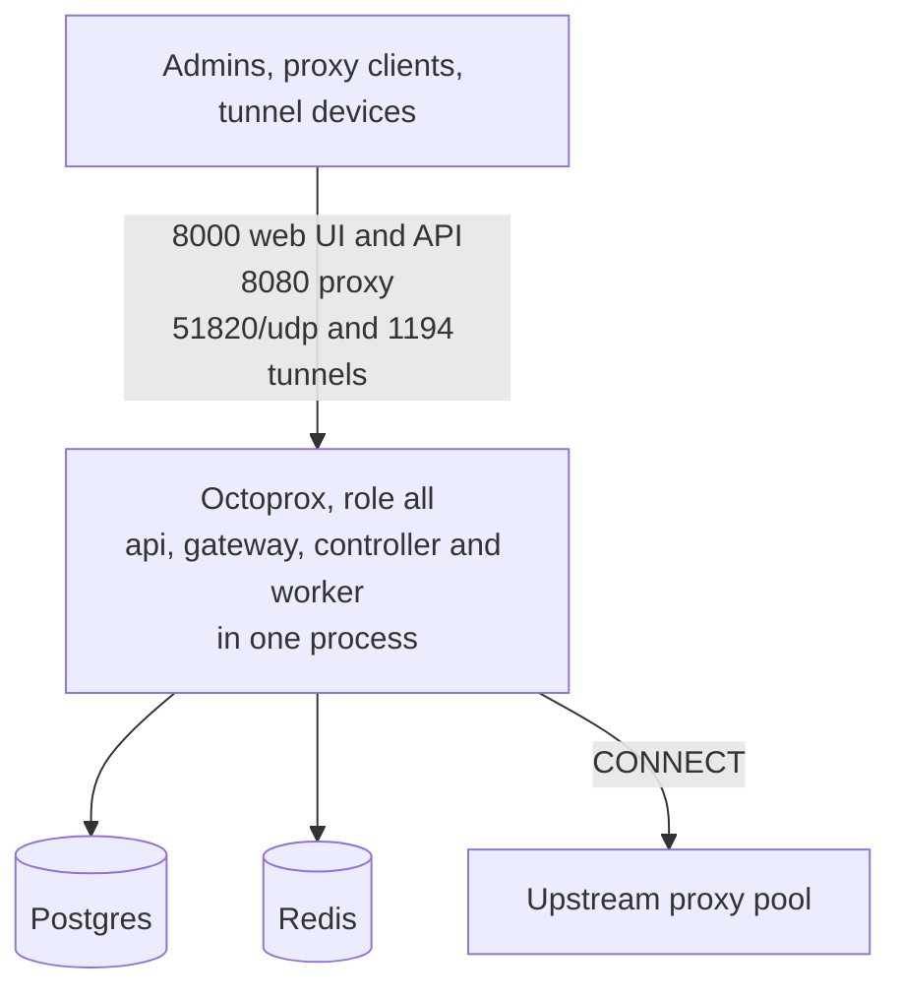
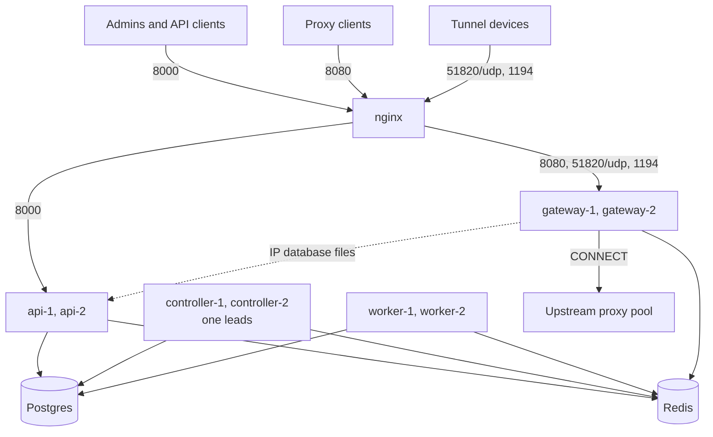

# Deployment & Scaling

<p class="subtitle">Octoprox runs as one process that does everything, or as a cluster of roles, each scaled on its own. Both shapes run the same image against one Postgres and one Redis; only the topology changes.</p>

How the roles divide the work and why they never talk to each other is on [Architecture]({{ site.baseurl }}/architecture). This page is about running them.

## Single instance

One process of role `all`, the default, runs the api, gateway, controller and worker side by side, with one Postgres and one Redis. It suits development, demos and small production installs: one host, tens of thousands of proxies, a few hundred concurrent tunnels. The tunnel ports are optional: see [WireGuard Devices](wireguard) and [OpenVPN Devices](openvpn) for enabling them.



Compose files: [`docker-compose.yml`](https://github.com/octoprox/octoprox/blob/main/docker-compose.yml) (build from source) or [`docker-compose.ghcr.yml`](https://github.com/octoprox/octoprox/blob/main/docker-compose.ghcr.yml) (pre-built image).

```bash
docker compose -f docker-compose.ghcr.yml up -d --remove-orphans
```

## Role cluster

Each role runs in containers of its own, so each is scaled on its own: gateways for traffic, workers for background jobs, the api for people and scripts, and a controller pair for failover. They share one Postgres and one Redis, and nginx (in the bundled compose files; any balancer that forwards HTTP, TCP and UDP works) sends the web UI and API to the api and the proxy and tunnel ports to the gateways.



Compose files: [`docker-compose.cluster.yml`](https://github.com/octoprox/octoprox/blob/main/docker-compose.cluster.yml) (build from source) or [`docker-compose.cluster.ghcr.yml`](https://github.com/octoprox/octoprox/blob/main/docker-compose.cluster.ghcr.yml) (pre-built image), with [`nginx/nginx.conf`](https://github.com/octoprox/octoprox/blob/main/nginx/nginx.conf). Each runs two api services, two gateways that both terminate WireGuard and OpenVPN, two controllers and two workers.

```bash
# Local-build cluster (Makefile targets, fast iteration)
make cluster-up
make cluster-logs
make cluster-down

# Production-ready cluster (pre-built GHCR image): invoke docker compose directly
docker compose -f docker-compose.cluster.ghcr.yml up -d --remove-orphans
docker compose -f docker-compose.cluster.ghcr.yml logs -f
docker compose -f docker-compose.cluster.ghcr.yml down
```

`--remove-orphans` stops and removes the containers of services the file no longer names. Coming from a 5.x cluster, stop it with its own file first (`docker compose -f <that file> down`), then start this one; see [Migrating to 6.0]({{ site.baseurl }}/migrating-to-6).

On Kubernetes, the same layout is one Deployment per role: see [Running on Kubernetes]({{ site.baseurl }}/kubernetes).

### What each role needs

| Role | Postgres | Redis | Secrets | Volumes and devices |
|------|----------|-------|---------|---------------------|
| api | yes | yes | `OCTOPROX_JWT_SECRET`, `OCTOPROX_INTERNAL_SECRET`, the admin seed | `ca_data` (reads the MITM CA certificate), `geo_data` |
| gateway | no | yes | `OCTOPROX_INTERNAL_SECRET` | `ca_data` (creates and uses the CA), `geo_data`; `NET_ADMIN` and `/dev/net/tun` for tunnels |
| controller | yes | yes | `OCTOPROX_INTERNAL_SECRET` | none: it opens no IP database |
| worker | yes | yes | Cloud identity for cloud connectors | `geo_data`; memory for an IP database download (up to 512 MiB, held twice at the peak) |
| echo | no | no | none | the IP database files it serves from |

`OCTOPROX_INTERNAL_SECRET` must be the same on the api, the gateways and the controllers; workers never read it. Gateways also need `OCTOPROX_INTERNAL_API_URL`, the address they reach the api at (`http://api:8000` in the bundled cluster); with the default they log `Gateway reaches the api at the default internal_api_url` at start. The full list of settings per role is in [Configuration]({{ site.baseurl }}/configuration#settings-per-role).

## Scaling each role

| Role | How many | Add more when | What one costs |
|------|----------|---------------|----------------|
| gateway | 2 or more | A gateway's CPU nears one core (each is one process with one event loop), or for connections and bandwidth | A blocked read of the feed stream, one round trip every 5 seconds for its counters, and the per-key state of its requests. No Postgres |
| worker | 2 or more | A work stream's queued entries stay above zero (the work streams of the System page), or on each stream's length with KEDA (see [Running on Kubernetes]({{ site.baseurl }}/kubernetes#scaling)) | A Postgres pool of up to 15 connections; up to `health_check_concurrency` health checks at once |
| api | 2 for availability | Admin and API traffic, or `/echo` traffic when no echo role serves it | A Postgres pool of up to 15 connections |
| controller | 2, small | Never: one leads, the other waits | A Postgres pool; its compile grows with the number of proxies |
| echo | Optional | Echo traffic | Nothing shared |

In the compose files, add a replica by copying a service under a new name (`gateway-3`, with its own `OCTOPROX_INSTANCE_ID`) and, for an api or a gateway, a `server` line in `nginx/nginx.conf`. `OCTOPROX_WORKER_JOBS` gives a worker only some job kinds (`health`, or `sync,scale`), so a set of workers can be kept for health checks and never hold up syncs and scaling, or the hourly IP database downloads (`geo_update`) can run on a worker sized for them; make sure every kind has a worker that takes it. Every worker takes every kind by default.

Adding replicas does not divide the controller's work (one leader compiles the feed and publishes the periodic jobs), nor the writes Postgres takes, nor what Redis carries. Those are the ceilings of an install: the controller's compile time, which grows with the number of proxies; Postgres write throughput; and one Redis for every gateway's per-key request state.

## Failover

- **Controller.** One controller holds the lease `o6:lease:controller` and runs the feed builder and the job producers; the other asks for the lease every second. A leader that stops cleanly releases the lease, and the standby leads within about a second. One that crashes or freezes keeps it until its 30-second TTL runs out, so the standby leads within about 31 seconds. The TTL is that long so a leader whose event loop is held up by a large compile keeps its lease. A new leader compiles the definitions from Postgres before it publishes anything, and its producers go on from the current second: periodic job messages pause only for the handover, and work asked for now goes on throughout. Gateways go on routing on the feed they have meanwhile; what waits is new changes reaching them. A stalled former leader can never overwrite the feed: every publish checks the lease inside its own script.
- **Workers.** Every worker takes entries from the same consumer groups, one per work stream, and keeps the ones it runs alive every 20 seconds. The entries of a worker that dies stay pending, and another worker reclaims them once they have been idle for 60 seconds. A worker that stops cleanly gives the batches it is running up to 30 seconds to finish, so a cloud instance being created gets its row, then leaves the rest to be reclaimed the same way. An entry delivered five times is given up rather than run again.
- **Gateways.** The connections a gateway carries end with it, and clients reconnect through the balancer to another gateway. What a gateway keeps of its own (open-transfer counts for `least_used`, outcomes for `health_based`, slots it took out after a refused preflight) is rebuilt as it serves; everything shared is in Redis.
- **api.** Any api answers any request, a write included, since every one reads the entities from Postgres on each request, and the provider catalog and the attribution settings it shows as well. Each api also keeps the custom provider descriptors, the attribution settings and the IP database list in memory for its checks, previews and lookups; those follow a change made through another api as soon as the change stream announces it. No session affinity is needed.

## Restarts and upgrades

Restarting one container or pod at a time keeps the cluster serving: a gateway leaves the balancer while others carry the traffic, the controller hands its lease over, and a worker's unfinished entries are reclaimed by another. When a new release starts, the first Postgres role to reach the database runs its migrations while the others wait for the migration lock. A process of the older release that restarts after that finds a schema revision it does not know and does not start, so finish an upgrade rather than restarting old containers in the middle of it.

Browsers with the web UI open notice an upgrade on their next call to an api. A bar at the top of the page names the new release and offers to refresh, and the next page the user opens loads the new release anyway, so nobody stays on the old UI and an open form is never cleared. A new tab always opens the release the api runs.

**The upgrade from 5.x to 6.0 is a short downtime: stop 5.x, start 6.0.** The 6.0 migration only adds to the schema, and 6.0 keeps its own Redis keys, so the way back is a redeploy of 5.0.11 on the same database once one SQL statement has set the schema version back to 047. See [Migrating to 6.0]({{ site.baseurl }}/migrating-to-6).

**An upgrade from 6.3 or earlier can roll, at the cost of a few IP observations.** The new release drops two fields from the observation log rows that older releases still write. While old and new processes run together, an older worker fails the observation batches it takes, and another worker runs them again a minute later, usually one of the new release; a batch that fails five times is dropped. An older worker also skips the preflight sightings the new gateways send, and the observation log page fails on an older api. Stop the old release before starting the new one to avoid all of it. A 6.3 started on the upgraded database records no IP observations.

## When Redis or Postgres is lost

**Redis.** Gateways go on routing on the feed they have. Calls on the request path fail open after the request deadline (`redis_request_timeout`, 2 seconds): a sticky session is bound afresh, preflight sends its echo instead of reading the cache, a rate window lets the request through. Counters, sightings and observations wait in memory, bounded. When Redis returns, empty or not, the controller takes its lease again and republishes the feed. After a wipe, the workers create their consumer groups again, the producers refill the job streams within a period of each kind, the controller asks for every proxy to be re-attributed, and traffic blocks are decided again as soon as a limited connector carries bytes. A wipe loses soft state and the work in hand only: quarantines, rate windows, sticky bindings, preflight verdicts, traffic blocks, the counts not flushed yet (up to a minute), job entries in flight, queued observations and sightings, failure examples and MITM captures. See [Redis loss and recovery]({{ site.baseurl }}/architecture#redis-loss-and-recovery).

**Postgres.** Gateways go on routing on their feed. Status changes and new definitions wait: jobs and ingest batches fail and are delivered again later (a batch given up after five deliveries; a metrics flush puts its counts back), the api answers errors, and the controller publishes nothing new. Every Postgres role reports itself unready until Postgres answers again.

## Health endpoints

Every role serves four paths on port 8000, without sign-in:

| Path | Answers | Use it for |
|------|---------|------------|
| `/live` | `200 {"status": "alive"}` while the process serves | Liveness probes |
| `/ready` | `200 {"status": "ready", "role": "gateway", "reasons": []}` while the process can do its work, else `503` with `"status": "unready"` and the reasons | Readiness probes, load balancer target checks |
| `/health` | The same check with the process's identity: `{"status": "healthy", "role", "instance", "version"}`, or `503` with `"status": "unhealthy"` and `reasons` | The image's `HEALTHCHECK`, compose health checks, balancer checks that read a body |
| `/metrics` | Prometheus text of this process (see [Metrics]({{ site.baseurl }}/metrics#prometheus)) | Scraping |

Ready means, per role:

| Role | Ready when | Reasons it gives while not |
|------|------------|----------------------------|
| api | Started, with its definitions read, and Postgres answering | `Postgres unreachable`, `definitions: definitions not loaded yet` |
| gateway | A routing feed applied, the proxy listener bound, the MITM CA loaded, and at first start every IP database the feed lists loaded | `gateway: feed not applied yet`, `gateway: proxy listener not bound`, `gateway: MITM CA not loaded`, `gateway: IP databases not loaded yet: ...` |
| controller | Redis and Postgres answering, and as the leader its last publish succeeded. A standby is ready | `Postgres unreachable`, `Redis unreachable`, `controller: Redis unreachable` (its lease), `controller: routing feed not published` |
| worker | Postgres and Redis answering, its definitions read | `Postgres unreachable`, `Redis unreachable`, `worker: definitions not loaded yet` |
| echo | Its IP database files opened | |

A gateway is therefore unready until a controller has published the feed, a few seconds after the first controller starts. A Postgres role answers nothing at all, not even `/live`, until it has migrated the database and started, so give probes a start-up allowance that covers a migration. Probe requests are left out of the access log below `DEBUG`.

A process of role `all` is ready only while every runtime in it is: while Postgres or Redis is unreachable its `/ready` and `/health` answer `503` with `Postgres unreachable` or `Redis unreachable` among the reasons, although its proxy goes on routing on the feed it has. In front of a single instance, point restart policies and balancer checks at `/live`, or run the roles apart.

nginx checks its backends passively: it skips one that refuses or times out, but it does not ask `/ready`. A container that is stopping refuses at once; one that has stopped answers nothing, and nginx keeps its old address until its next DNS lookup (every 10 seconds), so a connection sent there waits out the 2 second connect timeout before it goes to another backend, and the few sent in the last 2 seconds before that lookup fail instead (a 502 or 504 on the API, a closed connection on the proxy port). So a gateway binds its proxy port only once it has applied a routing feed, and refuses connections until then; nginx passes the client on to a gateway that has a feed. While none has (a first start, an emptied Redis), clients are refused until the controller publishes one: a few seconds, or, when a migration runs first, until the migration is done. A gateway serves as soon as it has a feed, even while the IP database files the feed lists are still downloading; only its `/ready` waits for them, at first start. A proxy port already in use shows when the first feed arrives: the gateway logs `Loop cycle failed` for its `feed_follower` loop with the error, stays unready (`gateway: feed not applied yet`), and binds the port once it is free. A balancer with active checks (a cloud load balancer, Envoy, HAProxy) should check the gateways' `/ready` on port 8000, not the api's.

## Inspecting the cluster

**Administration → System** (admins) shows the cluster from the processes' heartbeats and from Redis: every process grouped by role, with its readiness, its loops and its own numbers; which controller leads, how far its last compile read the change stream, and how soon a standby would take over; the routing feed and whether each gateway has applied the latest (*in sync*) or is *behind*; and the work streams, one row per job kind and one each for the sightings and the observations, with what is queued, running and waiting to be reclaimed and the age of the oldest entry. A row with entries queued and no live worker taking its kind says so, and one whose backlog lasts a minute says there are too few workers for it. What the page shows, field by field, is under [System Statistics]({{ site.baseurl }}/api#system-statistics). A process publishes its heartbeat every 5 seconds and drops off the page 10 seconds after its last one. The page is read-only: nothing in the cluster acts on who is alive.

Every process exports Prometheus metrics at `/metrics` on port 8000, labelled with its `role` (see [Metrics]({{ site.baseurl }}/metrics#prometheus)). In the bundled cluster, scrape each container's port 8000 on the compose network (`api-1:8000`, `gateway-1:8000`, and so on): nginx refuses `/metrics` (`403`) on its public port 8000, as it does `/internal/`, since through it a scrape would reach whichever api round robin picked. The same state can be read straight from Redis, where every key of 6.0 starts with `o6:`:

```bash
redis() { docker compose -f docker-compose.cluster.yml exec -T redis redis-cli "$@"; }

redis GET o6:lease:controller                    # the instance id of the leading controller
redis GET o6:feed:head                           # the routing feed's head: digest, changes, compiled_at, sections
redis HLEN o6:feed:sections                      # one section per connector, plus the global and runtime ones
redis XINFO STREAM o6:stream:changes             # the change stream: length, and its newest entry (last-generated-id)
redis XINFO GROUPS o6:jobs:health:stream         # the workers group: consumers, pending, last delivered entry
redis XLEN o6:jobs:health:stream                 # health checks queued or running (entries go once handled)
redis XPENDING o6:jobs:health:stream workers     # delivered, not acknowledged yet: count, first and last ID, per worker
redis XPENDING o6:jobs:health:stream workers - + 10   # the oldest ten: ID, worker, idle ms, deliveries
redis XINFO CONSUMERS o6:jobs:health:stream workers   # each worker process: pending entries, idle time
redis XLEN o6:stream:sightings                   # preflight sightings not ingested yet
redis XLEN o6:stream:observations                # IP observations not ingested yet
redis ZRANGE o6:proxy:quarantined 0 -1 WITHSCORES    # rate-limit quarantines, until epoch seconds
redis HGETALL o6:traffic:blocked                 # connectors blocked by their traffic limit, until when
redis HGETALL o6:traffic:pending                 # connectors waiting for the traffic decision a reset or limit edit asked for
redis HGETALL o6:scale:creating:<connector id>   # cloud instances a scale job is creating
redis SMEMBERS o6:instance_index                 # processes that heartbeat (and some just gone)
```

Replace `health` with any other job kind (`sync`, `scale`, `provision`, `reattribute`, `enrich`, `traffic`, `metrics_flush`, `compaction`, `snapshot`, `geo_update`, `tunnel_last_seen`, `index_hygiene`, `update_check`) for its stream; the queued backlog is the stream's length less the group's pending count. In Postgres, `SELECT version_num FROM alembic_version` is the schema revision the install migrated to, and `SELECT application_name, count(*) FROM pg_stat_activity GROUP BY 1` shows the connections of each role.

### Failover smoke test

```bash
# Note which controller leads
docker compose -f docker-compose.cluster.yml exec redis redis-cli GET o6:lease:controller

# A clean stop hands the lease over within about a second
docker compose -f docker-compose.cluster.yml stop controller-1
docker compose -f docker-compose.cluster.yml exec redis redis-cli GET o6:lease:controller

# A crash leaves the lease to run out first: about 31 seconds
docker compose -f docker-compose.cluster.yml start controller-1
docker kill octoprox-controller-2
docker compose -f docker-compose.cluster.yml exec redis redis-cli GET o6:lease:controller
```

Stop the one that leads (the lease holds its instance id, `controller-1` or `controller-2`). Proxy traffic through port 8080 goes on throughout.

## The WireGuard endpoint in a cluster

In the bundled cluster every gateway terminates the tunnel, and nginx forwards the UDP port with consistent hashing by source address, so a device keeps landing on the same gateway while its address holds and the others carry other devices. The key pair, endpoint and device list are install-wide and reach every gateway through the routing feed, so every gateway accepts every device's config, and the fake-IP mapping the tunnel DNS hands out is shared through Redis, so a connection that lands on a different gateway from the one that answered the device's DNS query still knows the name. Two things to know:

- **A flow that moves stalls briefly.** A device that changes source address (a phone switching networks) or whose gateway disappears is hashed to another gateway, which has no session keys for it yet. The device's next handshake attempt (a few seconds, or at the next rekey) establishes a session there and traffic resumes. Open TCP connections from before the move are gone, as with any L4 balancer.
- **nginx notices a dead container, not a dead host.** Open source nginx has no active UDP health check. A gateway whose container is down is skipped (the host answers with ICMP unreachable); one whose host is gone keeps its share of devices until it returns or the server list is edited. For a hands-off alternative run keepalived with a floating IP in front of the gateways instead of balancing the UDP port, or use a cloud L4 balancer (AWS NLB, GCP passthrough NLB, Azure LB), which checks health actively.

Each carrying gateway publishes its peer status to Redis every 10 seconds and the admin views merge them, so the device list is correct whichever gateway a device is currently talking to; a worker's `tunnel_last_seen` job writes the newest handshake to the device's row every 10 seconds, so where a device was last seen survives the gateway restarting. A device's traffic is metered on the proxy path of whichever gateway relays it and flows into the shared metrics pipeline, so its totals and history are install-wide like a connector's. The endpoint a device appears to connect from is nginx's address, since nginx proxies the datagrams. See [WireGuard Devices](wireguard).

## Echo endpoint

The api serves `GET /echo` on port 8000 for [IP attribution]({{ site.baseurl }}/ip-attribution): health checks, discovery and preflight request it *through* a proxy to learn the exit IP. The bundled nginx config adds `X-Forwarded-For` on the API listener; set `geo.echo.trusted_proxies` on the api services to the nginx address range so they report the real client instead of the balancer.

The request travels out through the vendor and back in from the public internet, so the echo URL in the attribution settings must be reachable from there. When the cluster sits on a private network, or to keep echo traffic off the api, run a process of role `echo` on a public host (same image, port 8000, no Postgres, Redis or secret) and point the settings' echo URL at it. See [IP Attribution]({{ site.baseurl }}/ip-attribution#echo-endpoint).

Health checks lean on it: every proxy whose connector names no `healthcheck_url` of its own is checked against the echo URL (httpbin's, until the attribution settings name another). So that an echo outage does not take all those proxies out of routing, a worker counts a failed check against the echo only while the echo itself answers. A check through another proxy that reached it within the last ten seconds shows it up; otherwise the worker requests the echo URL directly, at most once every ten seconds. While it does not answer, those proxies keep their status and are checked again an interval later, and the worker logs `Echo endpoint does not answer; failed health checks against it are not counted` once, then `Echo endpoint answers again; failed health checks count again` when it is back. So workers should reach the echo URL directly too: one that cannot (an echo on the install's own public address, behind a NAT that does not hairpin) counts failed checks only while checks through other proxies reach the echo. A connector's own `healthcheck_url` is judged as always.

## Production checklist

Before pointing real traffic at the cluster, edit the compose file (or your manifests):

- Set `OCTOPROX_AUTH_PASSWORD` to something strong (not `admin`).
- Set `OCTOPROX_JWT_SECRET` (api) and `OCTOPROX_INTERNAL_SECRET` (api, gateways and controllers, the same value) to two different long random strings.
- Set `OCTOPROX_PUBLIC_URL` on the api to the address users reach the web UI at (for example `https://proxy.example.com`). Invite links and the redirect URIs for sign-in through Google, Microsoft or GitHub are built from it; without it they are built from the Host header nginx forwards, which is right on `localhost:8000` and wrong behind TLS termination or a further load balancer. See [sso.md](sso).
- Set `OCTOPROX_PROXY_PUBLIC_URL` on the api to the URL clients reach the proxy at, when it is not the web UI's host and port 8080 (see [Connecting Clients]({{ site.baseurl }}/connecting#endpoint)).
- Set `OCTOPROX_DB_PASSWORD` (and the matching `POSTGRES_PASSWORD`), and give Redis a password in `OCTOPROX_REDIS_URL`: every role but echo reads and writes Redis, and it holds the routing feed (encrypted), request state and captures.
- Decide whether to expose Postgres (5433) and Redis (6379) on the host: for an internet-facing host you almost certainly want to remove those port mappings and keep them on the internal Docker network only.
- Keep the MITM CA on durable storage (the `ca_data` volume, or a Secret on Kubernetes) so every gateway signs with the same root and clients install it once.
- Take a passphrase-encrypted backup from **Administration → Backup & Migration** (or `POST /api/v1/backup/export`) before upgrades, and store it outside the cluster. Importing on a fresh install of the same release with "Keep my current account" ticked is the supported way to migrate between deployments: an import refuses a backup taken at another schema version, so move first and upgrade after. See [api.md](api#backup--migration).
