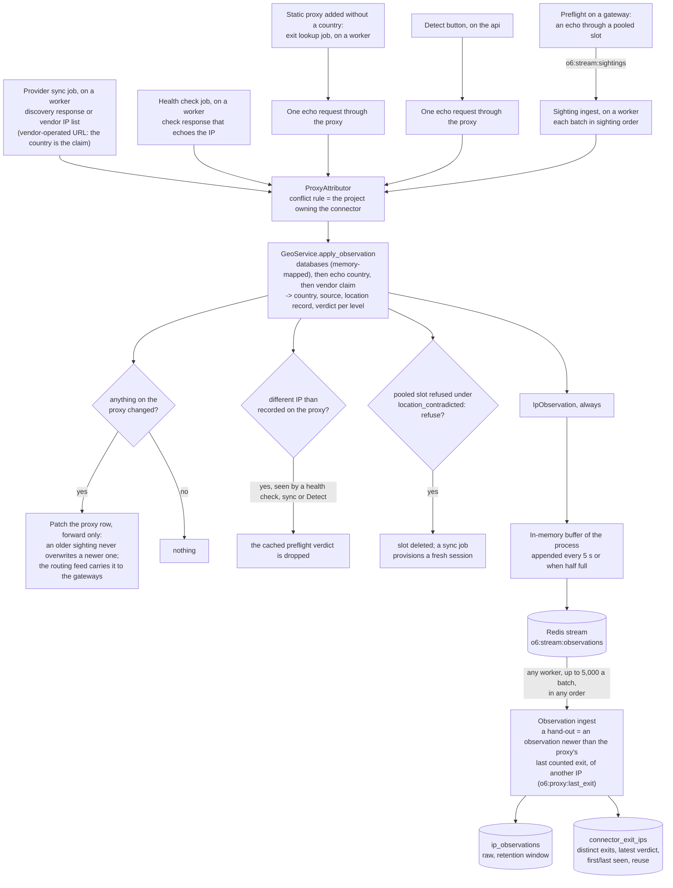
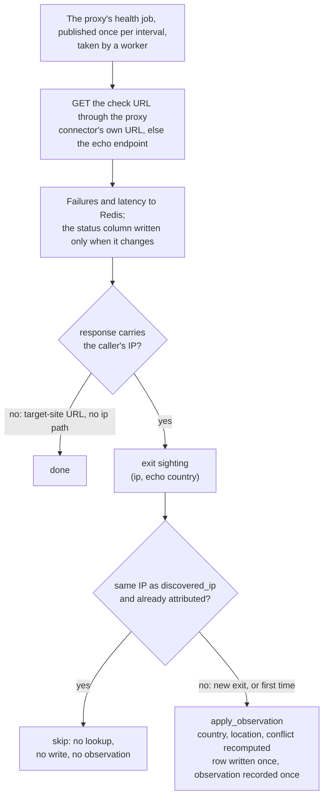
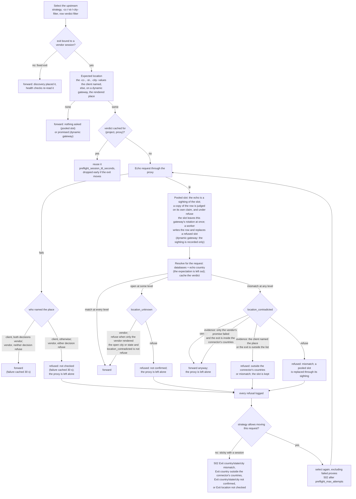
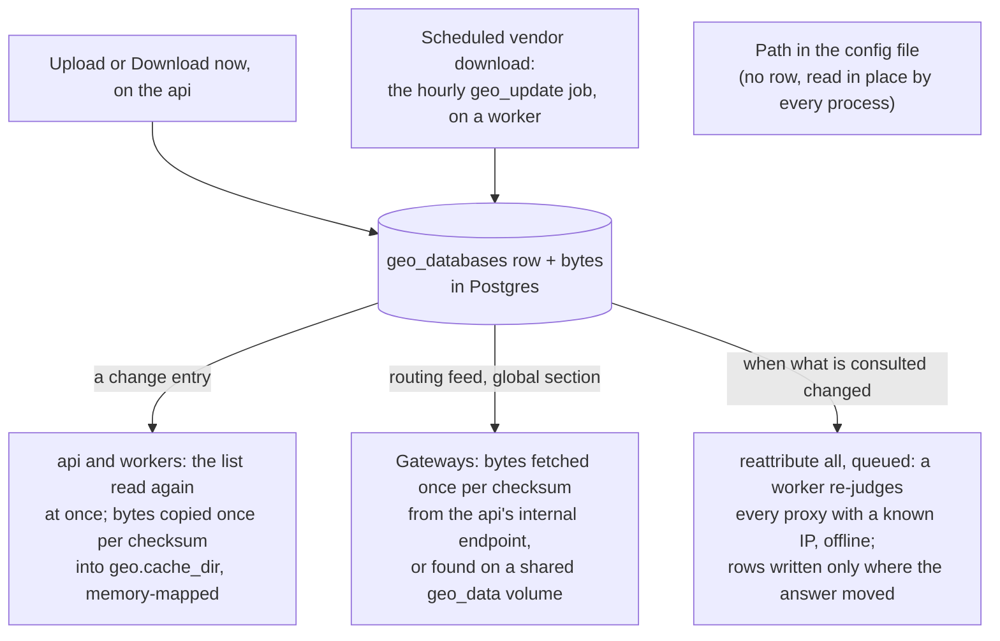

# IP Attribution

<p class="subtitle">Where an exit IP really is, decided from local IP databases, the vendor's own claim and an echo endpoint, and what that says about each provider.</p>

Every proxy Octoprox manages has an exit IP: the address a target site sees. Country routing (`-cc-` username suffix) needs to know which country that IP is in. IP attribution answers that with a small pipeline:

1. **Observe.** Every code path that learns an exit IP produces an *observation*: provider discovery, the exit lookup for manually added proxies, the health checks, the Detect button, and the optional preflight check.
2. **Attribute.** The IP is looked up in the IP databases loaded in the process (MaxMind, DB-IP, IPinfo, IP2Location). The databases, then the echo endpoint's answer, then the vendor's claim pick the country, in that fixed order, and the owning project's *conflict rule* decides whether the vendor's claim is contradicted.
3. **Act.** The resolved country lands on the proxy for routing. The verdict on the claim (confirmed, contradicted, open) is written on the row, for the country and for any state or city claimed, and a project's two *location decisions* (what to do with a contradicted claim, what to do with an exit nothing can place) may turn it into ineligibility. Every observation feeds per-connector accuracy totals.

Nothing on the request path waits for a database: attribution is a memory-mapped lookup, and observations are buffered in memory, appended to a Redis stream and written to Postgres by whichever worker takes them. A gateway, which has no database of its own, judges what preflight sees for the request in front of it and hands the sighting to a worker, which writes the proxy row (see [Architecture]({{ site.baseurl }}/architecture#sightings-and-observations)).

## How the pieces fit together

Four flows, drawn separately because they run at different times. The first is the spine every other flow feeds.

### Sightings become attributed proxies



### A health check, every minute, per proxy



So a proxy whose exit never moves costs one lookup and one write in its lifetime. A residential slot costs one per vendor session rotation.

A failed check against the echo endpoint counts against the proxy only while the echo itself answers, so an echo outage leaves the proxies checked against it as they were. A worker tells by requesting the echo URL directly when no recent check reached it, so workers should be able to reach it (see [Echo endpoint]({{ site.baseurl }}/deployment#echo-endpoint)).

### Preflight, per request, when the project turns it on



### Databases, and what happens when they change



The api and workers read the settings row and the database list again whenever the change stream announces a change to them, and once per `reconcile_interval` (an hour) whatever it announced; gateways read them when the routing feed's global section changes. Nothing is hashed unless a checksum or a file's size or mtime moved. Files listed under `geo.databases` are looked at on disk at least once per `reconcile_interval` by every process that opens them, gateways included, since a file system offers no event a container can follow. If the listing fails, the databases already open stay open rather than being closed on a Postgres blip. A gateway that cannot fetch a file tries again every 30 seconds, and at its first start it stays unready until it has every file the feed lists.

## How exit IPs are learned, per connector type

Attribution never makes requests of its own to find an IP. It listens for *sightings* from the code paths that already learn one, and only then looks the IP up. What produces sightings depends on the connector type:

| Connector / proxy type | How the exit IP is learned | Requests through the proxy | Vendor claim to verify |
|---|---|---|---|
| Residential and mobile sessions (Oxylabs, Bright Data, Decodo, IPRoyal, NetNut) | Never by provisioning: the vendor rotates the exit behind a session and the sync does not probe it. The health check reports it every minute when the check URL echoes the caller (the attribution echo endpoint by default), and preflight reports it when a project turns preflight on. | Health check: one per proxy per `health_check_interval`, which happens anyway. Preflight: one per (project, proxy) per `preflight_session_ttl_seconds`, or sooner when a health check sees the exit move. | The country the slot was provisioned for, when the connector or a `-cc-` request geo-targeted it. Untargeted slots make no claim. |
| Residential and mobile with **dynamic sessions** (one gateway row, a vendor session per request) | Only through preflight. The gateway row is not health-checked, since no single exit speaks for a rotating pool. Every request renders its own vendor session, so an echo through that session, before the request, is the only way to see where the request went: with preflight on, a request carrying `-sessid-` is echoed once per derived session and cached; a request without one is echoed for the connector's `exit_sample_percent` of requests (default 5), uncached. | No health checks. Preflight: one per client session per `preflight_session_ttl_seconds`, or per session length when the connector sets a shorter one, plus the sampled share of session-less requests. | The `-cc-` country or, with a country allow-list on the connector, the country rendered for the request. Requests with no country make no claim and are only recorded. |
| Port-based with IP discovery (Oxylabs ISP and datacenter, Decodo ISP and datacenter) | The sync job requests the **vendor's own** discovery endpoint (named in the descriptor, e.g. `ip.oxylabs.io`, `ip.decodo.com`) through each port when the slot is created, and again on every IP refresh (`ip_refresh_interval`, hourly by default). The response IP and the vendor's country arrive as one sighting. | One discovery request per slot at creation, one per slot per refresh, plus the health check. | The discovery endpoint's country, since the descriptor marks the URL as vendor-operated (`discovery.vendor_operated`, the default). A descriptor pointing discovery at a third-party echo unsets it and the country becomes an `endpoint` candidate instead. With countries listed on the connector, the country the port was kept for. |
| Port-based with a known-IP API (Bright Data ISP and datacenter) | The vendor's IP list gives each slot its IP and country without any request through the proxy; the sync job reports both. Refresh re-reads the list. | Health check only. | The country from the vendor's list. |
| Proxy lists (Webshare) | The list gives host, port and country. The host is normally the exit, but nothing is announced until the first health check reports the caller's IP. | Health check only. | The country from the list. |
| Static connectors (manually added proxies) | One request through the proxy to the echo endpoint when the proxy is added without a country (`proxy.geo_lookup.enabled`), and on the Detect button. Then health checks. | One at creation, one per Detect, plus the health check. | A country set by hand is treated as the claim and kept for routing. |
| Cloud instances (AWS, GCP, Azure) | Health checks only; the instance's public address is the exit. | Health check only. | None. The connector's declared countries list is not a per-proxy claim. |

Two endpoints are therefore in play. Provider descriptors keep the **vendor's discovery endpoint** for port-based IP discovery, at slot creation and on each refresh, because it also returns the vendor's own view of the location. Everything else goes to the **attribution echo endpoint** (`echo_url` in the settings): the health check of every connector that names no check URL of its own, the static-proxy lookup, the Detect button and preflight. A port-based proxy is thus probed by the vendor endpoint hourly and by the echo endpoint every minute, which is the same number of requests as before attribution existed; only the destination of the health check changed from httpbin to the echo. Preflight is a project setting, not a per-connector one: with it on, a request that asks for a country, or that lands on a proxy with a promised or pinned country, is verified against the echo once per project and proxy per cache window, whatever the connector type.

Two consequences worth knowing. A health check sighting is applied only when the IP moved or the proxy was never attributed, so a stable proxy costs one database lookup and one write in its lifetime, not one per minute. And a proxy of a connector with declared countries that attribution places elsewhere gets that country on its row, and is then never routed to, whatever was asked and under every location decision: the declared list bounds every row, and covers on its own only proxies whose location is not known yet. It is skipped, never replaced: only `location_contradicted: refuse` spends a fresh session. The rule binds rows the vendor placed in a declared country; a row that made no claim is bound by the list only for a request that names a country.

The **Detect** button on a proxy and **Re-attribute proxies** on the settings page are the manual paths. Detect runs on the api, which makes one echo request through the proxy and answers with the result. Re-attribution is offline: the button queues it and answers at once, and a worker re-runs the databases over every proxy with a known IP and makes no request.

### What each step costs

| Step | When | Cost |
|---|---|---|
| Database lookup | Every sighting that passes the checks above, every preflight check, every re-attribution | Memory-mapped read, microseconds, no I/O |
| Proxy write to Postgres | Only when the resolved country, source, location record, conflict flag or discovered IP changed | One patch of the row's attribution fields, by a worker (or the api, for Detect); the routing feed carries the change to the gateways |
| Observation | Every applied sighting and every preflight check (an echo through a pooled slot is applied as the slot's sighting and recorded once); deduplicated health checks and repeat preflights of an unchanged exit record nothing | Appended to an in-memory buffer; appended to the observations stream in Redis every `publish_interval_seconds` or as soon as the buffer is half full; written by whichever worker takes them, up to 5,000 a batch in one transaction, which also maintains the accuracy and exit IP aggregates. Workers read the stream as entries arrive and several take batches at once, so a burst is drained instead of piling up; the IP attribution page shows how many are still queued |
| Echo request | Static proxy creation, Detect, preflight (per cache window), and health checks whose URL is the echo endpoint | One HTTP request through the proxy |

## Databases

Any file in MaxMind's mmdb format works, from any vendor. Octoprox reads the file's own metadata to recognise the vendor and normalises each vendor's record layout into one shape (country, region, city, coordinates, ASN, organisation, anonymity flags). IP2Location's BIN format is also supported when the optional `IP2Location` Python package is installed.

| Vendor | Files | Free edition | Notes |
|--------|-------|--------------|-------|
| MaxMind | GeoIP2 / GeoLite2 Country, City, ASN, Anonymous IP (mmdb) | GeoLite2 with a free account and license key | Attribution text required for GeoLite2; redistribution is not permitted, so every install brings its own file |
| DB-IP | Country, City, ASN (mmdb) | Lite editions, CC BY 4.0 | Same layout as MaxMind |
| IPinfo | Country + ASN, Location, Privacy (mmdb) | Country + ASN with a free token | Flat record layout, ASN as `AS12345` |
| IP2Location | DB1 to DB26 (BIN, and mmdb for DB1/DB9), IP2Proxy (BIN) | LITE editions | BIN needs `pip install IP2Location` |
| GeoNames | `cities500`, `cities1000`, `cities5000`, `cities15000`, one file per country (`BR.zip`), zipped or bare `.txt` | Free, CC BY 4.0 | Answers no IP: city coordinates for the [city radius](#city-coordinates-and-the-city-radius) |

Databases reach the processes three ways:

* **Upload** in Settings → IP attribution. The file is validated by opening it and stored in Postgres. The api and workers copy it from there into their `geo.cache_dir` when the change stream announces it, and gateways fetch it from the api's internal endpoint when the routing feed lists it (with a `geo_data` volume shared by every process, only the first copy is made); each memory-maps it.
* **Scheduled download** from the vendor. Register the vendor's download URL with your own credentials (MaxMind account ID and license key as basic auth, an IPinfo token in the URL). The api downloads it at once, then a worker's `geo_update` job again every `update_interval_hours`, unpacks `.tar.gz` and `.gz` containers, and publishes the new file only when its checksum changed. A URL may carry `{YYYY}` and `{MM}`, filled in for the current month on each run, for vendors such as DB-IP that name their files by month and offer no fixed URL; when the current month's file is not published yet the previous month's is fetched instead. The databases table shows when each schedule last checked and when it is next due; the controller publishes the `geo_update` job once an hour (`geo.updater.check_interval_seconds`), so a download runs at the job's first run after that time. The job downloads on a worker, which therefore reaches the vendor's download URL and holds the download in memory while it unpacks it (up to 512 MiB, held twice at the peak); see [worker memory]({{ site.baseurl }}/kubernetes#configuration-and-secrets-per-role). **Pause** stops the schedule and keeps everything else: the file stays loaded and the URL, credentials and interval are kept for **Resume**, while **Download now** still fetches on demand. Disabling a database unloads its file and stops its schedule too; **Download now** still fetches it, and it stays unloaded until enabled.
* **Config file** for installs that already run `geoipupdate` on a shared volume: list the paths under `geo.databases`. These are never copied and cannot be removed from the UI.

Databases are consulted in **priority** order, lowest first. The first database with a country answers; the others fill in fields it lacked (a country database plus an ASN database give one merged record). Uploading or removing an enabled database, enabling or disabling one, moving an enabled one's priority, and a download that changed an enabled file each queue a re-attribution of every proxy with a known exit IP, offline, on a worker. Renaming a database or changing its schedule judges nothing.

**Which files to load.** Load one geolocation database per vendor. A city file already contains everything the same vendor's country file does, so never add both: choose the country file when you only route by country and want the smaller footprint, or the city file when you route or verify below the country. [State and city routing]({{ site.baseurl }}/routing-strategies#state-and-city-routing) matches fixed exits on the state code and city the databases record, and preflight can only judge a state or city claim with a city-level database loaded, so any project that targets `-st-` or `-city-` wants the city file. Adding a second vendor's geolocation file is worthwhile: the resolver treats each database as an independent opinion, and answers the databases disagree on are left open rather than confirmed (see the conflict rule below). ASN and anonymity files sit alongside any of these and only fill in fields the geolocation file lacks.

Free editions carry a license attribution; the settings page shows it while such a database is loaded.

Stored files live in Postgres, in `geo_database_blobs`. Postgres keeps a replaced or removed file on disk until the table is rewritten, so on every hourly run the `geo_update` job compares the table with the files in it and rewrites it (`VACUUM FULL`) when it holds more than a tenth more than they need. Until then the table is simply larger than its files. A file dropped moments before a check can survive that check, since a rewrite keeps whatever a transaction still running could see; the next check takes it.

### City coordinates and the city radius

IP databases name the city they place an exit in, and a city claim names the place that was promised; the two often name neighbouring places. DB-IP puts much of Greater São Paulo in Diadema, a separate municipality 15 km from the centre, and some exits in São Paulo's own districts (Vila Olímpia). The record carries one city name, one state name and one coordinate, with no parent city or metro area, so there is nothing to roll Diadema up to São Paulo by. Compared by name, every one of those exits contradicts a `-city-sao_paulo` claim.

A GeoNames file gives the claimed city a point, and an independent answer within the **city radius** of that point confirms the claim. Octoprox ships no such file: load one like any database, by upload or by scheduled download (the **GeoNames cities500** preset is `https://download.geonames.org/export/dump/cities500.zip`). It shows in the database list as *City coordinates* and answers no IP, so its priority only orders it against other GeoNames files: the first one that knows a city places it.

**Which file.** The number is a population cutoff, and each file holds every place of the next one up. `cities500` (every place over 500 people and every administrative seat down to the fourth level, about 236k places) covers essentially any town a vendor lets you target, and takes about 35 MB of memory and a couple of seconds to load in each process that opens it: every api, gateway and worker (the controller opens no IP database). `cities15000` (34k places, about 5 MB in memory) misses more than half of Brazil's municipalities. A per-country file such as `BR.zip` holds every populated place of one country. Only populated places are read, and a file with more than 1.5 million of them (`allCountries`) is refused.

**How a city is judged.** Only the city level is lenient; the country and state are still compared exactly.

* The claimed city (a `-city-` request, a vendor-listed city, a pin) is placed by the GeoNames file, by country and name, unless a database answering for the same IP named it too (next point). Several places of that name in one country resolve to the one in the claimed state when GeoNames uses the same code (US states, the UK's nations), else to the most populous.
* A database answer is placed at the database's own coordinates. Any other answer (the claim, the echo endpoint's city, a database answer without coordinates) is placed where a database answering for the same IP put a city of that name, since every answer is about one exit: when DB-IP says Camden and the echo says `camden`, both sit at DB-IP's Camden point, 3.8 km from London. Only a name no database reported for that IP is looked up in the GeoNames file.
* Two cities agree when their names are the same or their points are within the radius. The conflict rule then works as it always does: under `consensus` the claim is confirmed when every independent answer is within the radius, so DB-IP's Diadema and MaxMind's Guarulhos together confirm São Paulo, while answers on either side of the radius leave it open.
* The claim falls back to comparing names when it cannot be placed (no database named it and the file does not know it), when no GeoNames file is loaded, or when the radius is 0.

The radius is an install setting (Settings → IP attribution → Policy & echo, default 25 km), and each project may set its own on its Location tab, for instance a smaller one to be stricter. 25 km takes in the municipalities around a large city (Diadema, Guarulhos and Osasco are about 15 km from São Paulo's centre) without reaching the next real one (Campinas is 84 km away). The **Test an IP** box on the settings page takes a claimed city and shows the verdict and the distance.

A city confirmed within the radius keeps the database's answer as what was observed and resolved: the observation log shows `diadema` against the claim `sao_paulo`, confirmed. The row is routed on the claim it confirmed, so a fixed exit attributed to Diadema still serves `-city-sao_paulo`. The radius judges claims only: a row that made no city claim is routed on its database city, and a `-city-sao_paulo` request does not reach a row whose only city is `diadema`. Adding, replacing or removing a GeoNames file, and changing the install radius or a project's, re-judges the affected rows offline, as for any database.

## Sources and the conflict rule

Three kinds of evidence exist for an exit IP:

* **database**: the loaded IP databases;
* **vendor**: what the proxy vendor claimed (a country in its proxy list or known-IP API, or the country a slot was provisioned for);
* **endpoint**: what the echo endpoint reported when requested through the proxy, for endpoints that know geography.

The value routing reads has one fixed order: the databases, in their configured priority, then the echo endpoint, then the vendor, which fills only what nothing independent answered. There is no setting for it. The first kind with an answer decides the proxy's country, state and city, and the vendor's claim is judged against the independent kinds whether or not it decided. Two settings bend this, each in one case. Under the conflict rule `any` (below) a claim confirmed by a lower-ranked source is routed on that source's answer, so a confirmed row is never routed on a country its verdict disagrees with. Under the project's `location_contradicted: vendor` a contradicted level carries the vendor's claim as its routing value: that is what trusting the vendor means, and the independent answer is kept beside it as what was observed. Otherwise trust in the vendor is the two location decisions' business, never the value's: a project that serves an open claim serves it on the vendor's word, and `location_contradicted: evidence` serves a contradicted exit where the evidence puts it.

The install has a default conflict rule (Settings → IP attribution → Policy & echo). Each project may override it on its Location tab; a proxy is always judged under the rule of the project that owns its connector. None of the kinds costs a request of its own: vendor claims arrive with the vendor's proxy list or slot provisioning, and the echo endpoint is the same request discovery and health checks already make to learn the exit IP.

**Conflict rule** says when a vendor claim counts as contradicted:

* `consensus` (default): every independent source agrees with each other and all of them disagree with the vendor. Databases lag on residential ranges, so a single dissenting database is not evidence against a vendor; independent sources that disagree among themselves leave the claim *open* instead: no verdict, so the vendor is neither cleared nor blamed. A claim no independent source can judge at all, an IP no loaded database knows, is open for the same reason. An open claim changes nothing about the value: the row keeps the country the top-ranked source resolved, and only `location_unknown: refuse` treats an open claim as a reason not to route there.
* `first`: the top-ranked independent source disagrees with the vendor. The value is the top-ranked answer, as under `consensus`.
* `any`: no independent source agrees with the vendor. One that does, a database at any priority or the echo endpoint, confirms the claim, and the row is then routed on that source's answer rather than the top-ranked one, so a confirmed row is never routed on a country its verdict disagrees with. With no source agreeing the claim is a plain contradiction routed on the top-ranked answer. `any` never leaves a claim open while there is evidence; with no evidence at all it is open like the others.

A missing vendor claim never conflicts. A country set by hand on a proxy stays the routing country and is treated as the claim to verify.

## Per-project policy

Each project makes two decisions about exits whose location is in doubt (project settings → Location). Both apply to every kind of row: to the verdict written on a fixed exit or pooled slot by health checks, discovery, locate and re-attribution, and to the verdict preflight produces for a request. A confirmed claim, and a row not judged yet, serve under every setting. [Location routing]({{ site.baseurl }}/location-routing) walks the combinations of these settings with the routing strategy and the kind of proxy row, with examples.

| Setting | Values | Effect |
|---------|--------|--------|
| `location_contradicted` | `evidence`, `vendor`, `refuse` | What to do when the independent sources (databases, echo endpoint) agree against the vendor's claim. `evidence` (default) routes the proxy on where they put the exit: the row serves on its resolved country, the contradiction is shown and counted, a pooled slot is kept; a contradicted state or city only the vendor supplied is skipped, since it cannot be routed on the evidence, while a contradicted pin stays, shown as contradicted, since the operator placed it deliberately and attribution never overwrites a pin. `vendor` routes on the claim anyway and only shows the contradiction: the contradicted level carries the vendor's claim as its routing value, a contradicted pin stays, and preflight forwards a contradicted exit. `refuse` holds the vendor to its word: a contradicted pooled session slot is removed and replaced by the provider sync, a contradicted fixed exit is skipped, a contradicted exit at preflight refuses the request and removes a pooled slot. At preflight, when the client named the place, `evidence` and `refuse` both refuse a contradicted exit; when only the vendor promised it, `refuse` holds the vendor to its exact promise, `evidence` holds the exit to the connector's declared countries, `vendor` checks nothing but placement. |
| `location_unknown` | `vendor`, `refuse` | What to do when nothing independent places the exit: no loaded database knows the IP, or the databases disagree with each other under `consensus`, so the claim is open. `vendor` (default) routes on the vendor's word. `refuse` skips the row until a later sighting places it, and so a judged row with no country at all or with a country only the vendor supplied; a state or city only the vendor supplied is skipped for a `-st-` or `-city-` request; at preflight an open level the client named, or a promised country no source can place, is refused with `502 Exit country not confirmed`. A skipped slot is kept, not replaced. A country pinned by hand is the operator's word and never open: trusted under both values. Dynamic-sessions gateways carry no row verdict, so both decisions reach them only through preflight. |
| `location_preflight` | `true`, `false` | Verify a session's exit before its first request is forwarded (below). What the verdict does to the request is the two decisions' call. Not implied by them: must be on for a refusing decision to reach dynamic-sessions connectors, and to check a pooled residential or mobile session per request rather than per health check. |
| `location_conflict_rule` | `consensus`, `first`, `any`, or null | When a vendor claim counts as contradicted; null inherits the install default. |
| `location_city_radius_km` | 0 to 500, or null | How far from the claimed city an independent answer may place the exit and still confirm a city claim, once a GeoNames file is loaded; 0 compares names only, null inherits the install default (25 km). See [City coordinates and the city radius](#city-coordinates-and-the-city-radius). |

## Preflight

A residential or mobile exit belongs to the session, not to the proxy row, so verifying it means checking the proxy the request was actually routed to. With preflight on, Octoprox makes one echo request through the selected upstream, attributes the IP, and compares it with the location the request *requires*: the `-cc-`, `-st-` and `-city-` values the client named, or, on a dynamic gateway serving a request that named nothing, the place rendered into the vendor session. A client that named nothing has no expectation of a pooled slot: the slot is not preflighted for it, and its own claim is judged on the row by every sighting of its exit.

Only rows whose exit the vendor can move are checked: dynamic-sessions gateways and pooled session slots. A fixed exit (static, ISP, datacenter, list-mode) was placed by discovery and is re-read by every health check that reports its IP, so an echo per request would only repeat what attribution already knows; those rows are never preflighted, whatever was asked or promised.

Every level is judged the same way, under the project's conflict rule: the expected place is the claim, the databases and the echo endpoint are the evidence, and the level is contradicted, confirmed, or left open when nothing independent answered there or the independent sources disagreed under `consensus`. The echo endpoint contributes below the country only when `echo_state_path` and `echo_city_path` are set (Octoprox's own `/echo` answers `state_code` and `city`), and a country-only database never answers there. What a contradicted or open level does to the request is the two location decisions' call, below.

The verdict is cached in Redis per project and proxy for `preflight_session_ttl_seconds` (default 600), so a session pays one extra round trip and the rest of its requests pay nothing. That rests on the assumption that a vendor session keeps its exit for about that long. Vendors do not always oblige: a sticky window may be shorter, or the exit may be replaced after an upstream failure. So the cache is also dropped the moment a health check or an IP refresh sees the proxy exiting from a different address, and the next request through that proxy is verified again. The window during which a rotated exit is trusted unverified is therefore at most one `health_check_interval`, not the whole TTL. The reverse holds too: a preflight echo through a pooled slot is itself a sighting of the slot. The gateway judges the slot on it before the verdict is cached, and a worker writes the re-judged row within seconds, so an exit that moved is re-judged by the first request that sees it, not only by the next health check. Lower the TTL for a tighter bound at the cost of one echo request per proxy per TTL.

Preflight is a switch of its own and is not implied by the decisions. With it off, a refusing decision reaches pooled residential and mobile slots only through the row verdict the health check writes, and does not reach dynamic-sessions connectors at all, so a project with such connectors that wants either decision to hold per request turns preflight on. What the verdict does to the request is the project's two location decisions, the same ones that act on the verdict written on a row. Who named the place matters: the client with `-cc-`, `-st-` or `-city-`, the vendor through the slot's provisioning or the country and city a dynamic request rendered, or an operator through a pin.

* `location_contradicted: refuse` refuses a contradicted exit, a mismatch at any level, naming that level: `Exit country mismatch: requested US, observed GB (…)`, `Exit city mismatch: requested GB, city manchester, observed GB, city london (…)`. It holds the vendor to its exact promise when the client named nothing, including a city the vendor rendered into a dynamic request, and it removes a pooled slot whose exit it refused.
* `location_contradicted: evidence` refuses a contradicted exit when the client named the place, with the same `mismatch` messages, since a request that asked for one place cannot be routed on the evidence that puts the exit in another. When the client named nothing, the exit is held to the connector's declared countries rather than to the vendor's exact promise: a placed exit anywhere in the list is forwarded (anywhere at all when the connector lists none), one outside is refused with `Exit country outside the connector's countries: requested US, observed GB (…)`, and a city or state the vendor rendered is not checked. The slot is kept.
* `location_contradicted: vendor` forwards a contradicted exit whoever named the place, and records the contradiction. It checks nothing about the place; only placement, below, can refuse under it.
* `location_unknown: refuse` refuses an exit nothing independent could place, at every level the client named: `Exit country not confirmed: requested US, observed unknown (…)` (or `observed FR` when the independent sources disagreed with each other under `consensus`), `Exit city not confirmed: requested GB, city london, observed GB (…)`, `Exit state not confirmed: requested GB, state ENG, observed GB (…)`, until a later sighting settles the claim. A country the vendor promised is refused when open under every `location_contradicted` value; a city or state the vendor rendered into a dynamic request is refused when open only together with `location_contradicted: refuse`. With no city-level database loaded, a `-city-` or `-st-` request is therefore refused under `location_unknown: refuse`. The slot is kept.
* `location_unknown: vendor` forwards an open level on the vendor's word.

A country pinned by hand is judged on the row, never at preflight. The pair `vendor` + `vendor` refuses nothing at preflight: it records.

Whether a refused request moves to another proxy is the routing strategy's call, not a setting of its own. Under `sticky` a request with a session was promised one exit, so a refusal answers `502 Bad Gateway` at once; the other strategies re-select among the project's remaining eligible proxies, up to `preflight_max_attempts` proxies in all (install-wide, default 3, counting the first), then answer 502. `preflight_max_attempts: 1` fails fast on every strategy.

The echo also acts on the proxy, whichever way the request went: for a pooled vendor-session slot (residential, mobile) the gateway judges the slot's own claim on it under the project's decisions at once, and queues the sighting for a worker, which writes the row's location and verdict within seconds. Under `location_contradicted: refuse` a contradicted slot leaves that gateway's rotation at once and is rotated: the worker removes it, so the provider sync provisions a fresh session in its place, and every other gateway drops it as soon as the routing feed brings the change. Under `evidence`, and for an open exit under `location_unknown: refuse`, the slot is not removed: once the worker has written it, the re-judged row routes it on where the exit is, or keeps it out while nothing places it. Sightings are applied in the order they were made, whichever worker takes them: a row judged on a newer sighting is never overwritten by an older one. A dynamic gateway row is left alone either way: the misplaced session was that request's, and the next request mints another.

An upstream that refuses the echo with a 4xx, or cannot be reached, fails the request as its own connection would have, with the vendor's answer; a 5xx or a timeout, which may be the echo endpoint out of its reach, does so only where the settings could refuse, and the request is forwarded elsewhere. A timeout, an unreachable upstream or a 5xx is first tried on another proxy where the strategy allows, and a 4xx on another connector. An echo that gets through the upstream but fails at the echo endpoint checks nothing: a place the client named is refused unless both decisions are `vendor`, and a place the vendor promised under `location_contradicted: refuse` or `location_unknown: refuse` (`502 Exit location not checked, echo request failed: requested US`); elsewhere the request is forwarded, as [Location routing]({{ site.baseurl }}/location-routing) sets out. An IP no source knows is forwarded under `location_unknown: vendor` and refused under `refuse`. Rotating pools without a session id cannot be gated this way; their observations still feed provider accuracy.

**Dynamic sessions.** A connector running a residential or mobile product with dynamic sessions has one gateway row and no slot per exit, so the verdict cache is keyed per project, gateway row, vendor session *and* expected country: a client that keeps its `-sessid-` but changes `-cc-` is verified again. A request with `-sessid-` derives its vendor session deterministically and is verified once per session per TTL, like a slot. The TTL is capped at the session length the connector sets (Oxylabs and Decodo **Session duration**, IPRoyal **Session lifetime**): the vendor hands the same session id a new exit when that runs out, and no health check would notice, so a 3-minute session is verified every 3 minutes. A connector that leaves the length to the vendor keeps the full TTL. A request without one gets a fresh vendor session that nothing else will ever use, so it is echoed only when sampled (the connector's `exit_sample_percent`, `0` never, `100` every one), the verdict is not cached, and when the request named no country there is nothing to verify: the sighting is recorded for accuracy and unique exits and the request forwarded. Sampling thins observation only. Under every pair of decisions but `vendor` + `vendor`, a session-less request that asks for a country is verified every time regardless of the percentage, at one echo per such request; a sampled guarantee would be none. One that asks for nothing and lands on a connector with an allow-list is verified every time only when the project refuses contradictions or unknown exits; under `evidence` with trusted unknowns the list is checked on the sampled requests alone: a sampled exit outside the list is refused, an unsampled one goes unseen, and `exit_sample_percent` at 100 makes the list a full guarantee. `location_contradicted: evidence` reads a promised country as the connector's declared countries: a placed exit anywhere in the list passes, one outside is refused, and one nobody can place is refused when `location_unknown` is `refuse`. Under `vendor` + `vendor`, which can refuse nothing, the percentage applies to every session-less request. Preflight is therefore the *only* source of exit sightings for dynamic traffic; with preflight off, the connector has no accuracy or unique-exit data at all (the gateway is not health-checked). Sampling below 100 undercounts, and the shortfall cannot be corrected afterwards: an exit handed out once has only the sampled chance of being seen at all, and a repeat is detected only when both hand-outs were sampled, so distinct exits and the reuse share for session-less traffic are both low. The accuracy *rate* is unaffected, being a proportion of a random sample. `GET /geo/exits` and `GET /geo/accuracy` therefore return a `coverage` object for dynamic connectors (`preflight_on`, `sampled_percent`), and the Exit locations views and the connector inspector mark their unique-exit figures "sampled N%" or "preflight off". The percentage is a connector setting (**Exit sampling** on a dynamic connector), since the cost lands on that connector's vendor bill and one pool may carry most of the session-less traffic; set it to 100 for a complete count at the price of one echo per session-less request. A mismatch on a dynamic request is judged like any other for that request, under the project's two decisions, but does nothing to the gateway row; when the strategy allows a move, a session-less request is retried on the same gateway, since selecting it again mints a fresh vendor session, while a request with a client session moves to another connector, or fails under `sticky` or when there is no other connector. The row itself is left alone: the misplaced session was that request's alone, and the next request mints another. Nothing is ever written on the gateway row by attribution, so the decisions reach a dynamic connector only through preflight; with preflight off they do nothing to dynamic traffic.

## Provider accuracy

Every observation records what the vendor claimed and what attribution resolved, and the exit IP table keeps the latest of those per distinct exit. Provider accuracy is computed from that table: of a connector's distinct exits last seen in the window, how many carried a vendor claim, and how many of those the latest verdict confirms, contradicts or leaves open (no independent answer, or independent sources that disagree). The same is kept one level down. A claim below the country is a city or state the vendor's list or discovery endpoint named for an exit, the place a request asked for with `-st-` or `-city-`, or one an operator pinned on a static proxy; it is judged by the same conflict rule as the country, against the databases and the echo endpoint, and the observation records the claim, what was resolved at that level, and a verdict with the polarity of the country's (`state_conflict`, `city_conflict`: true contradicted, false confirmed, null when nothing was claimed, nothing independent answered, or the independent sources disagreed under `consensus`). The same verdict is written on the proxy row as `state_verdict` and `city_verdict`. Routing on a fixed exit reads the resolved state and city, so the vendor's city stands where no database or echo knows one, exactly as for the country; `location_unknown: refuse` then skips the row for a `-city-` request until a database places it. Cities are compared as slugs: the databases' district entries (`Sofia (g.k. Banishora)`, `Sofia (Old City Center)`, `London (Soho)`: DB-IP has tens per city) lose the parenthesised part and count as their city, and a few spellings of one place are folded together (`City of London` is `london`). With a GeoNames file loaded, a city within the project's radius of the claimed one also confirms it (see [City coordinates and the city radius](#city-coordinates-and-the-city-radius)). After such a rule changes, **Re-attribute** on the IP attribution settings page re-judges every exit under it; the observation log keeps what was judged at the time. The accuracy table shows a country rate, a state rate and a city rate; the two lower rates are confirmed over the exits with a verdict, so a missing city-level database shows as *open* claims rather than as a bad vendor. Opening a connector's row shows the judgement per level and every contradicted pair, filterable by level and by place. The observation log and the exit IP table show the country verdict as the row's badge, since an exit right at the country is usable at the country whatever its city turned out to be, and the state and city verdicts as their own lines under it ("city contradicted"); the verdict filter is the country verdict. Each IP counts once however often it was seen, so a restart, an hourly refresh or a re-attribution does not inflate the numbers, and a re-attribution after a database change rewrites the verdicts rather than adding to a frozen history. For a residential pool that hands out a fresh IP per session this is one judgement per exit; for pools that reuse exits a wrong IP counts once, not once per hand-out. Every user sees it for the current project under **Exit locations** in the project menu; admins see all projects, with a project filter, under Settings → IP attribution. The connector inspector shows the connector's own numbers. For a dynamic-sessions connector the unique-exit figures carry a "sampled N%" or "preflight off" mark, since only preflight sees that traffic (see [Preflight](#preflight)).

Rates below 100% are normal for residential pools whose ranges databases have not caught up with. A rate that keeps falling, or one vendor far below the others, is a vendor problem.

## Unique exits per connector

Every observation also feeds `connector_exit_ips`: one row per connector and distinct exit IP, with when it was first and last seen, how many times it was newly handed out, and the state of its latest observation: the proxy that held it, how it was seen, what the vendor claimed, what attribution resolved and the verdict. That state is stored on the row so the view is one indexed table rather than a join into the raw history, and it is refreshed by every observation, including re-attribution and preflight, while only hand-outs move the count. The observation ingest upserts it in the same transaction as the raw rows, and it is kept until `exit_ip_retention_days` after the IP was last seen (forever by default), so "how many distinct exits has this pool ever given us" survives the raw observation window. The hourly compaction job applies both retentions, the raw observations' (`observation_retention_days`) and the exit IPs'. Both aggregates are deleted with their connector; the raw observations are not, so what a removed connector did stays visible until retention.

Exit locations has four tabs built on this. **Provider accuracy** shows, per connector, the distinct exits first seen in the window and ever, and the share of IPs handed out more than once. **IP sharing** compares the project's connectors with each other (see [Shared exits between connectors](#shared-exits-between-connectors)). **Exit IPs** lists the distinct exits themselves with their latest state, one row per connector and IP, filtered and paged on the server. **Observation log** is the raw history, one row per sighting, which grows with every restart and IP change and follows the observation retention. Admins see all but IP sharing under Settings → IP attribution, across projects. `GET /geo/exits` returns the summary, `GET /geo/exits/sharing` the comparison and `GET /geo/exits/ips` the paged exit list.

Both lists stay quick at any size. Each page reads only the rows it shows, and the total is counted no further than 10,000 rows past the page, so on a long history the pager shows a lower bound ("of 10,050+") and has no last page. **Count all** asks for the exact number on demand; under a project, connector, proxy or IP filter that is a scan of an index, under the other filters alone it reads the whole table, and it gives up after 30 seconds. To reach further back than paging takes you, **Until** shows the observation log up to an earlier moment: a preset such as *6h ago*, which applies at once, or a date and time under *Custom*, which apply with **Apply** or Enter so the log does not reload while they are edited. The settings page's observation count is the database's own estimate, within a few percent.

`sightings` counts hand-outs: how many times the connector gave that IP to a proxy, not how many minutes it was in use. A hand-out is an observation of a proxy on another exit than the last one counted for it. Each proxy's last counted exit, with when it was observed, is kept in Redis (`o6:proxy:last_exit:<id>`, for a day after the last sighting), and the workers' ingest decides with one script per batch, over the batch's observations oldest first: an observation newer than the record and of another IP is a hand-out; one of the same IP, or not newer, is not; and the record only moves forward. Each verdict is made and recorded at once, so batches ingested by several workers at the same time count a transition once, a batch delivered again counts none, and an observation that arrives late counts none. Two gateways or workers reporting the same exit for a proxy, seconds or minutes apart, therefore count once, and both raw rows are kept. Detect and preflight count only when they find a different exit. Unchanged health checks are skipped before they become observations. Re-attribution is not a sighting at all: nothing looked at the exit, the IP already on the proxy was resolved again. It travels the same stream as a judgement that the ingest applies to the exit row's claim, resolution and verdict only, so it writes no log row, counts nothing and leaves first and last seen where they were. The Exit IPs view shows such a verdict as "via reattribute". When Redis holds no exit for a proxy, after a Redis loss or a day without a sighting, the exit table decides instead: an exit already on record with that proxy as its latest holder was counted before and is not counted again. A residential pool that keeps returning the same few thousand exits shows a high reuse share; one drawing on millions shows a low one.

The ingest writes a batch of up to 5,000 observations in one transaction, and every write it makes only moves forward (first seen least, last seen greatest, the latest state only from a newer sighting), so batches go to any worker in any order. A session ID longer than 255 characters, and an instance ID longer than 64, is cut to fit its column, so one client's long `-sessid-` cannot fail a batch. A batch Postgres refuses is delivered again a minute later, and given up after five deliveries; the worker's `observations_dropped` counts what was given up. Two losses are accepted: a batch delivered again after it was written (a worker that crashed before acknowledging it, or a Redis that refused the acknowledgement) writes its log rows twice, since log rows are never deduplicated, and a batch whose transaction fails after its hand-outs were decided loses those hand-outs.

## Shared exits between connectors

The **IP sharing** tab under Exit locations shows whether a project's connectors hand out the same exit IPs. It compares connectors, not providers, since two connectors on one provider can draw on the same pool. It covers one project at a time and the exits seen in the selected window (by their last sighting).

- **Distinct exits**: exit IPs across all the project's connectors, each IP counted once.
- **Shared**: of those, the IPs more than one connector handed out in the window.
- **Largest overlap**: the two connectors with the most exits in common.

Two charts come next. **Size vs. uniqueness** puts each connector at its exits seen (across) and the share no other connector had (up): the top right is a large pool of its own, the bottom a near copy of another connector's. **Shared exits** is a chord diagram: each connector is an arc as long as its exits, and a ribbon joins two connectors as wide as the exits both handed out. Hovering or tapping a ribbon, an arc or a legend entry shows its numbers under the chart. An IP on three connectors sits in two ribbons, so arcs can run a little longer than the exits they stand for.

Per connector the table shows the exits it handed out in the window, the share it handed out more than once (counting every hand-out ever), the share another connector also handed out (**Shared**), the exits no other connector had (**Only here**) and the connector it overlaps with most. The heatmap below compares every pair. Read a cell across its row: it is the share of the row connector's exits that the column connector also handed out, so a small pool inside a large one shows a high share on its own row and a low one on the other's. Two providers that share many exits are likely reselling the same network.

Only observed exits count, as for unique exits: a dynamic-sessions connector marked "sampled" or "preflight off" is undercounted, and so is its overlap with others. Two connectors that handed out one IP in the same window count as sharing it, even if they never held it at the same moment. A deleted connector's exits go with it. `GET /geo/exits/sharing` returns the same figures.

## Echo endpoint

The api serves `GET /echo`, unauthenticated (a single instance does too, and so does a process of role `echo`), returning the caller's IP as JSON plus the attribution from the loaded databases:

```json
{"ip": "203.0.113.7", "country": "GB", "city": "London", "asn": 12345, "organization": "Example Ltd", "databases": ["…"], "timestamp": "…"}
```

Requested through a proxy it returns the proxy's exit. The settings' `echo_url` is what the static-proxy lookup, the Detect button, preflight and, when a connector names no check URL of its own, the health checks request. The fresh-install default is `https://httpbin.org/ip`, which returns the IP and nothing else to every caller; set `echo_url` to a publicly reachable Octoprox `/echo` (the api's, or an echo role's) and those requests stop depending on a third party. Provider descriptors keep their vendor-specific discovery endpoints for port-based IP discovery, since those also return the vendor's own view of the location.

The request travels out through the vendor's proxy and back in from the public internet, so the endpoint must be reachable from there. Installs on a private network, or ones that want echo traffic off the api, run a process of role `echo` on a public host instead: the same image and command, on port 8000, with no Postgres, Redis or secret. It attributes with the files listed in `geo.databases`:

```bash
docker run -d -p 8000:8000 -e OCTOPROX_ROLE=echo \
  -e OCTOPROX_GEO_DATABASES='[{"path": "/data/GeoLite2-City.mmdb"}]' \
  -v /srv/geoip:/data:ro ghcr.io/octoprox/octoprox:latest
```

Behind a load balancer the peer address is the balancer's, so list its addresses in `geo.echo.trusted_proxies` (`OCTOPROX_GEO_ECHO_TRUSTED_PROXIES`, a JSON list, for either the api or the echo role) and the client IP is read from `X-Forwarded-For`. The bundled nginx config sets that header on the API listener.

## Health checks

Connectors that name no check URL are checked against the echo endpoint, so every check already sees the exit IP; Octoprox reads it and re-attributes the proxy when the IP changed, with no extra request. A dynamic-sessions gateway row is the exception: it is not health-checked at all, and any sighting of it (Detect, preflight) is recorded but never written on the row, whose location would otherwise mean nothing. Connectors whose check URL is a target site rather than an echo endpoint report no IP. For a custom echo-style URL set `healthcheck_ip_path` (and optionally `healthcheck_country_path`) in the connector config to the JMESPath of the address in the response, or `@text` for a plain-text body; the httpbin `origin` layout is recognised without configuration.

## What is stored on a proxy

| Metadata key | Meaning |
|--------------|---------|
| `country` | The resolved country routing reads |
| `country_source` | `database`, `vendor`, `endpoint` or `manual` |
| `vendor_country`, `vendor_state`, `vendor_city` | What the vendor claimed at each level: its proxy list, known-IP API or own discovery endpoint |
| `endpoint_country`, `endpoint_state`, `endpoint_city` | What a third-party discovery endpoint or the echo reported; a vendor-operated discovery URL writes the `vendor_*` keys instead |
| `state_code`, `city` | The resolved state and city routing reads for `-st-` and `-city-`, with `state_source` and `city_source` |
| `location` | Full record from the databases: the first-level subdivision as `region` (its name) and `state_code` (its ISO 3166-2 part), city, coordinates, ASN, anonymity flags |
| `manual_location` | A state code and city an operator pinned by hand on a static proxy; routing matches on them ahead of `location` |
| `location_conflict` | The vendor's country claim is contradicted under the conflict rule |
| `location_verdict` | How the country claim fared: `confirmed`, `contradicted` or `open`; absent when nothing was claimed |
| `state_verdict`, `city_verdict` | The same for a claimed state or city; read for `-st-` and `-city-` requests |
| `location_checked_at` | When the sighting the row was last judged on was made; a row without it has not been judged yet and serves under every setting. A sighting older than it never overwrites the row |
| `location_candidates` | Each source's answer, for the inspector |

`country`, `location.state_code` and `location.city` (or the manual pin) take part in routing: `-cc-` matches the country, `-st-` the state code and `-city-` the city as a slug. The rest is shown in the inspector.

## Backup and restore

The admin backup (Settings > Backup) always carries the attribution settings
row and the database records. The two optional boxes decide the rest:

| Backup option | What it adds |
|---------------|--------------|
| Include history | Raw exit IP observations and the per-connector exit IPs with their latest verdicts, alongside proxy and project metrics. |
| Include IP database files | The bytes of every uploaded or downloaded database. Off by default because a city database is tens of megabytes. |

A restore without the files keeps the records, so the databases list shows
each one without a file and with a load error until it is re-uploaded, or
refreshed when it has an update URL. Operator-managed files from the config
are not part of the backup at all; they live on disk next to each process.

## Configuration

```yaml
geo:
  cache_dir: data/geo                 # where this process caches stored database files
  databases:                          # operator-managed files (optional)
    - path: /etc/octoprox/GeoLite2-City.mmdb
      priority: 10
  defaults:                           # settings of a fresh install; the admin panel edits the live row
    default_conflict_rule: consensus
    default_city_radius_km: 25
    echo_url: https://proxy.example.com/echo
    preflight_max_attempts: 3
  echo:
    enabled: true
    trusted_proxies: [10.0.0.0/8]
  observations:
    publish_interval_seconds: 5       # how often each process appends its buffered observations to Redis
    max_buffer: 5000                  # observations one process holds while Redis does not take them
  updater:
    check_interval_seconds: 3600      # how often the controller publishes the geo_update job
```

The older `proxy.geo_lookup` settings still seed the echo endpoint of a fresh install, so existing installs keep their endpoint until an admin saves the settings.

## API

See the [API reference]({{ site.baseurl }}/api#ip-attribution) for the `/api/v1/geo` endpoints: settings, databases, lookup, re-attribution, observations, accuracy and status.
