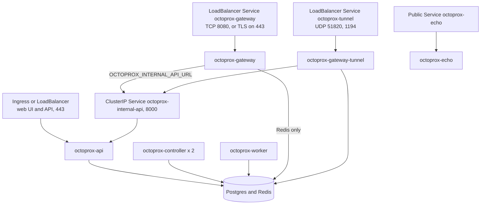

# Running on Kubernetes

<p class="subtitle">One Deployment per role, all from the same image: gateways behind the proxy load balancer, the api behind the web UI, a controller pair and a worker pool, sharing one Postgres and one Redis.</p>

This guide describes the layout and what each piece needs, with manifests to adapt to your own charts. It assumes the [architecture]({{ site.baseurl }}/architecture): every process runs `uvicorn api.main:app` on port 8000, and `OCTOPROX_ROLE` decides what it runs. Pin an image release (`ghcr.io/octoprox/octoprox:6.0.0`, not `latest`) so every role runs the same one.

## Layout

| Deployment | `OCTOPROX_ROLE` | Replicas | Container ports | Notes |
|------------|-----------------|----------|-----------------|-------|
| `octoprox-api` | `api` | 2 or more | 8000 | Web UI, admin API, `/echo`, the internal endpoint gateways call |
| `octoprox-gateway` | `gateway` | 2 or more, autoscaled | 8080 proxy, 8000 probes and metrics | No database credentials |
| `octoprox-gateway-tunnel` | `gateway` | 1 or more, optional | 51820/udp, 1194, 8080, 8000 | Only if you run [WireGuard]({{ site.baseurl }}/wireguard) or [OpenVPN]({{ site.baseurl }}/openvpn) devices |
| `octoprox-controller` | `controller` | 2, small | 8000 probes and metrics | One leads, one stands by: the routing feed and the timers that publish the periodic jobs |
| `octoprox-worker` | `worker` | 2 or more, autoscaled | 8000 probes and metrics | Every job kind, and the sighting and observation ingest |
| `octoprox-echo` | `echo` | 2, optional | 8000 | A public `/echo` apart from the admin API |

Postgres and Redis are yours: a managed service or your own. The names above are suggestions; what matters when you come from 5.x is that they are new names, so the switch deletes the 5.x Deployment and creates these, rather than rolling a 5.x pod into a role (see [Migrating to 6.0]({{ site.baseurl }}/migrating-to-6)).



## Services

- **Web UI and API.** An Ingress or a LoadBalancer Service in front of `octoprox-api` port 8000. No session affinity is needed: every api process reads projects, connectors, proxies and the other entities from Postgres on each request, and the provider catalog and the attribution settings it shows as well, so any replica answers with the latest write. Each api also keeps the custom provider descriptors, the attribution settings and the IP database list in memory for its checks, previews and lookups; those follow a change made through another api as soon as the change stream announces it. Set `OCTOPROX_PUBLIC_URL` on the api to the address users reach it at.
- **Internal.** A ClusterIP Service named `octoprox-internal-api` on port 8000, which gateways use as `OCTOPROX_INTERNAL_API_URL` (`http://octoprox-internal-api:8000`) to fetch IP database files. The internal endpoint (`/internal/v1/...`) requires a token derived from `OCTOPROX_INTERNAL_SECRET`; since only gateways call it, you may also keep `/internal/` off the public Ingress, and `/metrics` too, which Prometheus scrapes from inside the cluster.
- **Proxy.** A LoadBalancer Service (an L4 balancer: AWS NLB, GCP passthrough, Azure LB) on the gateways' port 8080. Point the balancer's target health check at port 8000, path `/ready`: a gateway answers 503 until it has a routing feed, and a gateway is the only role that needs to be checked for proxy traffic. A balancer that terminates TLS in front of 8080 makes it an HTTPS proxy; set `OCTOPROX_PROXY_PUBLIC_URL` on the api to the URL clients use (see [Connecting Clients]({{ site.baseurl }}/connecting#endpoint)).
- **Tunnels.** A LoadBalancer Service for UDP 51820 and UDP or TCP 1194 on the tunnel gateways, with `externalTrafficPolicy: Local` so a device's source address reaches the gateway, and `sessionAffinity: ClientIP` so a device stays on one gateway.
- **Echo.** Health checks and preflight request the echo URL *through* the proxies, from the vendors' exits, so it must be reachable from the internet. Either expose `/echo` on the api's public address, or run the echo role behind a public Service and point `echo_url` (**Settings → IP attribution**) at it. List the balancer's addresses in `geo.echo.trusted_proxies` so the client address is read from `X-Forwarded-For`. Let workers reach the echo URL directly too: a failed health check against an echo that does not answer is not counted (see [Echo endpoint]({{ site.baseurl }}/deployment#echo-endpoint)).
- **Names to avoid.** A Service named `octoprox-api`, `octoprox-proxy` or `octoprox-db` stops every role at start. Kubernetes gives each pod in the namespace variables named after every Service (for `octoprox-api`, `OCTOPROX_API_PORT=tcp://10.0.0.12:8000`), and Octoprox reads one as its own setting when the name matches (`api_port`, `proxy_port`, `db_port`).

## Probes

Every role answers four paths on port 8000 (see [Deployment & Scaling]({{ site.baseurl }}/deployment#health-endpoints)): `/live` while the process serves, `/ready` while it can do its work (503 with the reasons otherwise), `/health` (the same check with the process's identity in the body) and `/metrics`.

The api, controller and worker run the database migrations before they serve, one process at a time through a lock; until a process has migrated and started, it answers nothing at all. Give every Postgres role a `startupProbe` whose budget covers the longest migration you expect, so Kubernetes does not kill a pod that is migrating or waiting for another one to finish. After an upgrade that adds a migration, that can be minutes on a long metrics history.

```yaml
startupProbe:
  httpGet: {path: /live, port: http}
  periodSeconds: 10
  failureThreshold: 60        # 10 minutes for migrations; gateways need far less
readinessProbe:
  httpGet: {path: /ready, port: http}
  periodSeconds: 5
livenessProbe:
  httpGet: {path: /live, port: http}
  periodSeconds: 10
  failureThreshold: 6
```

`/ready` follows what each role depends on: an api turns unready while Postgres is unreachable, a gateway until it has applied a routing feed, loaded the MITM CA and fetched the IP database files the feed lists, a controller or a worker while Postgres or Redis is unreachable. A standby controller is ready; leadership is not readiness. Keep liveness on `/live`, so an outage of Postgres or Redis takes pods out of rotation without restarting them.

## Configuration and secrets per role

Give each role only what it reads. Gateways in particular face the internet and hold no database credentials and no `OCTOPROX_JWT_SECRET`, so a compromised gateway can neither read the database nor mint a sign-in.

| Setting or mount | api | gateway | controller | worker | echo |
|------------------|-----|---------|------------|--------|------|
| `OCTOPROX_ROLE` | `api` | `gateway` | `controller` | `worker` | `echo` |
| Database: `OCTOPROX_DB_*`, `PGSSLMODE`, `PGSSLROOTCERT` | yes | | yes | yes | |
| `OCTOPROX_REDIS_URL`, `OCTOPROX_REDIS_REQUEST_TIMEOUT` | yes | yes | yes | yes | |
| `OCTOPROX_INTERNAL_SECRET` (the same value on each) | yes | yes | yes | | |
| `OCTOPROX_JWT_SECRET`, `OCTOPROX_AUTH_*`, `OCTOPROX_PUBLIC_URL` | yes | | | | |
| `OCTOPROX_PROXY_PUBLIC_URL` | yes | | | | |
| `OCTOPROX_INTERNAL_API_URL` | | yes | | | |
| MITM CA at `/app/data/ca` | certificate | certificate and key | | | |
| Tunnel flags (`OCTOPROX_WIREGUARD_ENABLED`, `OCTOPROX_OPENVPN_ENABLED`), `NET_ADMIN`, `/dev/net/tun` | | tunnel gateways | | | |
| `wireguard.defaults`, `openvpn.defaults` (seed a fresh install) | yes | | | | |
| IP database cache `/app/data/geo`, files listed in `geo.databases` | yes | yes | | yes | yes |
| Cloud identity (IRSA, Pod Identity, Workload Identity) | | | | yes | |
| `OCTOPROX_PROVIDERS_DIR` and provider plugins | yes | yes | yes | yes | |
| `OCTOPROX_RECONCILE_INTERVAL` | yes | yes | yes | yes | |
| Feed compile interval, the periods of the periodic jobs (`health_check_interval`, `ip_refresh_interval`, `metrics_flush_interval`, `geo.updater`) | | | yes | | |
| Health check timeout and concurrency, `OCTOPROX_WORKER_JOBS` | | | | yes | |
| `system.metrics_interval` (and `system.metrics_retention_days` on workers) | yes | | yes | yes | |

- **`OCTOPROX_INTERNAL_SECRET`** encrypts and authenticates the routing feed in Redis and signs the gateways' calls to the api. The controller seals the feed with it, gateways open it and the api checks their calls, so those three need the same value; workers and echo never read it. A gateway with another value cannot read the feed: it logs `Loop cycle failed` for its `feed_follower` loop and stays on what it had (unready, when it had nothing). To rotate it, set the new value on all three and restart them together.
- **Cloud identity** belongs on the workers: the scale job is what launches, watches and terminates cloud instances. The api checks a cloud credential's fields without calling the cloud, and gateways and the controller never call it, so they need no identity (sharing one service account with the workers does no harm). See [AWS]({{ site.baseurl }}/aws-setup), [GCP]({{ site.baseurl }}/gcp-setup) and [Azure]({{ site.baseurl }}/azure-setup).
- **Network egress.** Gateways reach the proxies, and so do workers for health checks and the api for **Detect**; the api and workers reach vendor APIs (credential checks and options on the api, syncs on workers); workers reach the cloud APIs; the api (registering a download URL, **Download now**) and the workers (the hourly `geo_update` job) reach the download URLs of IP databases. The controller reaches nothing but Postgres and Redis. Mounting your own `/app/config` replaces the image's, which also holds `squid_setup.sh`, the start-up script of cloud instances: keep it there for workers.
- **Worker memory.** A worker that runs the `geo_update` job holds an IP database download in memory while it unpacks it: up to 512 MiB, held twice at the peak. Give workers the memory for it, or run `geo_update` on a worker Deployment of its own (`OCTOPROX_WORKER_JOBS=geo_update`) and leave it out of the others' list, so the workers that scale with the pool stay small.
- **`OCTOPROX_INSTANCE_ID`** needs no setting: it defaults to the pod's host name plus a random suffix, which names the pod in logs and on the System page.

## The MITM CA

Gateways sign the certificates of [TLS interception]({{ site.baseurl }}/tls-interception) with one CA, and every gateway must use the same one, since a client trusts one CA whichever gateway serves it. The api serves its certificate for download. A fresh volume makes a gateway generate a CA, which only works when every gateway shares that volume; on Kubernetes, create the CA once and keep it in a Secret:

```bash
openssl genrsa -out octoprox-ca.key 2048
openssl req -new -x509 -key octoprox-ca.key -out octoprox-ca.crt -days 3650 \
  -subj "/O=Octoprox/CN=Octoprox MITM CA"
kubectl -n octoprox create secret generic octoprox-mitm-ca \
  --from-file=octoprox-ca.crt --from-file=octoprox-ca.key
```

The two `openssl` commands are for a new install. Coming from 5.x, keep the CA your clients already trust: create the Secret from your 5.x `octoprox-ca.crt` and `octoprox-ca.key` instead, or name the Secret your 5.x pods mounted at `/app/data/ca` in `secretName` below (see [Migrating to 6.0]({{ site.baseurl }}/migrating-to-6#on-kubernetes)).

Mount the whole Secret at `/app/data/ca` on gateways, and only the certificate on the api:

```yaml
# api
volumes:
  - name: mitm-ca
    secret:
      secretName: octoprox-mitm-ca
      items: [{key: octoprox-ca.crt, path: octoprox-ca.crt}]
```

## Gateways

A gateway Deployment, the pattern for the others:

```yaml
apiVersion: apps/v1
kind: Deployment
metadata:
  name: octoprox-gateway
spec:
  replicas: 2
  selector:
    matchLabels: {app.kubernetes.io/name: octoprox, app.kubernetes.io/component: gateway}
  template:
    metadata:
      labels: {app.kubernetes.io/name: octoprox, app.kubernetes.io/component: gateway}
    spec:
      terminationGracePeriodSeconds: 60
      securityContext:
        fsGroup: 1000
      topologySpreadConstraints:
        - maxSkew: 1
          topologyKey: kubernetes.io/hostname
          whenUnsatisfiable: ScheduleAnyway
          labelSelector:
            matchLabels: {app.kubernetes.io/name: octoprox, app.kubernetes.io/component: gateway}
      containers:
        - name: gateway
          image: ghcr.io/octoprox/octoprox:6.0.0
          env:
            - {name: OCTOPROX_ROLE, value: gateway}
            - {name: OCTOPROX_ENV, value: production}
            - {name: OCTOPROX_INTERNAL_API_URL, value: "http://octoprox-internal-api:8000"}
            - name: OCTOPROX_INTERNAL_SECRET
              valueFrom: {secretKeyRef: {name: octoprox-internal, key: secret}}
            - name: OCTOPROX_REDIS_URL
              valueFrom: {secretKeyRef: {name: octoprox-redis, key: url}}
          ports:
            - {name: proxy, containerPort: 8080}
            - {name: http, containerPort: 8000}
          startupProbe:
            httpGet: {path: /live, port: http}
            periodSeconds: 5
            failureThreshold: 24
          readinessProbe:
            httpGet: {path: /ready, port: http}
            periodSeconds: 5
          livenessProbe:
            httpGet: {path: /live, port: http}
            periodSeconds: 10
            failureThreshold: 6
          lifecycle:
            preStop:
              exec: {command: ["sleep", "20"]}
          resources:
            requests: {cpu: "1", memory: 1Gi}
            limits: {memory: 2Gi}
          volumeMounts:
            - {name: mitm-ca, mountPath: /app/data/ca, readOnly: true}
            - {name: geo, mountPath: /app/data/geo}
      volumes:
        - name: mitm-ca
          secret: {secretName: octoprox-mitm-ca, defaultMode: 0440}
        - name: geo
          emptyDir: {}
```

- **Spread, not anti-affinity.** A topology spread with `ScheduleAnyway` spreads gateways over nodes (add a zone constraint likewise) without leaving a replica pending when there are more gateways than nodes, which a required anti-affinity would.
- **Stopping.** A gateway closes the connections it carries when it stops. The `preStop` sleep keeps it serving while the load balancer stops sending it new connections, so short requests finish; size it to the balancer's deregistration delay, and keep `terminationGracePeriodSeconds` above it.
- **IP database files.** A gateway fetches the files the feed lists from the api into `/app/data/geo` (an `emptyDir` is enough; a shared volume saves the downloads) and stays unready until the first ones are loaded. It retries a file it could not fetch every 30 seconds.
- **CPU.** Each gateway is one process with one event loop: it uses up to about one core, so request one core and scale out rather than up.
- **The others.** The api, controller and worker take the same shape with their own role and the settings from the table above, without the proxy port and the `preStop` sleep, with the longer `startupProbe`, and with the database Secret. The controller and workers need only port 8000.
- **The controller** does little: it compiles the routing feed when a change arrives and publishes the periodic job messages, so give its two replicas small requests. Its memory holds one compile of the definitions, and a compile of 100,000 proxies keeps it busy for a few seconds.
- **Stop grace.** A stopping worker cuts its reads and gives the batches it is running 30 seconds to finish, so a cloud instance being created gets its row; it cancels the rest, which another worker reclaims after the 60-second claim timeout. A create cut short that way (an Azure VM can take longer) keeps its creating entry, as a crash does: scale runs list the connector until the entry is ten minutes old, then terminate the instance unless its row was saved. Keep `terminationGracePeriodSeconds` above 30 on workers, as the 60 shown is. A controller releases its lease as it stops, so its standby leads within about a second.

### Tunnel gateways

Only gateways that terminate WireGuard or OpenVPN need privileges, so run them as a Deployment of their own and keep the main gateways unprivileged. A tunnel gateway sets `OCTOPROX_WIREGUARD_ENABLED=true` and/or `OCTOPROX_OPENVPN_ENABLED=true`, exposes 51820/udp and 1194, and needs:

- `NET_ADMIN` added to its capabilities, without `allowPrivilegeEscalation: false`: the process runs unprivileged and launches the tunnel tools through `setpriv`, which carries the capability as a file capability, and no-new-privileges disables file capabilities. A namespace enforcing the restricted or baseline Pod Security Standard refuses this, so tunnel gateways go in a namespace that allows it.
- `/dev/net/tun` for OpenVPN, and for WireGuard on nodes whose kernel has no WireGuard module: a `hostPath` volume of type `CharDevice`, or a device plugin where your cluster's policy requires one.

Every tunnel gateway accepts every device: the key pair, the CA and the device list reach them all through the feed. A device that moves to another gateway reconnects and is admitted there.

## Redis

Redis is a trusted component of the install: every role but echo reads and writes it, and whoever can write to it can disturb routing. It holds:

- the routing feed, which includes the credentials requests go upstream with (a secret no proxy template reads, such as a vendor account's API token, stays in Postgres) and the tunnels' server keys, encrypted and authenticated with `OCTOPROX_INTERNAL_SECRET`, so it cannot be read or altered without that secret;
- per-key request state (sticky bindings, rate windows, quarantines, preflight verdicts, tunnel fake IPs), counters not flushed yet, and the change, runtime and feed streams;
- the work in hand: each job kind's stream, the preflight sightings and the IP observations, taken by the workers through one consumer group;
- failure examples and MITM captures, which carry the targets and, for intercepted requests, request and response details.

It must be Redis 7.2 or later, and anything between Octoprox and Redis must pass `HELLO` through: every connection opens with `HELLO 3` (RESP3).

So: require a password (`redis://:password@host:6379/0` in `OCTOPROX_REDIS_URL`, kept in a Secret) or an ACL user; restrict who reaches it with a NetworkPolicy that admits only the Octoprox pods; and use TLS (`rediss://`) where your Redis offers it. Persistence is optional: Redis is never the only copy of anything needed to route, and an empty Redis is repaired without a manual step: the controller publishes the feed again, the workers create their groups again and the producers refill the job streams within a period (see [Redis loss and recovery]({{ site.baseurl }}/architecture#redis-loss-and-recovery)). A restart costs at most a minute of request counts and the work that was queued. Every key starts with `o6:`; see [Redis memory]({{ site.baseurl }}/architecture#redis-memory) for what each holds and its bound.

## Postgres

- **Connections.** Each api, controller and worker process keeps a pool of up to 15 connections (5, plus 10 under load), and one more while it migrates at start. Gateways and echo hold none. Budget `max_connections` for the replicas you autoscale to, not the ones you start with.
- **Names.** Each process names its sessions `octoprox-<role>` (`OCTOPROX_DB_APPLICATION_NAME`), so `SELECT application_name, count(*) FROM pg_stat_activity GROUP BY 1` shows what each role costs.
- **TLS.** `PGSSLMODE` and `PGSSLROOTCERT` (with the CA mounted) apply to every connection, migrations included.

## Scaling

| Role | Scale on | How |
|------|----------|-----|
| gateway | CPU, or open transfers | HorizontalPodAutoscaler on CPU (each gateway uses up to one core); or on `octoprox_gateway_in_flight` (open relays, idle tunnel connections included) through the Prometheus adapter or KEDA |
| worker | The length of each work stream it takes | KEDA's Redis Streams scaler, one trigger per stream, `streamLength` at one worker's capacity for the stream |
| api | CPU | HorizontalPodAutoscaler |
| controller | Nothing | Two small replicas, for failover only |
| echo | CPU | HorizontalPodAutoscaler |

Scrape port 8000, path `/metrics`, on every pod: each process exports its own role's metrics, labelled with the role (see [Metrics]({{ site.baseurl }}/metrics#prometheus)). No process exports the work streams' depth: KEDA reads the streams from Redis itself.

**Workers scale on stream length.** Every job kind has a stream of its own, `o6:jobs:<kind>:stream`, and the sightings and observations have `o6:stream:sightings` and `o6:stream:observations`. A stream's length (`XLEN`) counts the entries queued and the ones running, since a worker deletes each entry once it has handled it, so the workers in hand keep their replicas while they work. Set each trigger's `streamLength` to one worker's capacity for the stream, its batch size times its concurrency:

| Stream | One worker's capacity, the threshold |
|--------|--------------------------------------|
| `o6:jobs:health:stream` | 200 at the default 50 probes: about 4 x `health_check_concurrency`, at least 20 |
| `o6:jobs:sync:stream`, `o6:jobs:scale:stream`, `o6:jobs:provision:stream` | 4 |
| `o6:jobs:enrich:stream` | 5 |
| `o6:jobs:reattribute:stream`, `o6:jobs:traffic:stream` | 100 |
| `o6:jobs:metrics_flush:stream`, `o6:jobs:compaction:stream`, `o6:jobs:snapshot:stream`, `o6:jobs:geo_update:stream`, `o6:jobs:tunnel_last_seen:stream`, `o6:jobs:index_hygiene:stream` | 1 |
| `o6:stream:sightings` | 500 |
| `o6:stream:observations` | 5000 |

```yaml
apiVersion: keda.sh/v1alpha1
kind: ScaledObject
metadata:
  name: octoprox-worker
spec:
  scaleTargetRef: {name: octoprox-worker}
  minReplicaCount: 2
  maxReplicaCount: 10
  triggers:
    - type: redis-streams
      metadata: {address: "redis.octoprox:6379", stream: "o6:jobs:health:stream", streamLength: "200"}
      authenticationRef: {name: octoprox-redis-auth}
    - type: redis-streams
      metadata: {address: "redis.octoprox:6379", stream: "o6:jobs:sync:stream", streamLength: "4"}
      authenticationRef: {name: octoprox-redis-auth}
    - type: redis-streams
      metadata: {address: "redis.octoprox:6379", stream: "o6:jobs:traffic:stream", streamLength: "100"}
      authenticationRef: {name: octoprox-redis-auth}
    - type: redis-streams
      metadata: {address: "redis.octoprox:6379", stream: "o6:stream:sightings", streamLength: "500"}
      authenticationRef: {name: octoprox-redis-auth}
    - type: redis-streams
      metadata: {address: "redis.octoprox:6379", stream: "o6:stream:observations", streamLength: "5000"}
      authenticationRef: {name: octoprox-redis-auth}
    # ...and one trigger like these for every other stream the Deployment's workers take
```

- **One `ScaledObject` per worker Deployment, one trigger per stream it takes.** KEDA takes the largest replica count its triggers ask for.
- **Never `lagCount`, and no `consumerGroup` with `streamLength`.** Workers delete entries as they handle them, out of order, and Redis then reports a group's lag as unknown exactly when a backlog builds; the stream's length is the measure.
- **From zero.** KEDA reads Redis itself, so it scales a Deployment up from zero workers. A Deployment that takes only rare kinds (such as `geo_update`, see [worker memory](#configuration-and-secrets-per-role)) can rest at zero; keep the main Deployment's minimum at 1 or more, since an install-wide kind's one entry a period never asks for a replica of its own.
- **Redis access.** The user KEDA connects as needs read access to the keys `o6:jobs:*`, `o6:stream:sightings` and `o6:stream:observations`.
- **Producers do not burst.** The controller publishes each key of a periodic kind once per period, spread over the period, and after a stall it catches up on five seconds of keys at most, so a controller that froze for a minute never asks for a hundred workers.

`OCTOPROX_WORKER_JOBS` splits workers by kind: a Deployment with `OCTOPROX_WORKER_JOBS=health` scaled on the health stream, and one with the other kinds, so a burst of health checks never holds up syncs and scaling. Every job kind needs at least one worker taking it: the System page says so on a stream with entries queued and no live worker taking it.

Add PodDisruptionBudgets so a node drain never takes the last of a role: `maxUnavailable: 1` for gateways, workers and the api, `minAvailable: 1` for the controller.

## Upgrades

A rolling update of each Deployment keeps the install serving: gateways leave the balancer one at a time, the controller hands its lease over within a second of a clean stop (periodic job messages pause for that second, and work asked for now goes on), and a stopping worker leaves what it could not finish to be reclaimed by another (see the stop grace above). The first Postgres role of a new release to start runs its migrations, one process at a time through the migration lock. A process of the older release that starts after that finds a schema revision it does not know and does not start, so let a roll finish rather than restarting the old pods.

The upgrade from 5.x is not rolling: one release deletes the 5.x Deployment and creates the 6.0 ones, a short downtime; see [Migrating to 6.0]({{ site.baseurl }}/migrating-to-6#on-kubernetes). Leave `--atomic` off that release: once 6.0 has migrated the database, 5.x starts on it only after its schema version is set back to 047, so a failed release is rolled back by hand, the version first ([the way back]({{ site.baseurl }}/migrating-to-6#the-way-back)).
