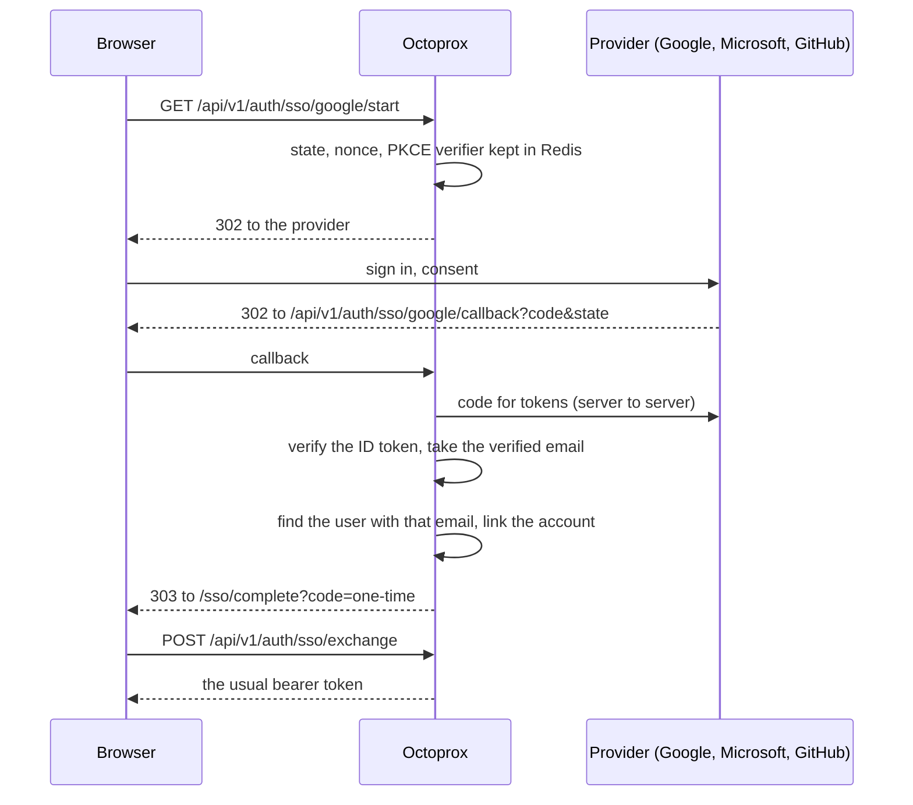

# Single Sign-On and API Tokens

<p class="subtitle">The people you have added sign in with the Google, Microsoft or GitHub account they already have. Scripts authenticate with a token instead of a password. Octoprox Enterprise lets your directory decide who gets in and with which role.</p>

Octoprox has three ways into the management API and the dashboard. Every one of them ends in the same bearer token and the same three roles (admin, editor, viewer), so nothing downstream cares which was used.

| Way in | Who it is for | Where it is set up |
|---|---|---|
| Username and password | Anyone the admin added with a password or an invite link | Settings, Users |
| Sign in with Google, Microsoft or GitHub | Anyone the admin added with the email they use at that provider | Settings, Sign-in |
| Personal access token | Scripts, CI jobs and API clients, acting as a user or a service account | Settings, Account (or the user's inspector, for an admin) |

Proxy traffic on port 8080 is unrelated: proxy clients authenticate with a project's credentials, which have nothing to do with who may open the dashboard.

## Sign in with a provider

### How it works



Two rules make this safe:

- **Nobody self-registers.** A sign-in succeeds only when the provider vouches for an email address that belongs to an existing, active user. The user table is the allowlist. There is no "sign up" and there is nothing for a stranger with a Google account to click into.
- **Only an email the provider has verified counts.** Google must mark the address verified. Microsoft sign-in is pinned to one Entra tenant, where addresses are set by that tenant's admins, never to the multi-tenant endpoints that admit any Microsoft account. GitHub is asked which addresses it has verified and the primary one is used, not whatever is shown on the profile.

The first successful sign-in links the provider account to the user: Octoprox stores the provider's stable id for the account, not the email. From then on the link is what signs the person in, so a changed email at the provider does not create a stranger, and the user's own email in Octoprox can be edited freely. A user may have one linked account per provider; linking a second one at the same provider is refused.

Every api process in a cluster shares the per-login state through Redis, so a login that starts on one and returns on another completes normally.

### Setting it up

1. **Set the public URL.** Each provider must be told where it may send the browser back to, and that address has to be the one users reach Octoprox at. Behind a load balancer or reverse proxy the request's own address is wrong, so set `OCTOPROX_PUBLIC_URL` (for example `https://proxy.example.com`, no trailing slash). The Sign-in page shows the redirect URI it derives; if that shows an internal address, fix the public URL first. The same setting is used for invite links.
2. **Register an OAuth client with the provider**, with the redirect URI from the Sign-in page:
   - **Google:** Google Cloud Console, APIs & Services, Credentials, create an OAuth client ID of type Web application. Add the redirect URI under Authorised redirect URIs. If the consent screen is in testing, add your users as test users or publish it.
   - **Microsoft:** Microsoft Entra admin center, App registrations, New registration. Under Supported account types pick accounts in this organisational directory only. Add a Web platform with the redirect URI. Create a client secret under Certificates & secrets. Note the Application (client) ID and the Directory (tenant) ID from the overview.
   - **GitHub:** Settings, Developer settings, OAuth Apps, New OAuth App (or under your organisation's settings). Put the redirect URI in Authorization callback URL. Generate a client secret.
3. **Paste the client ID and secret** into Settings, Sign-in, under the provider. Microsoft also needs the tenant ID. The secret is stored and never shown again; typing a new one replaces it. Tick the box to show the button on the login page and save.
4. **Add the people** under Settings, Users, with the email they use at the provider. Case does not matter: addresses are stored lowercase, and an address can belong to only one user. An invite link or a password is optional: a user whose email matches can click "Continue with Google" straight away. The Users table shows what each person signs in with.

Enabling a provider changes nothing for anyone who already has a password. Both ways in stay available side by side, and a person can use either.

### Adding a password later

A person who signs in through a provider has no password until they want one. They set it under Settings, Account: with no password on the account there is no current password to ask for, the provider session is what proves who they are. From then on the password and the provider are two ways into the same account, and changing the password asks for the current one as usual. An admin can also set a password on the user's row or send a set-password link from the Users table. Neither is possible from a session authenticated by an API token.

### Linking and unlinking

Settings, Account lists the provider accounts linked to you and lets you unlink one. An admin sees and manages the same under the user's inspector in Settings, Users. Unlinking does not end sessions that are already open, and signing in with that provider again relinks it as long as the verified email still matches.

Disabling a user ends every way in at once: password, provider sign-in and tokens. Deleting a user removes their linked accounts and tokens with them. Both travel with the user in a [backup]({{ site.baseurl }}/api#backup--migration), as do the provider settings themselves.

### What a failed sign-in says

The login page shows why a sign-in through a provider did not complete:

| Message | Cause |
|---|---|
| No Octoprox account has the email ... Ask an admin to add you | The provider vouched for an address no user has. Add the user, or fix the email on their row. |
| Your account is disabled | The user exists but is inactive. |
| Your Octoprox account is already linked to a different ... account | The user has another account at that provider linked. Unlink it first. |
| Your ... account has no verified email address | The provider would not vouch for any address. On GitHub, verify the primary email. |
| Your Microsoft account is not in this organisation's tenant | The person signed in with an account outside the configured tenant. |
| This sign-in attempt has expired. Please try again | More than ten minutes passed, or the state was already used. |
| This sign-in attempt did not start in this browser | The callback arrived without the cookie the start leg set: the link was opened in another browser, or cookies are blocked for the Octoprox host. |
| You cancelled the sign-in | The person pressed cancel at the provider. |

The server log has the specific reason behind each one, with the provider's subject id, never the error text the browser sees.

## Personal access tokens

A token lets a script call the API as a user without a password and without the browser round trip, which also makes it the way in for anyone who signs in through a provider.

- **Create one** under Settings, Account, API tokens. Give it a name (what will use it) and an expiry: 30 days, 90 days, a year, or never. The secret is shown once; copy it then. Octoprox keeps only a hash.
- **Send it** as a bearer token, exactly like the token the login endpoint returns:

  ```bash
  curl -H "Authorization: Bearer octo_..." https://proxy.example.com/api/v1/projects
  ```

- **It acts as the user is right now.** The role and the active flag are read from the user on every call, so a role change takes effect immediately and disabling the user ends the token at once. This is unlike a session token from a password login, which carries its role until it expires.
- **Revoke it** from the same list. The next call made with it gets 401. A token cannot create other tokens: something that leaked one should not be able to breed replacements that outlive its revocation.
- **Service accounts.** For automation that should not run under a person's identity, an admin adds a user with no password and no email (an invite that is never used, or any account), and issues it a token from the user's inspector under Settings, Users. The admin's name is recorded on the token. Give the account the lowest role that does the job; a viewer token can read everything and change nothing.

The Users inspector shows every token a person holds, when each was last used and when it expires, so an admin can confirm nothing outlives a departure.

A token starts with `octo_`, which is how the API tells it from a session token and how secret scanners can match the format.

## Octoprox Enterprise

The sign-in above is for teams whose admin adds each person by hand. Octoprox Enterprise hands that control to your directory. It is a licensed add-on, enabled by a license key entered under Settings, System, and it builds on the same sign-in engine; nothing in a project changes.

### Domain rules

Instead of adding every person, an admin writes rules under Settings, Sign-in, Enterprise: everyone whose verified email is at `@example.com` may sign in and gets a user on first login, with a default role per rule. Individual emails can still be listed, with their own role, and an email rule wins over a domain rule. Google domain rules check the hosted-domain claim, so an `@example.com` address that is not a Workspace account of that domain does not match.

### Your own identity provider

Any OpenID Connect provider (Okta, Entra ID, Auth0, Keycloak, Ping, Google Workspace, and others) is configured with its issuer URL, client ID and secret; discovery fills in the rest. Any SAML 2.0 provider (ADFS, Shibboleth, PingFederate, and the SAML side of Okta and Entra) is configured from its metadata XML or URL, and Octoprox publishes its own service-provider metadata at `/api/v1/auth/sso/saml/metadata` for the IdP to import. Several providers can be enabled at once, each with its own button and its own rules. The SAML signing key pair and certificate belong to the install and are shared by every api process.

### Group sync

Each provider can map directory groups (an OpenID Connect `groups` claim, a SAML attribute, or Entra app roles) to Octoprox roles: `octoprox-admins` to admin, `engineering` to editor, everyone else to viewer. The mapping is re-evaluated on every sign-in, so removing someone from a group demotes them the next time they sign in, and sessions started through the IdP are issued with a shorter lifetime so the change lands within the hour.

### Enforcement

With enforcement on, password sign-in is refused for every user except those marked as break-glass admins, and the login page shows only the provider buttons. Octoprox refuses to turn enforcement on while it would leave no active break-glass admin, and a break-glass admin always keeps a "Sign in with password" link. Session lifetime can be taken from the IdP's own assertion rather than the fixed expiry.

### Provisioning

A SCIM 2.0 endpoint lets Okta, Entra and other directories create, update and deactivate users directly, so a leaver loses access the moment the directory says so, without waiting for a sign-in that would never happen. Deactivation through SCIM ends the user's sessions, linked accounts and tokens together.

### Audit log

Every sign-in (which way, from where, which provider), every token issued, used for the first time or revoked, and every change to a provider or a rule is recorded with the actor and the request id, kept for a configurable period, visible under Settings, System, Audit, and exportable as JSON lines for a SIEM.

### Getting a license

A license names the organisation, an expiry and the number of seats. It is verified offline, so nothing phones home, and the organisation's name is shown on the login page. After expiry everything keeps working for a grace period with a banner, then provider sign-in through the Enterprise features stops and the free sign-in and password paths remain, so nobody is ever locked out. To obtain one, contact the Octoprox authors through the project's GitHub repository.

## Reference

- Settings: `OCTOPROX_PUBLIC_URL` in [Configuration]({{ site.baseurl }}/configuration).
- API: the sign-in, provider and token endpoints in the [API reference]({{ site.baseurl }}/api#authentication).
- Redis keys `o6:sso:state:*` (ten minutes) and `o6:sso:login_code:*` (one minute) are the only state a sign-in keeps outside the database. The browser carries the same state in a short-lived cookie (`octoprox_sso_state`, scoped to the sign-in endpoints) so a callback can only complete in the browser that started it. An `o6:sso:login_code:*` entry is named by a digest of the one-time code and holds the token sealed with a key drawn from the code, so reading Redis yields no sign-in.
